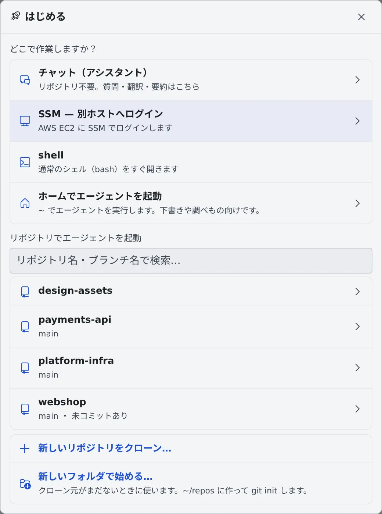
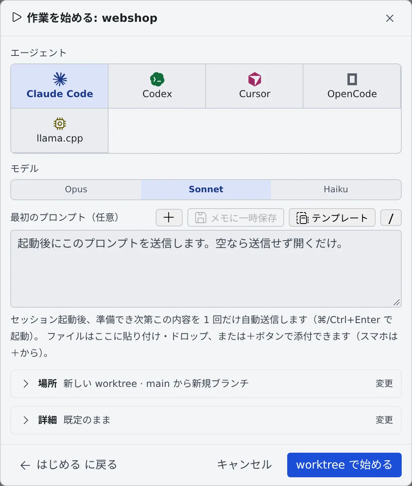

# セッションを始める

[English](start.md) | 日本語

「**はじめる**」から、リポジトリやホームでエージェントを起動したり、チャットや shell を開いたりできます。
セッションは、エージェントに任せる仕事 1 つ分の会話・作業場所・実行状態をまとめたものです。

## 全体像

| あなたがやること | エージェントがやること |
|---|---|
| 「はじめる」で、どこで作業するかを選ぶ | 選んだ場所（リポジトリの作業コピーやホーム）で起動する |
| エージェント・モデル・最初のプロンプトを決めて起動する | 最初のプロンプトを受け取って、作業を始める |
| 返事が要るときに答える | 質問・許可・プランで止まって、あなたを待つ |

セッションは左ペインの「**リポジトリ**」で作業コピーの下に並び、リポジトリに属さないものは「**その他のセッション**」に並びます。
いくつでも並行して持てて、それぞれが別々の会話と作業フォルダを持ちます。

## 「はじめる」で場所を選ぶ

ワークスペース操作バーの「**＋ はじめる**」を押すと、「**はじめる**」の画面が開きます。

| 選ぶもの | 起きること |
|---|---|
| チャット（アシスタント） | リポジトリを使わないチャットを始めます。質問・翻訳・要約向けです（[アシスタントに質問する](../chat/assistant.ja.md)） |
| SSM — 別ホストへログイン | EC2 に SSM でログインします。SSM のプロファイルがあるときだけ出ます（[SSM で EC2 にログインする](../integrations/aws-ssm.ja.md)） |
| shell | 押すとすぐ、ふつうのシェル（bash）が開きます |
| ホームでエージェントを起動 | ホーム（`~`）でエージェントを動かします。下書き・調べもの・使い捨ての作業向けです。リポジトリと同じ「作業を始める」ダイアログが開きます（画像やファイルも添付できます）。worktree やブランチの選択はありません |
| リポジトリでエージェントを起動 | クローン済みのリポジトリを検索して選ぶと、「**作業を始める**」に進みます |
| 新しいリポジトリをクローン… | 接続から選ぶか URL を入れてクローンし、終わるとそのまま「作業を始める」に進みます |
| 新しいフォルダで始める… | クローン元がまだないときに使います。`~/repos` にフォルダを作って `git init` し、そこで始めます |

- 左ペインのリポジトリの行の「**起動**」からも、同じ「作業を始める」が開きます
- 「作業を始める」の左下の「**はじめる に戻る**」（またはブラウザの戻る）で、1 つ前に戻れます

> [!TIP]
> ワークスペースが止まっていても「はじめる」は押せます。「**ワークスペースを起動してはじめる**」で「**起動する**」を押すと、
> 準備ができしだい「はじめる」の画面が自動で開きます。

## 「作業を始める」で起動する

1. 「**エージェント**」で、使うエージェントを選びます
2. 「**モデル**」を選びます
3. 必要なら「**最初のプロンプト（任意）**」に指示を書きます。起動して準備ができたら、1 回だけ自動で送られます。空なら送らずに開くだけです
4. 「**場所**」と「**詳細**」は、畳んだまま中身の要約が出ています。変えるときだけ「**変更**」を押します
5. 「**worktree で始める**」（このコピーで直接始めるときは「**起動**」）を押します

最初のプロンプトの欄では、次のこともできます。

- ファイルを貼り付け・ドロップするか、「**＋**」で添付する
- 「**テンプレート**」で、保存しておいた文面や過去に送ったプロンプトを入れる
- 「**メモに一時保存**」で、書きかけの内容と添付をメモキューに退避します。メモの「**この内容で始める**」で戻せます

### 場所

既定では、セッションごとに新しい worktree（専用の作業コピー）を作って、そこで起動します。
ブランチの決め方や、リポジトリの中のフォルダで起動する方法は [worktree で並行して作業する](worktrees.ja.md) にあります。

### 詳細

選んだエージェントが対応している項目だけが出ます。

| 項目 | 決めること |
|---|---|
| 実行方式 | マネージド（推奨）か ターミナル（CLI）か（[実行方式を選ぶ](#実行方式を選ぶ)） |
| モデルのルート | モデル呼び出しの行き先と、課金されるアカウント。ターミナル（CLI）で起動するときだけ出ます（[Amazon Bedrock のルート](../../ref/bedrock-route.ja.md)） |
| 推論 effort | 未指定のときは、モデルの既定になります |
| 開始モード | 「Plan」にすると、最初のターンを調査と計画に使います |
| 権限確認 | 「スキップする（既定）」か「毎回たずねる」。たずねると、編集やコマンドの前に許可待ちで止まります |
| セッション名 | 空欄なら、リポジトリ名と日時から自動で決まります |
| 予算（米ドル） | 推定の費用がこの額に達すると、ターンの終わりに止めます。0 なら予算なしです |

## セッションの種類

「はじめる」に並ぶのは、接続済みのエージェントと shell です。エージェントの接続は [エージェントを選ぶ](../agents/choose.ja.md) にあります。

| 種類 | 起動するもの |
|---|---|
| claude | Claude Code |
| codex | Codex |
| cursor | Cursor（Cursor のプランが必要です） |
| copilot | GitHub Copilot（GitHub の接続をそのまま使います） |
| kiro | Kiro |
| agy | Antigravity（試験的な対応です） |
| opencode | OpenCode |
| lcpp | ワークスペースの llama.cpp エンジン。ログインは要りません。⚙設定 →「エージェント」の「**llama.cpp を使う**」がオンのときだけ並びます |
| muse | Muse Code。導入してログインすると並びます |
| shell | ふつうのシェル（bash） |

種類ごとにできることの一覧は [エージェント — 種類ごとにできること](../../ref/agents.ja.md) にあります。

## 実行方式を選ぶ

マネージドとターミナル（CLI）の両方に対応する種類では、「詳細」の「**実行方式**」で選べます。会話の保存先や作業フォルダは、どちらでも同じです。

| 実行方式 | 向いているとき |
|---|---|
| マネージド（推奨） | ふだんの作業。チャットで操作し、ターミナルはありません。Codex と OpenCode はセッションごとの CLI を動かさないので、メモリが少なくて済みます |
| ターミナル（CLI） | CLI 固有の画面やコマンドを使いたいとき。セッションごとに CLI を起動するので、その分メモリを使います |

- 新しいセッションは、既定ではマネージドで始まります
- GitHub Copilot・Cursor・Kiro は、マネージドでもセッションごとにプロセスを動かします。メモリはターミナル（CLI）と変わりません
- lcpp と muse は、いつもマネージドで動きます
- ターミナル（CLI）の画面は、ブラウザを閉じてもバックグラウンドで動き続けます

### あとから切り替える

エージェントが処理中でなければ、セッションの「⋯」メニューの「**マネージドに切り替え**」「**ターミナル（CLI）に切り替え**」で切り替えられます。
会話はそのまま引き継がれます。

> [!NOTE]
> codex をターミナル（CLI）に切り替えられるのは、セッションを止めているときだけです。止めてから 1 分ほどは
> 切り替えもターミナル（CLI）での再開も断られるので、少し待ってからやり直してください。

## タイトルとブランチ名を変える

どちらも、セッションの「⋯」メニュー（右クリックでも開きます）から変えます。

| メニュー | できること |
|---|---|
| タイトルを変更 | 一覧に出る名前を変えます。空のまま保存すると、自動の名前に戻ります |
| ブランチ名を変更 | worktree で動いているセッションだけに出ます。その worktree のブランチの名前を変えます。フォルダとセッションはそのままです |

- どちらも「**AI に提案してもらう**」で会話から案を出させ、「**この案にする**」で採用できます。課題から始めたセッションでは、課題のキーや番号が残ります
- ブランチ名の接頭辞は、リポジトリのブランチ命名規則にあるもの（既定は `feature/` `fix/` `hotfix/` など）からボタンで付け替えられます。規則から外れた名前には注意が出るだけです
- 暫定名（`temp/…`）で始めたセッションに、あとから意味のある名前を付けるのに使います

同じメニューの「**レポ {name} のメニュー**」は、そのセッションが属するリポジトリのメニューを開きます。コミットやブランチの切り替えにすぐ行けます。

## チームの既定から始める

テナント管理者が起動の既定値を決めていると、ダイアログはその値が入った状態で開きます。対象は、チームのエージェント・モデル・実行方式・権限確認・予算です。**はじめる** の一覧では、チームのリポジトリが「チーム」の印付きで先頭に並びます。

- 自分の選択が優先されます。そのリポジトリで最後に選んだ値と、⚙設定 →「エージェント」の値が、チームの既定より先に使われます。ただし、設定の値が Agent Fleet の組み込みの値と同じなら「未設定」として扱われます。その値をチームの既定より優先したいときは、**自分の既定にする** で保存してください
- 「詳細」の **自分の既定にする** を押すと、ダイアログのいまのエージェント・モデル・実行方式・権限確認・予算を、そのエージェントを始めるときの初期値として保存できます。モデルはそのエージェントにだけ効きます。モデルや予算を空にすると「未設定」になり、チームの値が使われます。サーバーが受け付けない値（チームの一覧にないエージェント、$10000 を超える予算）のときはボタンが押せなくなり、理由が出ます。**自分の既定を解除** でチームの既定に戻ります。設定そのものは変わりません
- 既定は、Agent Fleet が最後に返した内容をブラウザに保存して使います。そのため、ワークスペースが止まっていても、Agent Fleet に接続できなくても使われます

## 困ったとき

### 「使用できるエージェントがありません」と出る

接続済みのエージェントがありません。⚙設定 の「接続」で、エージェントにログインしてください（[エージェントを選ぶ](../agents/choose.ja.md)）。

### codex をターミナル（CLI）に切り替えられない

「codex のセッションは停止してからターミナル（CLI）に切り替えてください（停止から 1 分ほどで切り替えられます）。」と出たら、セッションを止めて、1 分ほど待ってから切り替えます。

## 関連

- [worktree で並行して作業する](worktrees.ja.md)：場所とブランチの決め方
- [Issue やチケットから始める](from-issues.ja.md)：課題管理の一覧からセッションを始める
- [セッションの状態を読む](status.ja.md)：一覧の印と通知
- [セッションに返事をする](reply.ja.md)：起動したセッションとのやり取り
