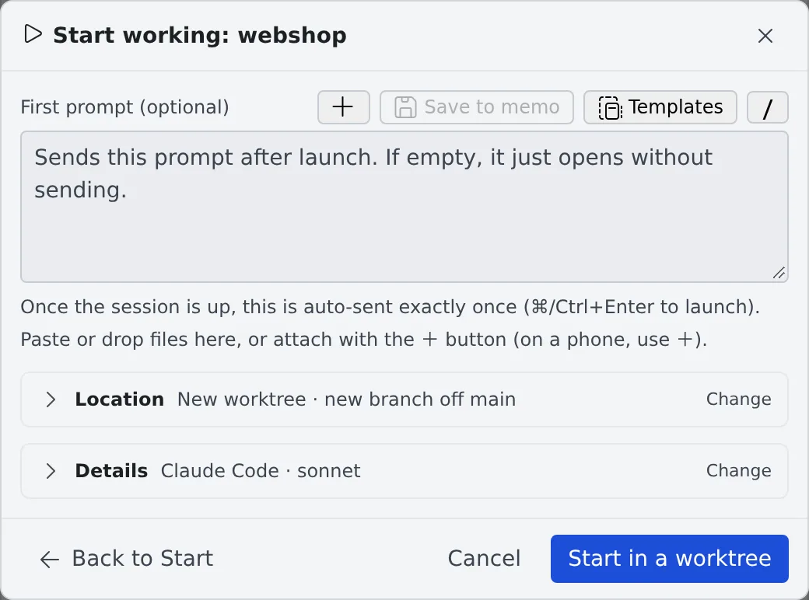

# Start a session

English | [日本語](start.ja.md)

From **Start** you can launch an agent in a space, in a repository or in your home folder, or open a shell.
A session is one piece of work handed to an agent: its conversation, its working place and its running state.

## How it works

| What you do | What the agent does |
|---|---|
| Choose where to work in Start | Starts in the place you chose (a new space, a repository's working copy, or home) |
| Write a first prompt, check the agent, route and model under it, then launch | Takes the first prompt and starts working |
| Answer when a reply is needed | Stops at a question, a permission request or a plan, and waits for you |

Sessions are listed in the Sessions view of the left pane under **Repositories**, below their working copy; sessions in a
space are under **Spaces**, and the ones that belong to neither are under **Other sessions**. Shells and SSM sessions are in the **Terminals** view ([Find your shells and SSM sessions](terminals.md)). You can have as many as you like at once, each with its own conversation and working folder.

## Pick a place in Start

Press **＋ Start** on the workspace action bar to open the **Start** screen. It has three sections, and one of them is
open at a time. Start opens on the section you used last; the very first time, that is **Start in a space**.

| Section | What it holds |
|---|---|
| Start in a space | Starts an agent in a new folder of its own under `~/spaces`, straight from this screen ([Start work in a space](spaces.md)) |
| Start in a repository | Search for a cloned repository and pick it to go on to **Start working**. Team repositories come first |
| Other | Launch an agent in home, shell, SSM, Clone a new repository… and Start in a new folder… |

**What would you like done?** is shown in every section, and it is one draft: switching sections keeps the text and the
attached files. Picking a repository takes them into **Start working**; in **Other**, only **Launch an agent in home**
uses them. The draft lasts until you close Start.

| Row in Other | What happens |
|---|---|
| Launch an agent in home | Runs an agent in home (`~`), for drafts, research and throwaway work. It opens the same Start working dialog as a repository (images and files can be attached), without the worktree and branch choices |
| shell | Opens a plain shell (bash) right away |
| SSM — log in to another host | Logs in to EC2 over SSM. Shown only when you have an SSM profile ([Log in to EC2 with SSM](../integrations/aws-ssm.md)) |
| Clone a new repository… | Clone from a connection or a URL; when it finishes you go straight on to Start working |
| Start in a new folder… | For when there is nothing to clone from yet: creates a folder under `~/repos`, runs `git init` and starts there |

- **Launch** on a repository row in the Sessions view opens the same Start working dialog
- **Back to Start** at the bottom left of Start working (or the browser's back) takes you one step back
- A chat with an assistant starts from the **Assistants** view ([Ask an assistant](../chat/assistant.md))

> [!TIP]
> Start works while the workspace is stopped too. Press **Start** in **Start the workspace and begin**, and the Start
> screen opens by itself as soon as the workspace is ready.

## Launch from Start working

The dialog asks what, then with what, then where, then the details.

1. If you want, write an instruction in **First prompt (optional)**. It is sent once, automatically, as soon as the session is ready. Left empty, the session just opens
2. Check the **run-with strip** under the prompt ([Run with](#run-with)): the agent, the model route and the model
3. **Location** shows where the session will run: a new worktree by default. Press **Change** only to change it
4. **Details** summarises every setting the launch will use, defaults included (for example "effort default · Normal start · Approvals skipped"). Press **Change** to change any of them ([Details](#details))
5. Press the launch button. It names what will run, for example **Start in a worktree with Claude Code · Opus**
   (**Start with Claude Code · Opus** when you start directly in this copy)

The last agent you used in the repository, and the last model you used with that agent in that repository, are chosen already, so most launches need only the
prompt. Details stays open next time once you open it. It opens by itself only when something there stops the launch, such as a budget that is not a valid amount. A problem with the
agent, route or model is explained in the strip instead.

When no agent can be listed, the dialog says why in one line: **No model route is available to you. Ask your
administrator.** when your organisation allows no route, or **You have switched off every agent.** with **Reset my
settings** when your own switches in ⚙ Settings → Agents turned them all off.

The first prompt box also lets you:

- paste or drop files, or attach them with **＋**
- insert saved text or a prompt you sent before with **Templates**
- move what you have written, with its attachments, into the memo queue with **Save to memo**. **Start with this** on the memo brings it back

### Run with

The strip under the first prompt shows which agent, route and model the launch will use. It has two lines: the one you
change rarely, and the one you change with almost every prompt.

| Part | What it does |
|---|---|
| Agent chip (icon and name) | Opens the agent tiles. Picking another agent swaps the model row to that agent's models |
| Route chip (**Route: default**) | Shown for an agent that can run on more than one route. Opens the route choices with their explanation. A route other than the default (an API key, Bedrock, a route your organisation provides) is shown in an accent colour, because the billed account changes. This includes a route you saved as your default in ⚙ Settings → Agents: the accent marks a route other than the plain default, not a change you made in this dialog. Your default route (⚙ Settings → Agents) is already chosen when it can be used now. A route marked "no credential yet" can be picked once its key or login is added in ⚙ Settings → Model credentials. Only the routes your organisation allows are listed ([Amazon Bedrock route](../../ref/bedrock-route.md)) |
| Model row | For Claude Code and the other agents with a fixed model list: one single-choice row of the agent's aliases (Fable, Opus, Sonnet and Haiku for Claude Code), a divider, then the up to 3 registered models you launched with most recently for this agent, and **+N** for the rest. Exactly one button is active. Picking from **+N** puts that model in the row. The common `claude-` prefix is dropped from labels; the tooltip has the full id. An agent whose models come from a live catalogue (Codex and OpenCode, for example) shows a searchable model picker instead, with no recent models. On a Bedrock route that takes a Bedrock model id, the row is replaced by a Bedrock model field |

- The agent, then the route, then the model narrow from left to right. When the agent or route changes and the chosen model cannot be used there, it is dropped and the strip says so. The model goes back to the agent's default, except on a route that needs a model of its own (OpenCode on Bedrock, for example): the launch cannot start until you pick one
- When the launch needs a route choice (no usable default route, a route model to pick, a Bedrock region or model), it cannot start until you make it, and the route chip says why
- The recent models are kept in your browser for each agent, not for each repository, so the row does not start empty in every repository. The route is not remembered: it is the default each time
- On a narrow screen, line 1 becomes one chip (agent and route) and line 2 becomes one model button

### Location

By default each session gets a new worktree (its own working copy) and starts there.
How to choose the branch, and how to start inside a folder of the repository, is in [Work in parallel with worktrees](worktrees.md).

### Details

The agent, route and model are in the [run-with strip](#run-with), not here. Only the items the chosen agent supports are shown.

| Item | What it decides |
|---|---|
| Execution method | Managed (recommended) or Terminal (CLI) ([Choose the execution method](#choose-the-execution-method)) |
| Reasoning effort | Left unset, the model's default applies |
| Start mode | "Plan" spends the first turn on research and a plan |
| Tool permissions | "Skip approvals (default)" or "Ask every time". When it asks, the agent stops for approval before edits and commands |
| Session name | Left empty, a name is made from the repository name and the time |
| Budget (USD) | When the estimated cost reaches this amount, the session stops at the end of the turn. 0 means no budget |

## Session types

Start lists the agents you have connected, and shell. Connecting an agent is in [Choose an agent](../agents/choose.md).

| Type | What it starts |
|---|---|
| claude | Claude Code |
| codex | Codex |
| cursor | Cursor (needs a Cursor plan) |
| copilot | GitHub Copilot (uses your GitHub connection) |
| kiro | Kiro |
| agy | Antigravity |
| opencode | OpenCode |
| lcpp | The workspace's llama.cpp engine. No login needed. Listed only while **Use llama.cpp** is on in ⚙ Settings → Agents |
| muse | Muse Code. Listed once it is installed and signed in |
| shell | A plain shell (bash) |

What each type can do is listed in [Agents — what each kind can do](../../ref/agents.md).

## Choose the execution method

For a type that supports both Managed and Terminal (CLI), choose under **Execution method** in More. The conversation and
the working folder are the same either way.

| Execution method | When to use it |
|---|---|
| Managed (recommended) | Everyday work. You work in the chat; there is no terminal. Codex and OpenCode run no CLI per session, so they use little memory |
| Terminal (CLI) | When you need the CLI's own screens or commands. A CLI is started for each session, which costs memory |

- New sessions start Managed by default
- GitHub Copilot, Cursor and Kiro run a process per session even when Managed, so they use as much memory as Terminal (CLI)
- lcpp and muse always run Managed
- A Terminal (CLI) screen keeps running in the background after you close the browser

### Switch later

While the agent is not working, switch with **Switch to managed execution** or **Switch to terminal execution** in the
session's ⋯ menu. The conversation carries over.

> [!NOTE]
> A codex session can be switched to Terminal (CLI) only while it is stopped. For about a minute after the stop, both the
> switch and a resume in Terminal (CLI) are refused; wait a moment and try again.

## Rename a session or its branch

Both are in the session's ⋯ menu (right-click opens it too).

| Menu item | What it does |
|---|---|
| Rename | Changes the name shown in the list. Saving it empty goes back to the automatic name |
| Rename the branch | Shown only for a session running in a worktree. Renames that worktree's branch; the folder and the session stay as they are |

- In both, **Ask AI to suggest** proposes a name from the conversation and **Use this** takes it. For a session started from an issue, the issue's key or number is kept
- The branch prefix can be swapped with buttons for the ones in the repository's branch naming rules (by default `feature/`, `fix/`, `hotfix/` and so on). A name outside the rules only gets a warning
- Use it to give a meaningful name to a session started under a temporary name (`temp/…`)

**Menu of repository {name}** in the same menu opens the menu of the repository the session belongs to, one step away from
committing or switching branches.

## Start from your team's defaults

If your tenant administrator set launch defaults, the dialog opens with them filled in: the team's agent, model, execution method, permission prompts and budget. **Start** lists the team's repositories first, marked "Team". A team repository you have not cloned yet is listed there too; pick it to clone it and continue. It is offered only when exactly one of GitHub and Bitbucket is connected for you, because that decides where it is cloned from. With both connected, or neither, clone it with **Clone a new repository…** instead.

- Your own choices win. The last choice in a repository and the values you set in ⚙ Settings → Agents are used before the team's. A Settings value that equals Agent Fleet's built-in one counts as not set, so to keep such a value against a team default, save it with **Use as my default**
- Under **More**, **Use as my default** saves the dialog's current agent, model, execution method, permission prompts and budget as your starting point whenever you start that agent. The model applies to that agent only. A model or budget you leave empty is not set, so the team's value is used. A value the server would refuse (an agent outside the team list, a budget over $10000) disables the button and says why. **Clear my default** puts the team's back. Your Settings are not changed
- The defaults are kept in your browser from the last time Agent Fleet answered, so they still apply while your workspace is stopped or Agent Fleet cannot be reached

## When it goes wrong

### "No agents available" appears

No agent is connected. Sign in to one under Connections in ⚙ Settings ([Choose an agent](../agents/choose.md)).

### A codex session will not switch to Terminal (CLI)

When it says "Stop this codex session first, then switch it to terminal execution (about a minute after the stop).", stop the session, wait about a minute,
and switch.

## Related

- [Start work in a space](spaces.md): a place of its own for work that has no repository
- [Work in parallel with worktrees](worktrees.md): choosing the location and the branch
- [Start from an issue or a ticket](from-issues.md): starting a session from the issue tracker list
- [Read a session's state](status.md): the row marks and notifications
- [Reply to a session](reply.md): working with a session once it is running
