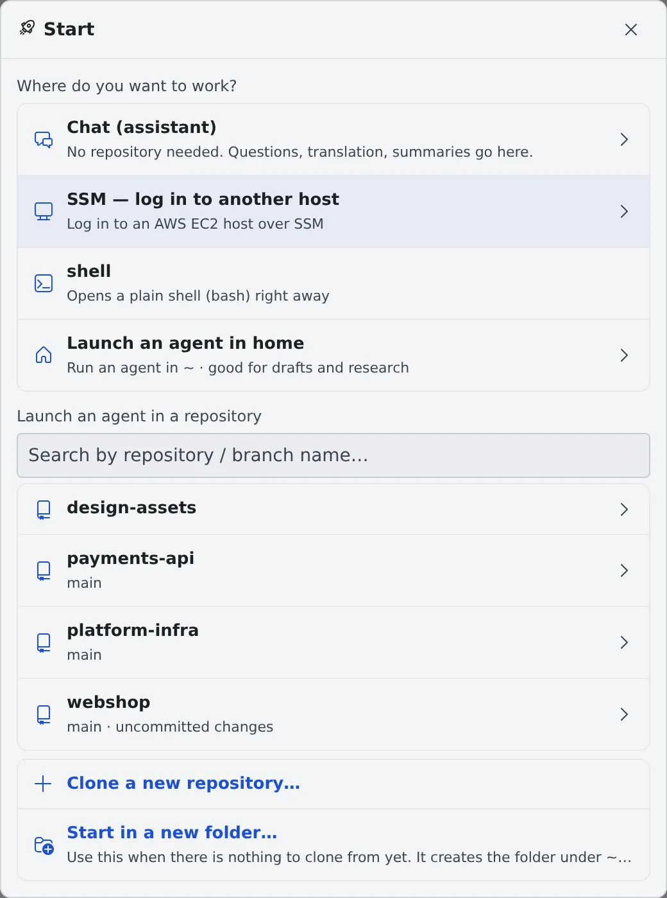
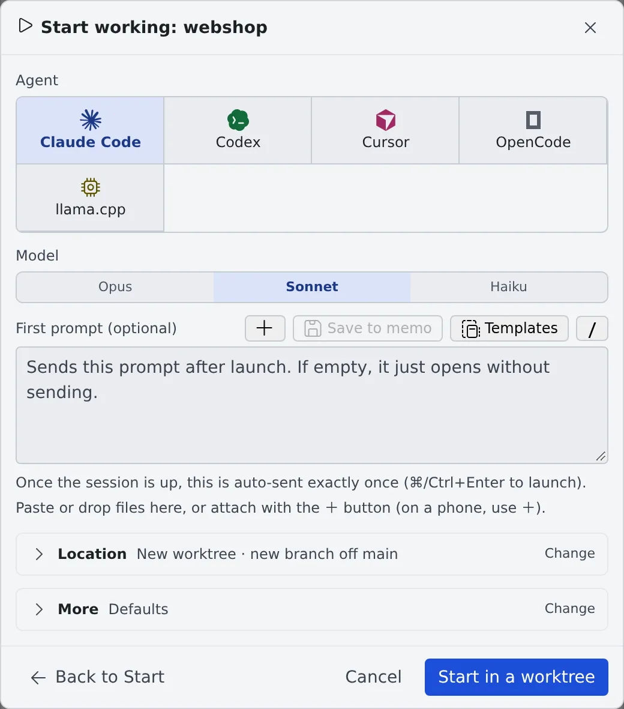

# Start a session

English | [日本語](start.ja.md)

From **Start** you can launch an agent in a repository or in your home folder, or open a chat or a shell.
A session is one piece of work handed to an agent: its conversation, its working place and its running state.

## How it works

| What you do | What the agent does |
|---|---|
| Choose where to work in Start | Starts in the place you chose (a repository's working copy, or home) |
| Pick the agent, the model and a first prompt, then launch | Takes the first prompt and starts working |
| Answer when a reply is needed | Stops at a question, a permission request or a plan, and waits for you |

Sessions are listed in the left pane under **Repositories**, below their working copy; the ones that belong to no repository
are under **Other sessions**. You can have as many as you like at once, each with its own conversation and working folder.

## Pick a place in Start

Press **＋ Start** on the workspace action bar to open the **Start** screen.

| Choice | What happens |
|---|---|
| Chat (assistant) | Starts a chat that uses no repository, for questions, translation and summaries ([Ask an assistant](../chat/assistant.md)) |
| SSM — log in to another host | Logs in to EC2 over SSM. Shown only when you have an SSM profile ([Log in to EC2 with SSM](../integrations/aws-ssm.md)) |
| shell | Opens a plain shell (bash) right away |
| Launch an agent in home | Runs an agent in home (`~`), for drafts, research and throwaway work. It opens the same Start work dialog as a repository (images and files can be attached), without the worktree and branch choices |
| Launch an agent in a repository | Search for a cloned repository and pick it to go on to **Start working** |
| Clone a new repository… | Clone from a connection or a URL; when it finishes you go straight on to Start working |
| Start in a new folder… | For when there is nothing to clone from yet: creates a folder under `~/repos`, runs `git init` and starts there |

- **Launch** on a repository row in the left pane opens the same Start working dialog
- **Back to Start** at the bottom left of Start working (or the browser's back) takes you one step back

> [!TIP]
> Start works while the workspace is stopped too. Press **Start** in **Start the workspace and begin**, and the Start
> screen opens by itself as soon as the workspace is ready.

## Launch from Start working

1. Under **Agent**, pick the agent to use
2. Pick the **Model**
3. If you want, write an instruction in **First prompt (optional)**. It is sent once, automatically, as soon as the session is ready. Left empty, the session just opens
4. **Location** and **More** stay folded with a summary of what they will do. Press **Change** only to change them
5. Press **Start in a worktree** (**Launch** when you start directly in this copy)

The first prompt box also lets you:

- paste or drop files, or attach them with **＋**
- insert saved text or a prompt you sent before with **Templates**
- move what you have written, with its attachments, into the memo queue with **Save to memo**. **Start with this** on the memo brings it back

### Location

By default each session gets a new worktree (its own working copy) and starts there.
How to choose the branch, and how to start inside a folder of the repository, is in [Work in parallel with worktrees](worktrees.md).

### More

Only the items the chosen agent supports are shown.

| Item | What it decides |
|---|---|
| Execution method | Managed (recommended) or Terminal (CLI) ([Choose the execution method](#choose-the-execution-method)) |
| Model route | Where model calls go and which account is billed. Shown only for a Terminal (CLI) launch ([Amazon Bedrock route](../../ref/bedrock-route.md)) |
| Reasoning effort | Left unset, the model's default applies |
| Start mode | "Plan" spends the first turn on research and a plan |
| Tool permissions | "Skip approvals (default)" or "Ask every time". When it asks, the agent stops for approval before edits and commands |
| Session name | Left empty, a name is made from the repository name and the time |
| Budget (USD) | When the estimated cost reaches this amount, the session stops at the end of the turn. 0 means no budget |

## Session types

Start lists the agents you have connected, and shell. Connecting an agent is in [Choose an agent](../agents/choose.md).

| Type | What it starts |
|---|---|
| claude | Claude Code |
| codex | Codex |
| cursor | Cursor (needs a Cursor plan) |
| copilot | GitHub Copilot (uses your GitHub connection) |
| kiro | Kiro |
| agy | Antigravity (experimental) |
| opencode | OpenCode |
| lcpp | The workspace's llama.cpp engine. No login needed. Listed only while **Use llama.cpp** is on in ⚙ Settings → Agents |
| muse | Muse Code. Listed once it is installed and signed in |
| shell | A plain shell (bash) |

What each type can do is listed in [Agents — what each kind can do](../../ref/agents.md).

## Choose the execution method

For a type that supports both Managed and Terminal (CLI), choose under **Execution method** in More. The conversation and
the working folder are the same either way.

| Execution method | When to use it |
|---|---|
| Managed (recommended) | Everyday work. You work in the chat; there is no terminal. Codex and OpenCode run no CLI per session, so they use little memory |
| Terminal (CLI) | When you need the CLI's own screens or commands. A CLI is started for each session, which costs memory |

- New sessions start Managed by default
- GitHub Copilot, Cursor and Kiro run a process per session even when Managed, so they use as much memory as Terminal (CLI)
- lcpp and muse always run Managed
- A Terminal (CLI) screen keeps running in the background after you close the browser

### Switch later

While the agent is not working, switch with **Switch to managed execution** or **Switch to terminal execution** in the
session's ⋯ menu. The conversation carries over.

> [!NOTE]
> A codex session can be switched to Terminal (CLI) only while it is stopped. For about a minute after the stop, both the
> switch and a resume in Terminal (CLI) are refused; wait a moment and try again.

## Rename a session or its branch

Both are in the session's ⋯ menu (right-click opens it too).

| Menu item | What it does |
|---|---|
| Rename | Changes the name shown in the list. Saving it empty goes back to the automatic name |
| Rename the branch | Shown only for a session running in a worktree. Renames that worktree's branch; the folder and the session stay as they are |

- In both, **Ask AI to suggest** proposes a name from the conversation and **Use this** takes it. For a session started from an issue, the issue's key or number is kept
- The branch prefix can be swapped with buttons for the ones in the repository's branch naming rules (by default `feature/`, `fix/`, `hotfix/` and so on). A name outside the rules only gets a warning
- Use it to give a meaningful name to a session started under a temporary name (`temp/…`)

**Menu of repository {name}** in the same menu opens the menu of the repository the session belongs to, one step away from
committing or switching branches.

## Start from your team's defaults

If your tenant administrator set launch defaults, the dialog opens with them filled in: the team's agent, model, execution method, permission prompts and budget. **Start** lists the team's repositories first, marked "Team".

- Your own choices win. The last choice in a repository and the values you set in ⚙ Settings → Agents are used before the team's. A Settings value that equals Agent Fleet's built-in one counts as not set, so to keep such a value against a team default, save it with **Use as my default**
- Under **More**, **Use as my default** saves the dialog's current agent, model, execution method, permission prompts and budget as your starting point whenever you start that agent. The model applies to that agent only. A model or budget you leave empty is not set, so the team's value is used. A value the server would refuse (an agent outside the team list, a budget over $10000) disables the button and says why. **Clear my default** puts the team's back. Your Settings are not changed
- The defaults are kept in your browser from the last time Agent Fleet answered, so they still apply while your workspace is stopped or Agent Fleet cannot be reached

## When it goes wrong

### "No agents available" appears

No agent is connected. Sign in to one under Connections in ⚙ Settings ([Choose an agent](../agents/choose.md)).

### A codex session will not switch to Terminal (CLI)

When it says "Stop this codex session first, then switch it to terminal execution (about a minute after the stop).", stop the session, wait about a minute,
and switch.

## Related

- [Work in parallel with worktrees](worktrees.md): choosing the location and the branch
- [Start from an issue or a ticket](from-issues.md): starting a session from the issue tracker list
- [Read a session's state](status.md): the row marks and notifications
- [Reply to a session](reply.md): working with a session once it is running
