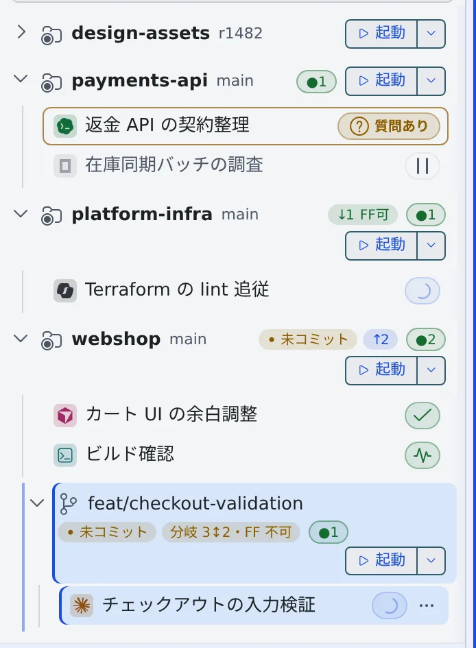

# セッションの状態を読む

[English](status.md) | 日本語

左ペインのセッションの行と通知で、どのセッションが動いていて、どれがあなたの返事を待っているかがわかります。

## 全体像

| あなたがやること | エージェントがやること |
|---|---|
| 行の状態の印を見て、返事が要るものを開く | 作業を進め、質問・許可・プランで止まって、あなたを待つ |
| 通知を受けて、見ていない間の変化に気づく | 一段落したり質問したりすると、Console に知らせる |

## 行の印を読む

行の先頭の色付きアイコンはエージェントの種類、行の最後の印は今の状態です。印にマウスを重ねると、状態の名前が出ます。
あなたの操作が要る状態は、印のほかに文字も出ます。



| 表示 | 意味 | あなたがやること |
|---|---|---|
| 進行中…（回る印） | エージェントが作業している | 待つ |
| 入力待ち（チェックの印） | ひと区切りついて、次の指示を待っている | 次の指示を送る |
| 質問あり | 質問への答えを待っている | 開いて答える |
| プランあり | プランの承認か却下を待っている | 開いてプランを読み、承認か却下をする |
| 許可待ち | コマンドの実行や編集の許可を待っている | 開いて許可するか断る |
| 起動中 | shell や SSM が動いている | なし |
| 停止中 | プロセスが止まっている。あとで再開できる | 必要なら再開する |

ほかの状態（利用上限・残高上限・バックグラウンド処理・引き継ぎ・異常終了など）と、行に付くそのほかの印は
[アイコン・バッジ・メニュー](../../member/badges-and-menus.ja.md#セッションの表示) にあります。

- 動いているセッションは、4 秒ごとに更新されます
- マネージドのセッションを開くと、会話がそのまま出ます。ターミナル（CLI）のセッションでは、上に「**チャット**」と「**ターミナル**」の切り替えが出て、「チャット」を選ぶと会話をターンごとに整えて読めます
- 止まっているセッションを開くと「**履歴を閲覧中（入力するには再開）**」と出て、読むだけになります

> [!NOTE]
> 人あての質問や許可に、のぞいているだけの人が代わりに答えないでください。担当の人に声をかけるか、メモキューに書いて渡します。

## 通知を受ける

見ていない間に状態が変わると、ブラウザ通知が出ます。本文にはセッションの名前が入ります。その画面を開いているときは出ません。

| 通知 | 出るとき |
|---|---|
| 回答が返ってきました | 作業が一段落して、入力待ちになった |
| 質問が来ています | エージェントが質問した |

- shell と SSM のセッションは通知しません
- どの通知を表示するか、読み上げるか、赤いドットを付けるかは、種類ごとに [設定 › 通知](../settings/notifications.ja.md) で選べます

### 赤いドット

まだ読んでいない通知があるセッションは、種類のアイコンの角に赤いドットが付き、左ペインでは名前が太字になります。

- どれかのペインにそのセッションを出すと消えます
- 通知センターの「**すべて既読にする**」でも消えます。ベルを開いただけでは消えません

### 端末からの通知

セッションの中のプログラムが端末に通知を頼むと（OSC 9 / 99 / 777 のエスケープシーケンス）、「**端末からの通知**」として通知センターに届き、ブラウザ通知も出ます。

```sh
printf '\e]9;ビルド完了\a'
```

- shell のセッションで、長いビルドの終わりを知らせるのに使えます
- ブラウザ通知は、そのセッションをアクティブなペインで出しているときと、ブラウザで通知を許可していないときは出ません
- claude・codex・opencode は自分の仕組みで同じタイミングを知らせるので、端末の通知は使いません。claude の通知ツール（`PushNotification`。claude 側では既定でオフ）で claude が送ったものだけは、端末からの通知として届きます

## 困ったとき

### 「ライブ更新を一時停止中 — クリックで再開」と出ている

作業中のセッションがないまま、Console の画面で 10 分間マウス・キー・タッチの操作がないと、ライブ更新を止めます。
その間は状態の変化を映さず、通知も出ません。質問を待っているセッションがあっても止まります。

この表示を押すか、画面を操作するか、ウィンドウにフォーカスを戻すと、すべてを読み直して再開します。

### 通知が来ない

- ブラウザで、Console からの通知を許可しているか確かめてください
- その種類の通知を [設定 › 通知](../settings/notifications.ja.md) で切っていないか確かめてください
- 「ライブ更新を一時停止中」が出ていたら、押して再開します

## 関連

- [アイコン・バッジ・メニュー](../../member/badges-and-menus.ja.md)：すべての状態と印の一覧
- [セッションと会話する](../../member/04-conversation.ja.md)：質問・許可・プランに答える
- [セッションを始める](start.ja.md)
