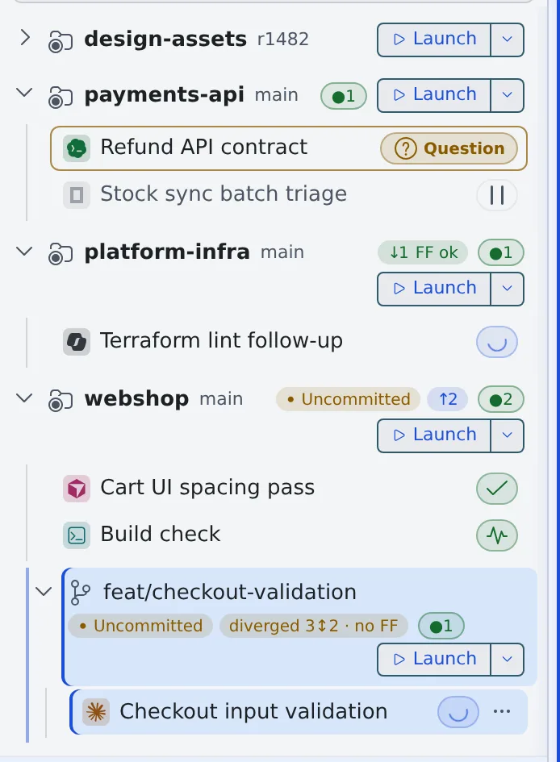

# Read a session's state

English | [日本語](status.ja.md)

The session rows in the left pane and the notifications tell you which sessions are working and which are waiting for your reply.

## How it works

| What you do | What the agent does |
|---|---|
| Look at the state mark on each row, and open the ones that need a reply | Works on, and stops at a question, a permission request or a plan to wait for you |
| Get notified of changes while you are not looking | Tells the Console when it reaches a stopping point or asks a question |

## Read the row marks

The colored icon at the start of a row is the agent's type; the mark at the end is the current state. Hover over the mark
to see the state's name. States that need you show text as well as the mark.



| What you see | Meaning | What you do |
|---|---|---|
| Working… (a spinning mark) | The agent is working | Wait |
| Ready (a check mark) | It reached a stopping point and waits for the next instruction | Send the next instruction |
| Question | It waits for an answer to a question | Open it and answer |
| Plan ready | It waits for its plan to be approved or rejected | Open it, read the plan, approve or reject it |
| Awaiting permission | It waits for permission to run a command or make an edit | Open it and allow or deny |
| Running | A shell or SSM session is up | Nothing |
| Stopped | The process is stopped; it can be resumed later | Resume it if you need it |

The other states (usage limits, spend limits, background work, handoffs, abnormal exits and more) and the other marks a row
can carry are in [Icons, badges, and menus](../../member/badges-and-menus.md#session-display).

- Running sessions are refreshed every 4 seconds
- A Managed session opens straight on its conversation. A Terminal (CLI) session shows a **Chat** / **Terminal** switch at the top, and "Chat" shows the conversation tidied up turn by turn
- Opening a stopped session shows "**Viewing history (resume to type)**", and it is read-only

> [!NOTE]
> If you are only watching, do not answer a question or a permission request meant for someone else. Tell the person in
> charge, or write it into the memo queue for them.

## Get notifications

When a state changes while you are not looking, a browser notification appears with the session's name in it. It does not
appear while you have that screen open.

| Notification | When |
|---|---|
| A reply is ready | The work reached a stopping point and the session is ready for input |
| A question is waiting | The agent asked a question |

- shell and SSM sessions do not notify
- Which notifications to show, read aloud or mark with a red dot is chosen per kind in [Settings › Notifications](../../member/20-settings.md#notifications)

### The red dot

A session with a notification you have not read gets a red dot on the corner of its type icon, and its name turns bold in the left pane.

- It clears when that session is shown in any pane
- **Mark all as read** in the notification center clears it too. Just opening the bell does not

### Terminal notifications

When a program in a session asks the terminal for a notification (the OSC 9 / 99 / 777 escape sequences), it arrives in the
notification center as a "**Terminal notification**", and a browser notification appears.

```sh
printf '\e]9;Build finished\a'
```

- Use it in a shell session to hear when a long build ends
- The browser notification does not appear while the session is in the active pane, or when the browser has not been allowed to show notifications
- claude, codex and opencode report the same moments their own way, so their terminal notifications are not used. The exception is claude's notification tool (`PushNotification`, off by default in claude): what claude sends with it arrives as a terminal notification

## When it goes wrong

### "Live updates paused — click to resume" is showing

When no session is working and the Console window has seen no mouse, key or touch input for 10 minutes, live updates stop.
In the meantime state changes are not shown and no notifications appear. They stop even while a session waits for a question.

Press the note, use the page, or bring the window back into focus, and everything is read again and updates resume.

### No notifications arrive

- Check that the browser allows notifications from the Console
- Check that the kind is not turned off in [Settings › Notifications](../../member/20-settings.md#notifications)
- If "Live updates paused" is showing, press it to resume

## Related

- [Icons, badges, and menus](../../member/badges-and-menus.md): every state and mark
- [Talking to a session](../../member/04-conversation.md): answering questions, permission requests and plans
- [Start a session](start.md)
