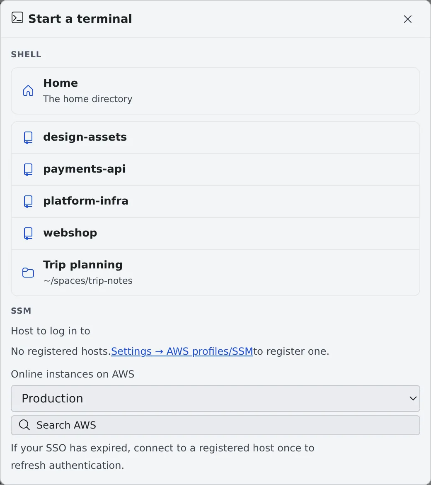

# Find your shells and SSM sessions

English | [日本語](terminals.ja.md)

The **Terminals** view lists every shell and every SSM session in one place. The Sessions view lists agent sessions only,
so a shell never sits among the conversations.

## How it works

| What you do | What happens |
|---|---|
| Press **Terminals** on the activity bar | The left pane lists your shells under the place each was opened in, and your SSM sessions under the machine each logs in to |
| Press the number on a repository or space row in Sessions | The left pane switches to Terminals and brings that place's shells into view |
| Press **+** at the top of the view | Opens **Start a terminal**: a shell in home, a repository's base clone or a space, or an SSM session on a registered machine. Worktrees are not listed here; use **Open shell here** on their row |
| Press the SSM icon at the top of the view | Opens the Start screen on the SSM host list |

Opening a shell opens it in the main area. It does not change what the left pane shows.

## Shells: grouped by place

| Group | Holds |
|---|---|
| **Home** | Shells opened in your home folder, including the ones **Settings → Databases** opens to connect to a database. Also shells whose folder is neither a repository nor a space (for example a repository that was removed) |
| A repository or worktree | Shells opened in that working copy ("Open shell here" on a folder in the file tree starts one) |
| A space | Shells opened in that space, under the space's name |

Each group lists its shells newest first.

## SSM sessions: grouped by machine

An SSM group is one machine: the same account, region and instance id. The group is named after the host you registered
for that instance in **Settings → "AWS profiles/SSM"**; when no registered host points at it, it is named by the instance id.

Two logins to one machine through different profiles, or with a different run-as document, stay in one group. The
profile and the document are written on the row.

## Find a place's shells from the Sessions view

A repository row, and a space row, in the Sessions view show a small terminal icon with a count when shells were opened
there. Press it to switch to Terminals; the group is scrolled into view and highlighted. **Open shell here** stays on the
right-click menu of the file tree.

## Tidy up

The archive icon at the top of the view deletes every stopped shell and SSM session after you confirm. They go to the
trash, where they can be restored. A session you locked against deletion is left alone, and so is one that is still
running.

## Things to know

- While the workspace is stopped the view says it starts when the workspace is running. Stopped shells and SSM
  sessions appear again once it is.
- A working set narrows the view the same way it narrows Sessions.
- Only the Sessions view of the left pane leaves shells out. The sessions overview and the command palette still list running shells and SSM sessions.
- A session list read while the workspace was stopped, or from an Agent older than this view, carries no SSM target.
  Those SSM sessions are listed together under **Unknown machine** until the list is read again.

## Related

- [Start a session](start.md)
- [Find your way around the screen](../start/console-tour.md#activity-bar)
- [Clear away finished sessions](cleanup.md)
