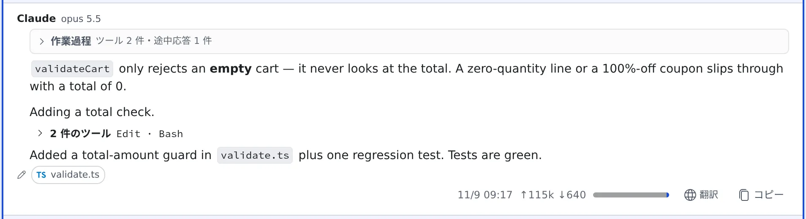

# 回答を自分の言語で読む

[English](translate.md) | 日本語

エージェントが英語で答えてきたとき、その回答だけをボタン 1 つで日本語にして読めます。
会話は進まず、エージェントの文脈も増えません。

## 全体像

| あなたがやること | 起きること |
|---|---|
| 回答の下の **「翻訳」** を押す | セッションの外でモデルを 1 回呼び、その回答を表示言語に訳して置き換える |
| **「原文」** を押す | 元の回答に戻る。モデルは呼ばない |

「日本語で答えて」と送り直すのとは違い、**セッションのターンは使いません。**

## 訳す

1. チャット表示で、回答の下の **「翻訳」** を押します
2. その回答だけが訳文に置き換わります
3. 元に戻すときは **「原文」** を押します

- 訳す先は、Console の表示言語です。**⚙設定 →「アシスタント」** の **回答言語** を日本語か English に固定していれば、その言語になります
- 訳すのは**文章だけ**です。コードブロック・コマンド・パス・ツールの実行ログは原文のまま残ります
- マーカーは原文に付いたままなので、訳文を出している間は見えません
- 答えを待っている質問のカードにも **「翻訳」** が出ます。訳すのは表示だけで、送られるのは元の選択肢です

## ボタンが出るとき

| 回答 | ボタン |
|---|---|
| 表示言語と違う言語で書かれている | 出る |
| 英語の回答に、Console の表示名（「無効」「オンデマンド」など）や製品名が数語だけ混じる | 出る |
| 2 つの言語が本当に混ざっている | 出ない（読めるものを訳し直しても得がないため） |
| ほかの人から共有されたセッション | 出ない（翻訳はオーナーのワークスペースで動くため） |

## トークンの使い方

- **押したときだけ消費します。** 使用量では「回答の翻訳（ミラー）」として見えます
- **訳した結果は、そのセッションを消すまで残ります。** 同じ本文なら 2 回目からは無料です。ペインを開き直しても、スマートフォンから開いても同じ訳が出ます
- この機能のエージェントやモデルを変えると、次に押したときは新しく訳します。前の組み合わせの訳は消えず、戻せばまた使えます

## 設定を変える

**⚙設定 →「AI 補助」** の **回答の翻訳（ミラー）** で切り替えます。

| 設定 | 動き |
|---|---|
| **回答の翻訳（ミラー）** をオフ | 「翻訳」ボタン自体が出なくなる |
| **自動翻訳** をオン | ターンが終わった時点で、ボタンを自動で押す。既定ではオフです |

自動翻訳の対象は、そのセッションを開いて見ている間に届いた回答だけです。
開いた時点ですでに画面にある回答は、勝手には訳しません（ボタンはこれまでどおり出ます）。
翻訳の設定のうち、自動翻訳だけは、押さなくてもトークンを消費します。

## 関連

- [セッションに返事をする](reply.ja.md)：チャット表示と質問のカード
- [会話を Markdown で保存する](export.ja.md)：会話をファイルに残す
