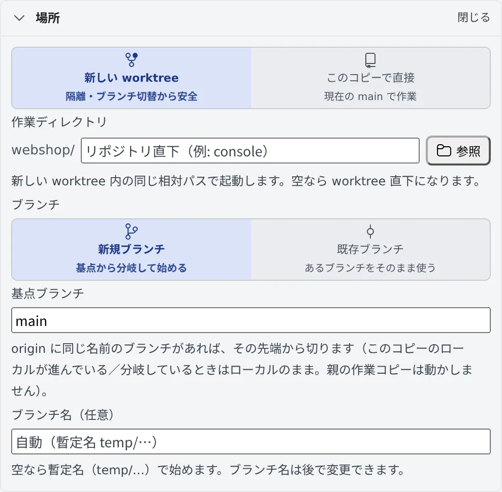

# worktree で並行して作業する

[English](worktrees.md) | 日本語

セッションごとに専用の作業コピー（worktree）を作ると、同じリポジトリで複数のエージェントを同時に動かしても、互いの変更がぶつかりません。
「**作業を始める**」の「**場所**」で、どこで作業するかとブランチを決めます。

## 全体像

| あなたがやること | エージェントがやること |
|---|---|
| 「場所」で「新しい worktree」を選び、基点ブランチとブランチ名を決める | 自分専用の worktree の中だけで作業する |
| 必要なら、リポジトリの中のフォルダを「作業ディレクトリ」に指定する | そのフォルダで起動する |

worktree は Agent Fleet が作ります。起動の直前に、基点ブランチを `origin` の先端に合わせてから切ります。

## 場所を選ぶ

「作業を始める」の「**場所**」の行には、どこで起動するかが 1 行で出ています。「**変更**」を押すと開きます。

| 選ぶもの | 起きること |
|---|---|
| 新しい worktree（既定） | このセッション専用の作業コピーを作って、そこで起動します。ほかのセッションのブランチ切り替えの影響を受けません |
| このコピーで直接 | いま選んでいる作業コピーの、今のブランチで起動します |

## ブランチを決める

「新しい worktree」では、「**ブランチ**」で新しいブランチを切るか、今あるブランチを使うかを選びます。

| 選ぶもの | 入れるもの | 起きること |
|---|---|---|
| 新規ブランチ | 基点ブランチと、ブランチ名（任意） | 基点から新しいブランチを切ります。ブランチ名が空なら、暫定名 `temp/…` で始まります |
| 既存ブランチ | 使うブランチ | そのブランチを新しい作業コピーに取り出し、最新まで進めてから起動します |

- worktree のフォルダ名は、ブランチ名から自動で決まります
- 暫定名で始めても、あとでセッションの「⋯」メニューの「**ブランチ名を変更**」で名前を付けられます（[セッションを始める](start.ja.md#タイトルとブランチ名を変える)）
- リポジトリにブランチの命名規則（git-flow など）があると、ブランチ名と基点がその規則から入ります。規則から外れた名前には注意が出るだけで、そのまま使えます

### 基点は origin の先端に合わせる

新規ブランチは、`origin` にある同じ名前の基点ブランチの先端から切ります。古いクローンから始めても、何週間も前のコミットから始まることはありません。

- 合わせるのは、新しく作った worktree の中だけです。元の作業コピーは動かしません
- 手元の基点ブランチが `origin` より進んでいるか分岐しているとき、`origin` に同じ名前のブランチがないときは、手元の基点から切ります

### 新しい worktree を作れないとき

次の場合は「新しい worktree」が選べず、その作業コピーで直接起動します。ダイアログにもそう出ます。

| 場合 | どうするか |
|---|---|
| 既存の worktree の行から開いた | 新しい worktree は、元のリポジトリの行から作ってください |
| Subversion の作業コピー | そのまま直接起動します |
| まだコミットが 1 つもないリポジトリ | 最初のコミットをすると、選べるようになります |

## リポジトリの中のフォルダで起動する

monorepo で `console/` や `apps/web` だけを触る作業なら、「場所」の「**作業ディレクトリ**」で、エージェントを起動するフォルダを絞れます。

- パスを直接入れるか、「**参照**」でリポジトリのフォルダをたどって選びます。空ならリポジトリ直下です
- 「新しい worktree」と組み合わせると、同じ相対パスを**新しい worktree の中で**探します
- そのブランチにフォルダがないときは起動を断り、何も作りません
- 前回そのリポジトリで起動したフォルダを覚えていて、次から入力欄に入ります

セッション自体は作業コピーに属したままです。左ペインでは同じリポジトリの下に並び、ブランチの切り替えや片付けも変わりません。

## 困ったとき

### 「同名のローカルブランチ … がすでにあります」と出る

別のブランチ名にしてください。

### 「リモートに同名ブランチ … があります」と出る

過去に使った名前です。別の名前にするか、「**その既存ブランチで作業**」を押してそのブランチで始めます。

### 「ブランチ … は作業コピー … で使用中です」と出る

git は、同じブランチを 2 つの作業コピーに置けません。別のブランチを選ぶか、そのブランチの作業コピーの行から起動してください。

## 関連

- [セッションを始める](start.ja.md)：「はじめる」と「作業を始める」の全体
- [リポジトリをクローンする](../code/clone.ja.md)：左ペインの「追加」で作業コピーを作る、ブランチを切り替える
- [終わったセッションを片付ける](cleanup.ja.md)：終わった worktree を片付ける
