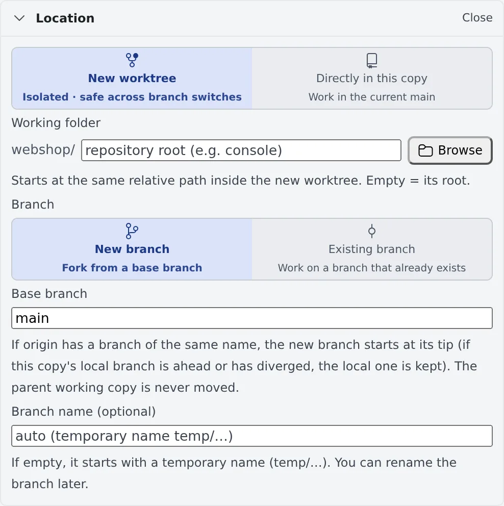

# Work in parallel with worktrees

English | [日本語](worktrees.ja.md)

Give each session its own working copy (a worktree), and several agents can work in the same repository at once without
their changes colliding. Choose where to work, and on which branch, under **Location** in **Start working**.

## How it works

| What you do | What the agent does |
|---|---|
| Choose "New worktree" under Location, and set the base branch and the branch name | Works only inside its own worktree |
| If needed, set a folder of the repository as the "Working folder" | Starts in that folder |

Agent Fleet creates the worktree. Right before launching, it moves the base branch to `origin`'s tip and branches from there.

## Choose the location

The **Location** row of Start working says in one line where the session will start. Press **Change** to open it.

| Choice | What happens |
|---|---|
| New worktree (default) | Creates a working copy for this session alone and starts there. Branch switches in other sessions do not touch it |
| Directly in this copy | Starts in the working copy you picked, on its current branch |

## Choose the branch

With "New worktree", choose under **Branch** whether to cut a new branch or use one that exists.

| Choice | What you enter | What happens |
|---|---|---|
| New branch | The base branch, and a branch name (optional) | Cuts a new branch from the base. With no name, it starts under a temporary name `temp/…` |
| Existing branch | The branch to use | Checks that branch out into a new working copy, brings it up to date, and starts |

- The worktree's folder name is made from the branch name
- A session started under a temporary name can be named later with **Rename the branch** in its ⋯ menu ([Start a session](start.md#rename-a-session-or-its-branch))
- When the repository has branch naming rules (git-flow and the like), the branch name and the base come from them. A name outside the rules only gets a warning and can still be used

### The base follows origin's tip

A new branch is cut from the tip of the same-named base branch on `origin`. Starting from an old clone does not mean
starting from a commit weeks old.

- Only the new worktree is moved. The original working copy is left alone
- When your local base branch is ahead of `origin` or has diverged, or `origin` has no branch of that name, the branch is cut from the local base

### When a new worktree cannot be made

In these cases "New worktree" is not offered and the session starts directly in that working copy; the dialog says so.

| Case | What to do |
|---|---|
| You opened it from an existing worktree's row | Create new worktrees from the original repository's row |
| A Subversion working copy | It starts directly |
| A repository with no commit yet | After the first commit you can choose it |

## Launch inside a folder of the repository

For work that only touches `console/` or `apps/web` in a monorepo, narrow where the agent starts with **Working folder**
under Location.

- Type the path, or pick it by walking the repository's folders with **Browse**. Empty means the repository root
- Combined with "New worktree", the same relative path is looked up **inside the new worktree**
- If the folder does not exist on that branch, the launch is refused and nothing is created
- The folder you last started in for that repository is remembered and filled in next time

The session itself still belongs to the working copy. It is listed under the same repository in the left pane, and
branch switches and tidying up work as before.

## When it goes wrong

### "A local branch named … already exists"

Choose another branch name.

### "A remote branch named … exists"

It is a name used before. Choose another name, or press **Work on that existing branch** to start on that branch.

### "Branch … is in use by working copy …"

git cannot check one branch out into two working copies. Choose another branch, or launch from that working copy's row.

## Related

- [Start a session](start.md): Start and Start working as a whole
- [Clone a repository](../code/clone.md): creating a working copy with Add in the left pane, switching branches
- [Clear away finished sessions](cleanup.md): clearing away finished worktrees
