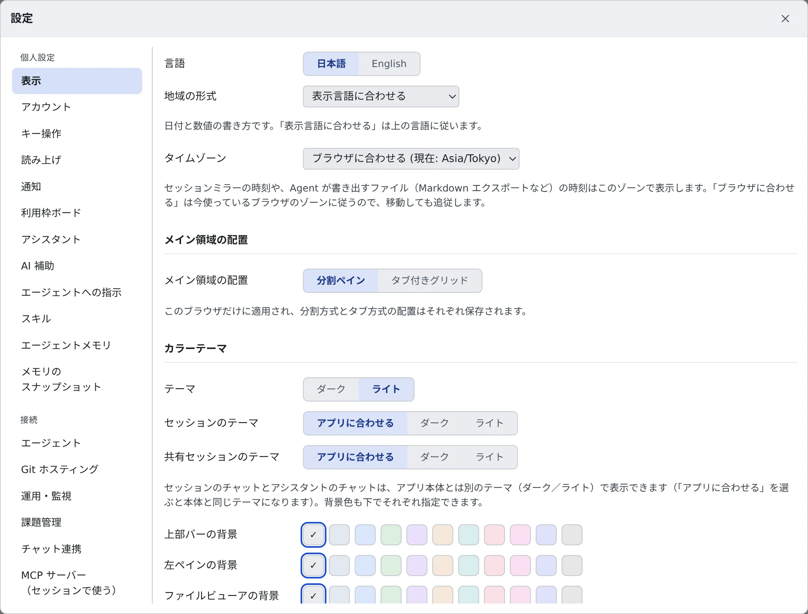

# 表示とアカウントを変える

[English](display.md) | 日本語

Console の言語・タイムゾーン・テーマ・フォントを、自分の読みやすいように変えられます。
会社が複数のサインイン方法を用意していれば、2 つ目の方法を自分のアカウントに足すこともできます。

## 全体像

| あなたがやること | 起きること |
|---|---|
| 言語・地域の形式・タイムゾーンを選ぶ | Console の表示と、エージェントが書き出すファイルの時刻が変わる |
| テーマ・配置・フォントを選ぶ | その場で見た目が変わる。保存先は項目によって違う |
| サインイン方法を追加する | どの方法で入っても、同じワークスペース・同じホーム・同じ秘密情報になる |

## 表示を変える

**⚙設定 →「表示」** を開きます。変えた内容はその場で反映されます。

| まとまり | 選べるもの |
|---|---|
| 言語など | 「**言語**」「**地域の形式**」（日付と数値の書き方）「**タイムゾーン**」 |
| メイン領域の配置 | 「**分割ペイン**」か「**タブ付きグリッド**」 |
| カラーテーマ | アプリ全体の「**テーマ**」、「**文字のコントラスト**」（標準・強め・最強）、「**セッションのテーマ**」「**共有セッションのテーマ**」、上部バー・左ペインなどの背景色 |
| 和文フォント | ①②③ や ㈱ のような記号を、どの和文フォントで描くか |
| ターミナル | フォント・文字サイズ、「**Ctrl+C / Ctrl+V でコピー・貼り付け**」、「**マウスドラッグ直後は確認なしでコピー**」 |
| ファイルビューア | フォント・文字サイズ・タブ幅・行番号・折り返し・ミニマップ |
| Markdown 表示 | 「**コードブロックを折り返す**」 |
| セッションのチャット・朗読ビュー | それぞれのフォントと文字サイズ |
| ファイルアイコン | 「**アイコンセット**」 |

- アシスタントのテーマと背景色は、このタブではなく **⚙設定 →「アシスタント」** にあります
- 2 つ以上のテナントに所属しているときだけ、「**テナントごとに外観を分ける**」が出ます。既定ではオフです
- 配置とテーマは、画面最上部のバーの「**外観**」からも切り替えられます

### 言語・地域の形式・タイムゾーン

- 「**地域の形式**」は、既定の「**表示言語に合わせる**」なら上の言語に従います
- 「**タイムゾーン**」は、既定の「**ブラウザに合わせる**」なら今使っているブラウザのゾーンに従います。移動するとゾーンも一緒に変わります。ゾーンを選ぶと固定できます
- タイムゾーンは、セッションミラーを含む Console の日時と、エージェントが書き出すファイル（Markdown エクスポートなど）の時刻に使われます。ワークスペースを再起動しなくても、すぐ反映されます
- 「ブラウザに合わせる」のとき、エージェントが書く文面（利用上限の再開通知など）は、最後に Console を開いた端末のゾーンで書かれます

シェルやエージェントの時計（`TZ`）は別の設定です。[ツールチェーンを選ぶ](../workspace/toolchains.ja.md) で選びます。

### ターミナルのコピーと貼り付け

- 「**Ctrl+C / Ctrl+V でコピー・貼り付け**」がオンのとき、文字を選んでいれば Ctrl+C でコピーします。選んでいなければ、これまでどおりプログラムを中断します。オフにすると、両方のキーをプログラムへ送ります
- Ctrl+Shift+C / Ctrl+Shift+V は、設定にかかわらず使えます
- 「**マウスドラッグ直後は確認なしでコピー**」がオフのときは、ターミナルの中のプログラム（tmux のコピーモードを含む）がクリップボードへ書き込むたびに確認が出ます

## どこに保存されるか

設定によって、保存先が違います。

| 保存先 | 設定 |
|---|---|
| このブラウザだけ | テーマ、文字のコントラスト、セッション・共有セッションのテーマ、背景色、メイン領域の配置、テナントごとに外観を分けるか |
| サーバー（別の PC やブラウザでも同じ） | 言語、地域の形式、タイムゾーン、フォントと文字サイズなど、それ以外 |

- 会社の PC と自宅の PC で、明るさに合わせてテーマを変えておけます
- メイン領域の配置は、分割ペインとタブ付きグリッドのそれぞれの並びを別に覚えています。行き来しても崩れません

## サインイン方法を追加する

**⚙設定 →「アカウント」** に、今のアカウントに紐づいたサインイン方法（Google・Microsoft・GitHub など）が並びます。
どの方法で入っても、同じワークスペース・同じホーム・同じ秘密情報になります。

1. 「**サインイン方法を追加**」の下で、足したい方法のボタンを押します
2. その方法のサインイン画面が開くので、サインインします
3. Console に戻ると、一覧に増えています

追加できるのは、次の条件をすべて満たす方法だけです。

- 今のアカウントと**同じメールアドレス**を名乗る（別のアドレスのアカウント同士は 1 つにまとめられません）
- その方法の許可条件（GitHub なら組織のメンバーであること、許可されたメールドメイン）を満たしている
- まだ**別の人のアカウント**で使われていない

この欄は、配備が IdP のサインインを使っているときだけ使えます。使えない配備では、そう表示されます。

## サインイン方法を解除する

使わなくなった方法は、一覧の「**解除**」で外せます。ワークスペース・ホーム・秘密情報はそのままで、あとから同じ方法をもう一度追加できます。

次の 2 つは解除できません。理由は、ボタンにマウスを乗せると出ます。

| 解除できない方法 | 理由 |
|---|---|
| 「**いま使用中**」の方法 | 先に別の方法でサインインし直してから解除します |
| 残り 1 つの方法 | 解除するとどの方法でも入れなくなり、自分では戻せません |

## 困ったとき

### 「設定をサーバーに保存できていません」と出る

変更がこのブラウザにだけあり、エージェントは前の設定のまま動いています。設定画面の上部の「**再送**」を押してください。

### 「このメールアドレスは、すでにこのデプロイの別のサインイン方法で使われています」と出る

サインイン画面でこう出たら、いつも使っている方法でサインインし直してから、**⚙設定 →「アカウント」** でこの方法を追加します。

### 「このサインイン方法が名乗ったメールアドレスは、いまのアカウントのものと違います」と出る

追加しようとした方法が、別のメールアドレスを名乗っています。同じアドレスを名乗る方法だけを追加できます。

### 「このサインイン方法では、いまのアカウントは許可されていません」と出る

その方法の許可条件を満たしていません。組織への参加や許可されたドメインについて、管理者に確かめてください。

## 関連

- [ツールチェーンを選ぶ](../workspace/toolchains.ja.md)：シェルとエージェントのタイムゾーン
- [通知を受け取る](notifications.ja.md)
- [読み上げを使う](read-aloud.ja.md)
- [アイコン・バッジ・メニュー](../../ref/console-ui.ja.md)
