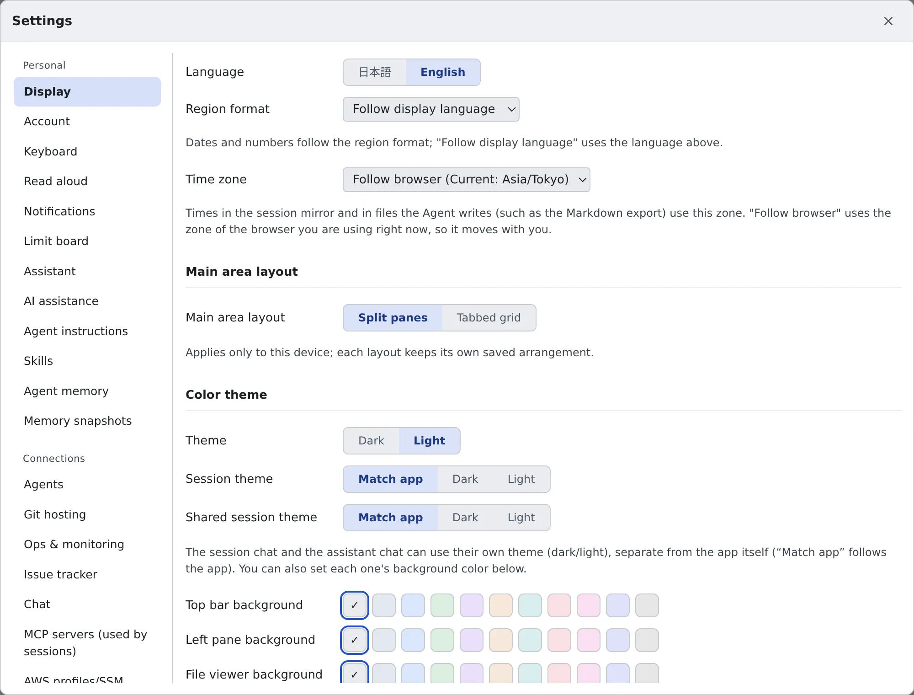

# Change the display and your account

English | [日本語](display.ja.md)

Set the Console's language, time zone, theme and fonts the way you read best.
If your company offers more than one way to sign in, you can also add a second method to your account.

## How it works

| What you do | What happens |
|---|---|
| Pick the language, region format and time zone | The Console's display and the times in files the agent writes change |
| Pick the theme, layout and fonts | The look changes at once. Where it is saved depends on the setting |
| Add a sign-in method | Whichever method you use, you land in the same workspace, the same home and the same secrets |

## Change the display

Open **⚙ Settings → "Display"**. A change applies at once.

| Group | What you can pick |
|---|---|
| Language and region | "**Language**", "**Region format**" (how dates and numbers are written), "**Time zone**" |
| Main area layout | "**Split panes**" or "**Tabbed grid**" |
| Color theme | The app's "**Theme**", "**Text contrast**" (Standard, Strong, Strongest), "**Session theme**", "**Shared session theme**", and the backgrounds of the top bar, the left pane and so on |
| Japanese font | Which Japanese font draws symbols such as ①②③ and ㈱ |
| Terminal | Font and size, "**Ctrl+C / Ctrl+V copy and paste**", "**Copy without asking after a mouse drag**" |
| File viewer | Font, size, tab width, line numbers, wrap, minimap |
| Markdown | "**Wrap code blocks**" |
| Session chat and reader view | The font and size of each |
| File icons | "**Icon set**" |

- The assistant's theme and background are not on this tab but under **⚙ Settings → "Assistant"**
- "**Separate appearance per tenant**" appears only when you belong to two or more tenants. It is off by default
- You can also switch the layout and the theme from "**Appearance**" on the bar at the top of the screen

### Language, region format and time zone

- "**Region format**" follows the language above while it is on the default, "**Follow display language**"
- "**Time zone**" follows the browser you are using right now while it is on the default, "**Follow browser**". It moves with you when you travel. Pick a zone to pin it
- The time zone is used for dates in the Console, the session mirror included, and for the times in files the agent writes (such as the Markdown export). It applies at once, without restarting the workspace
- Under "Follow browser", text the agent writes (such as the note that a usage limit has reset) uses the zone of the device that last opened the Console

The clock of the shell and the agents (`TZ`) is a separate setting. You pick it in [Choose your toolchains](../workspace/toolchains.md).

### Copy and paste in the terminal

- With "**Ctrl+C / Ctrl+V copy and paste**" on, Ctrl+C copies while text is selected. With nothing selected it interrupts the program as usual. Off sends both keys to the program
- Ctrl+Shift+C / Ctrl+Shift+V always work, whatever the setting
- With "**Copy without asking after a mouse drag**" off, you are asked each time a program in the terminal (tmux's copy mode included) writes to the clipboard

## Where it is saved

Settings are saved in two places.

| Saved in | Settings |
|---|---|
| This browser only | The theme, text contrast, the session and shared session themes, background colors, the main area layout, whether appearance is separate per tenant |
| The server (the same on another PC or browser) | Language, region format, time zone, fonts and sizes, and everything else |

- You can keep a different theme on your office PC and your home PC, to suit the lighting
- The main area layout remembers the arrangement of split panes and of the tabbed grid separately, so switching back and forth does not undo either

## Add a sign-in method

**⚙ Settings → "Account"** lists the sign-in methods linked to your account (Google, Microsoft, GitHub and so on).
Whichever one you use, you land in the same workspace, the same home and the same secrets.

1. Under "**Add a sign-in method**", press the button of the method to add
2. That method's sign-in page opens; sign in
3. Back in the Console, it is in the list

You can add a method only when all of these hold:

- It asserts the **same email address** as your account. Accounts with different addresses cannot be merged
- You satisfy that method's own rules (for GitHub, membership of the organization; allowed email domains)
- It is not already used by **someone else's account**

This section works only when the deployment signs in through an IdP. Where it does not, the tab says so.

## Remove a sign-in method

Press "**Remove**" on a method you no longer use. Your workspace, home and secrets stay as they are, and you can add the same method again later.

You cannot remove these two. Hover over the button to read why.

| Method you cannot remove | Why |
|---|---|
| The one marked "**in use now**" | Sign in with another method first, then remove it |
| The last one left | Removing it would leave you unable to sign in at all, with no way back on your own |

## When it goes wrong

### "Your settings could not be saved to the server"

The change exists on this browser only, and the agents still act on the previous settings. Press "**Retry**" at the top of the settings dialog.

### "This email address is already used by another sign-in method on this deployment"

If the sign-in page says this, sign in the way you normally do, then add this method under **⚙ Settings → "Account"**.

### "The address that sign-in method asserted is not the one on your account"

The method you tried asserts a different email address. Only a method that asserts the same address can be added.

### "That sign-in method doesn't allow this account"

You do not satisfy that method's rules. Ask your administrator about the organization membership or the allowed domains.

## Related

- [Choose your toolchains](../workspace/toolchains.md): the time zone of the shell and the agents
- [Get notified](notifications.md)
- [Use read-aloud](read-aloud.md)
- [Icons, badges and menus](../../ref/console-ui.md)
