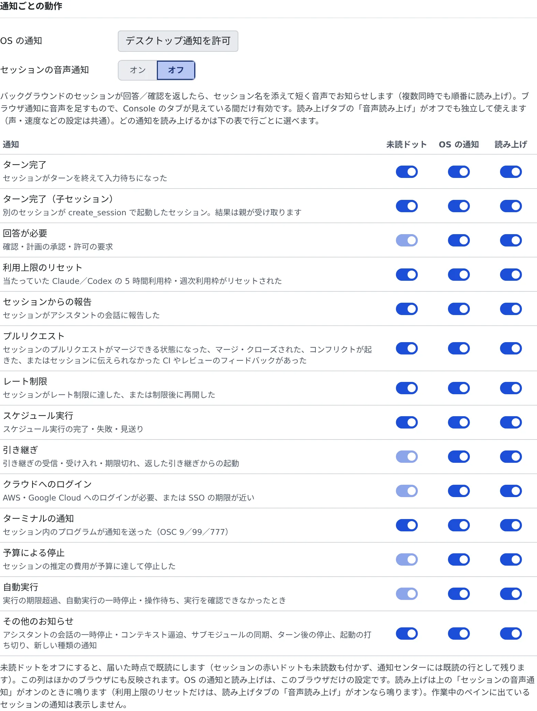

# 通知を受け取る

[English](notifications.md) | 日本語

セッションが返事を待っているとき、プルリクエストがマージできるようになったときなどに、通知を受け取れます。
通知の種類ごとに、赤いドットを付けるか、OS の通知を出すか、読み上げるかを選べます。

## 全体像

| あなたがやること | 起きること |
|---|---|
| ブラウザにデスクトップ通知を許可する | 見ていない間の変化が、OS の通知として出る |
| 通知の種類ごとにスイッチを選ぶ | その種類が届いたときの動作が変わる |
| 画面最上部のベルを開く | 過去 7 日間の通知を通知センターで読める |
| スマートフォンやパソコンでプッシュ通知をオンにする | Console を閉じていても、質問やターンの完了がその端末に届く |

## 通知を設定する

**⚙設定 →「通知」** を開きます。「**通知ごとの動作**」の表に、通知の種類が 1 行ずつ並びます。

1. 「**デスクトップ通知を許可**」を押して、ブラウザの確認で許可します。このボタンは、ブラウザがまだ尋ねていない間だけ出ます
2. 声でも知らせてほしいときは、「**セッションの音声通知**」をオンにします
3. 表で、種類ごとに 3 つのスイッチを選びます。既定ではすべてオンです

| 列 | オンのときの動作 | 効く範囲 |
|---|---|---|
| 未読ドット | セッションに赤いドットを付け、未読の数に数える | ほかのブラウザにも反映される |
| OS の通知 | OS の通知を出す | このブラウザだけ |
| 読み上げ | 声で知らせる。「セッションの音声通知」がオンのときに鳴る | このブラウザだけ |

- 未読ドットをオフにすると、届いた時点で既読になります。通知センターには既読の行として残ります
- 職場の PC と自分のスマホで、OS の通知と読み上げを分けておけます
- いま作業しているペインに出ているセッションの通知は、表の設定にかかわらず表示も読み上げもしません

### 通知の種類

| 行 | 届くとき |
|---|---|
| ターン完了 | セッションがターンを終えて入力待ちになった |
| ターン完了（子セッション） | 別のセッションが `create_session` で起動したセッションが、ターンを終えた。結果は親が受け取ります |
| 回答が必要 | 確認・計画の承認・許可の要求 |
| 利用上限のリセット | 当たっていた Claude／Codex の 5 時間利用枠・週次利用枠がリセットされた |
| セッションからの報告 | セッションがアシスタントの会話に報告した |
| プルリクエスト | セッションのプルリクエストがマージできる状態になった、マージ・クローズされた、コンフリクトが起きた、またはセッションに伝えられなかった CI やレビューのフィードバックがあった |
| レート制限 | セッションがレート制限に達した、または制限後に再開した |
| スケジュール実行 | スケジュール実行の完了・失敗・見送り |
| 引き継ぎ | 引き継ぎの受信・受け入れ・期限切れ、返した引き継ぎからの起動 |
| クラウドへのログイン | AWS・Google Cloud へのログインが必要、または SSO の期限が近い |
| ターミナルの通知 | セッション内のプログラムが通知を送った（OSC 9／99／777） |
| 予算による停止 | セッションの推定の費用が予算に達して停止した |
| 自動実行 | 実行の期限超過、自動実行の一時停止・操作待ち、実行を確認できなかったとき（[メモを自動で実行する](../chat/memo-auto-run.ja.md#通知)） |
| その他のお知らせ | アシスタントの会話の一時停止・コンテキスト逼迫、サブモジュールの同期、ターン後の停止、起動の打ち切り、新しい種類の通知 |

「回答が必要」「引き継ぎ」「クラウドへのログイン」「予算による停止」は、人の対応を待つ通知です。この 4 つの未読ドットはオフにできません。

## スマートフォンにプッシュ通知を受け取る

Console を閉じていても、スマートフォンやパソコンにプッシュ通知を届けられます。**⚙ 設定 →「通知」** の「**この端末へのプッシュ通知**」で設定します。
この項目は、配備の管理者が Web Push をオンにした環境にだけ出ます（[Web Push をオンにする](../../operate/run/web-push.ja.md)）。

1. iPhone / iPad では、先に Console をホーム画面に追加し、そこから開きます（[スマートフォンで使う](../start/phone.ja.md#ホーム画面に追加してプッシュ通知を受け取る)）。ほかのブラウザでは追加は要りません
2. 「**この端末でプッシュ通知を受け取る**」をオンにし、ブラウザの確認で通知を許可します。ブラウザが通知をブロックしているときは、先にサイトの設定で許可します
3. 「**プッシュする通知**」で、何をプッシュするか選びます

| スイッチ | プッシュするとき |
|---|---|
| 質問が待っているとき | セッションがあなたに質問したとき |
| プランの承認待ちのとき | セッションがプランの承認を求めたとき |
| 権限の許可待ちのとき | セッションが権限の許可を求めたとき |
| ターンが終わったとき | セッションがターンを終えて、あなたを待っているとき |
| 自動実行のターンが失敗したとき | 自動実行自身のセッションのターンが失敗したとき。「ターンが終わったとき」とは別のスイッチで、そちらをオフにしても失敗のプッシュは止まらず、このスイッチをオフにしても終了のプッシュは止まりません。下の「自動実行」の行に従います |

4. 「**プッシュする起動元**」で、誰が起動したセッションをプッシュするか選びます。各行に「**そのセッション**」（セッション自身）と「**そのセッションが起動したセッション**」（レビュー役や補助役など）の 2 つのスイッチがあります

| 行 | 対象 |
|---|---|
| 自分で起動 | あなたが起動したセッションと、そのセッションが起動したセッション |
| 自動実行 | 自動実行が起動したセッションと、そのセッションが起動したセッション |
| スケジュール | スケジュールが起動したセッションと、そのセッションが起動したセッション |

- プッシュは、種類のスイッチと起動元のスイッチの両方がオンのときだけ送られます。既定ではすべてオンです
- たとえば「自動実行」の「そのセッションが起動したセッション」をオフにすると、自動実行自身の通知は残し、そこから起動したレビュー役などの通知だけを止められます
- 自動実行やスケジュールからのプッシュは、タイトルの先頭に「自動実行 · 」「スケジュール · 」などのラベルが付きます。ほかのセッションが起動したセッションからのものには「子 · 」も付きます。自分で起動したセッションにはラベルは付きません

- この選択はサーバーに保存され、あなたのすべての端末に効きます。この端末のオン・オフは、この端末だけに効きます
- プッシュをタップすると、Console でそのセッションが開きます
- 別の端末の Console で見ているセッションには、プッシュしません。Console は画面に出ているセッションを約 20 秒おきに伝え、その報告は 45 秒間有効です
- 既定では、プッシュに載るのはセッション名と何が起きたかだけです。テナント管理者は、質問の文面も載せるよう許可できます（下記）
- 「**端末**」には、プッシュを受け取る端末が並びます。「**削除**」でその端末へのプッシュを止めます。Console からサインアウトしたときも、そのブラウザへのプッシュは止まります
- 端末に「サーバーのプッシュ用の鍵が変わる前に設定されています」と出たら、いったんオフにして、もう一度オンにします

### 質問の文面を載せる（テナント管理者）

プッシュは Apple・Google・Mozilla のプッシュサービスを経由するため、質問の文面は既定では載せません。
テナント管理者は、**テナント設定 →「上限・自動停止」→「プッシュ通知」** の「**プッシュ通知に質問の文面を含める**」をオンにして許可できます。文面は短く切り詰められ、設定はテナントの全メンバーに効きます。

## 音声で知らせる

「**セッションの音声通知**」をオンにすると、見ていないセッションが回答や確認を返したとき、セッション名を添えて短く声で知らせます。

- Console のタブが見えている間だけ鳴ります
- **⚙設定 →「読み上げ」** の「**音声読み上げ**」がオフでも使えます。声や速度は読み上げの設定と共通です
- 利用上限のリセットだけは、「セッションの音声通知」ではなく「音声読み上げ」がオンなら鳴ります
- 通知センターのスピーカーのボタンでも、同じ設定を切り替えられます

声の選び方は [読み上げを使う](read-aloud.ja.md) にあります。

## Discord・Slack への通知を止める

「**サービス通知**」で、Discord や Slack への送信だけを、接続を切らずに止められます。

- 接続していないサービスには「**チャット連携で接続**」が出ます
- ワークスペースが止まっているときは切り替えられません
- 接続と、サービスごとに送るイベントの選び方は [Discord・Slack とつなぐ](../integrations/chat-bridge.ja.md#届く通知を決める) にあります

## 通知センターで読む

画面最上部のベルを開くと、**通知センター**に過去 7 日間の通知が並びます。「**すべて既読にする**」で、まとめて既読にできます。
赤いドットの消え方は [セッションの状態を確認する](../sessions/status.ja.md#赤いドット) にあります。

## 困ったとき

### OS の通知が出ない

- 「このサイトのデスクトップ通知はブラウザでブロックされています」と出ていたら、ブラウザのサイトの設定から通知を許可します。Console からは戻せません
- その種類の行の「OS の通知」がオフになっていないか確かめます
- そのセッションを作業中のペインに出していると、通知は出ません

### プッシュ通知が届かない

- 「この端末へのプッシュ通知」の項目が出ない：この配備では Web Push がオフです。配備の管理者に頼んでください
- iPhone では、iOS 16.4 以降で、ホーム画面のアイコンから開いたときだけ使えます
- 「この端末でプッシュ通知を受け取る」と、その種類がオンで、「端末」に並んでいるか確かめます
- 別の端末で見ているセッションにはプッシュしません。そちらを閉じるか画面から外します。報告は最後の報告から 45 秒で切れます。その間に見送られたプッシュは後から送られず、次の通知から届きます

### 声で知らせてくれない

- 「セッションの音声通知」がオンか、その行の「読み上げ」がオンかを確かめます
- Console のタブが隠れていると鳴りません

## 関連

- [セッションの状態を確認する](../sessions/status.ja.md)：行の印と赤いドット
- [Discord・Slack とつなぐ](../integrations/chat-bridge.ja.md)
- [読み上げを使う](read-aloud.ja.md)
- [スマートフォンで使う](../start/phone.ja.md)
- [表示とアカウントを変える](display.ja.md)
