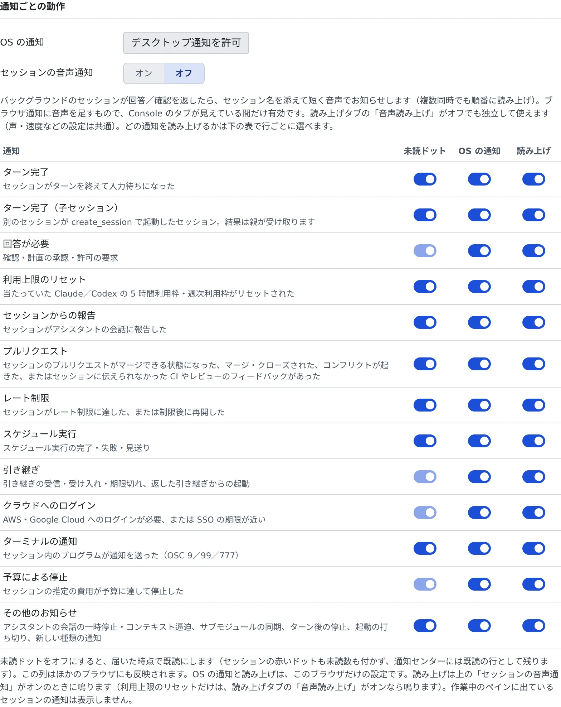

# 通知を受け取る

[English](notifications.md) | 日本語

セッションが返事を待っているとき、プルリクエストがマージできるようになったときなどに、通知を受け取れます。
通知の種類ごとに、赤いドットを付けるか、OS の通知を出すか、読み上げるかを選べます。

## 全体像

| あなたがやること | 起きること |
|---|---|
| ブラウザにデスクトップ通知を許可する | 見ていない間の変化が、OS の通知として出る |
| 通知の種類ごとにスイッチを選ぶ | その種類が届いたときの動作が変わる |
| 画面最上部のベルを開く | 過去 7 日間の通知を通知センターで読める |

## 通知を設定する

**⚙設定 →「通知」** を開きます。「**通知ごとの動作**」の表に、通知の種類が 1 行ずつ並びます。

1. 「**デスクトップ通知を許可**」を押して、ブラウザの確認で許可します。このボタンは、ブラウザがまだ尋ねていない間だけ出ます
2. 声でも知らせてほしいときは、「**セッションの音声通知**」をオンにします
3. 表で、種類ごとに 3 つのスイッチを選びます。既定ではすべてオンです

| 列 | オンのときの動作 | 効く範囲 |
|---|---|---|
| 未読ドット | セッションに赤いドットを付け、未読の数に数える | ほかのブラウザにも反映される |
| OS の通知 | OS の通知を出す | このブラウザだけ |
| 読み上げ | 声で知らせる。「セッションの音声通知」がオンのときに鳴る | このブラウザだけ |

- 未読ドットをオフにすると、届いた時点で既読になります。通知センターには既読の行として残ります
- 職場の PC と自分のスマホで、OS の通知と読み上げを分けておけます
- いま作業しているペインに出ているセッションの通知は、表の設定にかかわらず表示も読み上げもしません

### 通知の種類

| 行 | 届くとき |
|---|---|
| ターン完了 | セッションがターンを終えて入力待ちになった |
| ターン完了（子セッション） | 別のセッションが `create_session` で起動したセッションが、ターンを終えた。結果は親が受け取ります |
| 回答が必要 | 確認・計画の承認・許可の要求 |
| 利用上限のリセット | 当たっていた Claude／Codex の 5 時間利用枠・週次利用枠がリセットされた |
| セッションからの報告 | セッションがアシスタントの会話に報告した |
| プルリクエスト | セッションのプルリクエストがマージできる状態になった、マージ・クローズされた、コンフリクトが起きた、またはセッションに伝えられなかった CI やレビューのフィードバックがあった |
| レート制限 | セッションがレート制限に達した、または制限後に再開した |
| スケジュール実行 | スケジュール実行の完了・失敗・見送り |
| 引き継ぎ | 引き継ぎの受信・受け入れ・期限切れ、返した引き継ぎからの起動 |
| クラウドへのログイン | AWS・Google Cloud へのログインが必要、または SSO の期限が近い |
| ターミナルの通知 | セッション内のプログラムが通知を送った（OSC 9／99／777） |
| 予算による停止 | セッションの推定の費用が予算に達して停止した |
| その他のお知らせ | アシスタントの会話の一時停止・コンテキスト逼迫、サブモジュールの同期、ターン後の停止、起動の打ち切り、新しい種類の通知 |

「回答が必要」「引き継ぎ」「クラウドへのログイン」「予算による停止」は、人の対応を待つ通知です。この 4 つの未読ドットはオフにできません。

## 音声で知らせる

「**セッションの音声通知**」をオンにすると、見ていないセッションが回答や確認を返したとき、セッション名を添えて短く声で知らせます。

- Console のタブが見えている間だけ鳴ります
- **⚙設定 →「読み上げ」** の「**音声読み上げ**」がオフでも使えます。声や速度は読み上げの設定と共通です
- 利用上限のリセットだけは、「セッションの音声通知」ではなく「音声読み上げ」がオンなら鳴ります
- 通知センターのスピーカーのボタンでも、同じ設定を切り替えられます

声の選び方は [読み上げを使う](read-aloud.ja.md) にあります。

## Discord・Slack への通知を止める

「**サービス通知**」で、Discord や Slack への送信だけを、接続を切らずに止められます。

- 接続していないサービスには「**チャット連携で接続**」が出ます
- ワークスペースが止まっているときは切り替えられません
- 接続と、サービスごとに送るイベントの選び方は [Discord・Slack とつなぐ](../integrations/chat-bridge.ja.md#届く通知を決める) にあります

## 通知センターで読む

画面最上部のベルを開くと、**通知センター**に過去 7 日間の通知が並びます。「**すべて既読にする**」で、まとめて既読にできます。
赤いドットの消え方は [セッションの状態を読む](../sessions/status.ja.md#赤いドット) にあります。

## 困ったとき

### OS の通知が出ない

- 「このサイトのデスクトップ通知はブラウザでブロックされています」と出ていたら、ブラウザのサイトの設定から通知を許可します。Console からは戻せません
- その種類の行の「OS の通知」がオフになっていないか確かめます
- そのセッションを作業中のペインに出していると、通知は出ません

### 声で知らせてくれない

- 「セッションの音声通知」がオンか、その行の「読み上げ」がオンかを確かめます
- Console のタブが隠れていると鳴りません

## 関連

- [セッションの状態を読む](../sessions/status.ja.md)：行の印と赤いドット
- [Discord・Slack とつなぐ](../integrations/chat-bridge.ja.md)
- [読み上げを使う](read-aloud.ja.md)
- [表示とアカウントを変える](display.ja.md)
