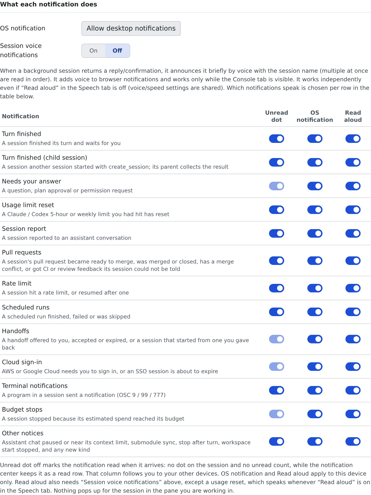

# Get notified

English | [日本語](notifications.ja.md)

Get notified when a session is waiting for you, when a pull request is ready to merge, and more.
For each kind of notification, choose whether it raises a red dot, shows an OS notification or is read aloud.

## How it works

| What you do | What happens |
|---|---|
| Allow desktop notifications in the browser | A change you are not watching shows up as an OS notification |
| Set the switches for each kind of notification | What happens when that kind arrives changes |
| Open the bell at the top of the screen | The notification center lists the last 7 days of notifications |

## Set up notifications

Open **⚙ Settings → "Notifications"**. The "**What each notification does**" table has one row per kind of notification.

1. Press "**Allow desktop notifications**" and allow it when the browser asks. The button is there only while the browser has not asked yet
2. To be told by voice as well, turn "**Session voice notifications**" on
3. In the table, set the three switches for each kind. All of them are on by default

| Column | When on | Applies to |
|---|---|---|
| Unread dot | Puts a red dot on the session and counts the notification as unread | Your other browsers too |
| OS notification | Shows an OS notification | This browser only |
| Read aloud | Announces it by voice. Sounds while "Session voice notifications" is on | This browser only |

- With the unread dot off, a notification is marked read when it arrives. The notification center keeps it as a read row
- You can keep OS notifications and read-aloud different on your work PC and your phone
- A notification for the session in the pane you are working in is neither shown nor read aloud, whatever the table says

### Kinds of notification

| Row | Arrives when |
|---|---|
| Turn finished | A session finished its turn and waits for you |
| Turn finished (child session) | A session another session started with `create_session` finished its turn. Its parent collects the result |
| Needs your answer | A question, plan approval or permission request |
| Usage limit reset | A Claude / Codex 5-hour or weekly limit you had hit has reset |
| Session report | A session reported to an assistant conversation |
| Pull requests | A session's pull request became ready to merge, was merged or closed, has a merge conflict, or got CI or review feedback its session could not be told |
| Rate limit | A session hit a rate limit, or resumed after one |
| Scheduled runs | A scheduled run finished, failed or was skipped |
| Handoffs | A handoff offered to you, accepted or expired, or a session that started from one you gave back |
| Cloud sign-in | AWS or Google Cloud needs you to sign in, or an SSO session is about to expire |
| Terminal notifications | A program in a session sent a notification (OSC 9 / 99 / 777) |
| Budget stops | A session stopped because its estimated spend reached its budget |
| Other notices | Assistant chat paused or near its context limit, submodule sync, stop after turn, workspace start stopped, and any new kind |

"Needs your answer", "Handoffs", "Cloud sign-in" and "Budget stops" wait for a person to act. The unread dot of these four cannot be turned off.

## Be told by voice

With "**Session voice notifications**" on, a session you are not watching that returns a reply or a confirmation is announced briefly by voice, with its name.

- It sounds only while the Console tab is visible
- It works even when "**Read aloud**" under **⚙ Settings → "Read aloud"** is off. Voice and speed are shared with the read-aloud settings
- A usage limit reset is the one exception: it sounds whenever "Read aloud" is on, not "Session voice notifications"
- The speaker button in the notification center toggles the same setting

How to choose a voice is in [Use read-aloud](read-aloud.md).

## Stop notifications to Discord and Slack

Under "**Service notifications**", you can stop sending to Discord or Slack without disconnecting.

- A service that is not connected shows "**Connect in Chat**"
- You cannot switch them while the workspace is stopped
- How to connect, and how to choose the events each service receives, is in [Connect Discord and Slack](../integrations/chat-bridge.md#choose-which-notifications-arrive)

## Read them in the notification center

Open the bell at the top of the screen: the **notification center** lists the last 7 days of notifications. "**Mark all as read**" marks them all read at once.
How the red dot clears is in [Read a session's state](../sessions/status.md#the-red-dot).

## When it goes wrong

### No OS notification appears

- If the tab says "Desktop notifications are blocked for this site in the browser", allow them in the browser's site settings. The Console cannot undo it
- Check that "OS notification" is on for that row
- A session shown in the pane you are working in gets no notification

### Voice notifications stay silent

- Check that "Session voice notifications" is on, and so is "Read aloud" on that row
- Nothing sounds while the Console tab is hidden

## Related

- [Read a session's state](../sessions/status.md): row marks and the red dot
- [Connect Discord and Slack](../integrations/chat-bridge.md)
- [Use read-aloud](read-aloud.md)
- [Change the display and your account](display.md)
