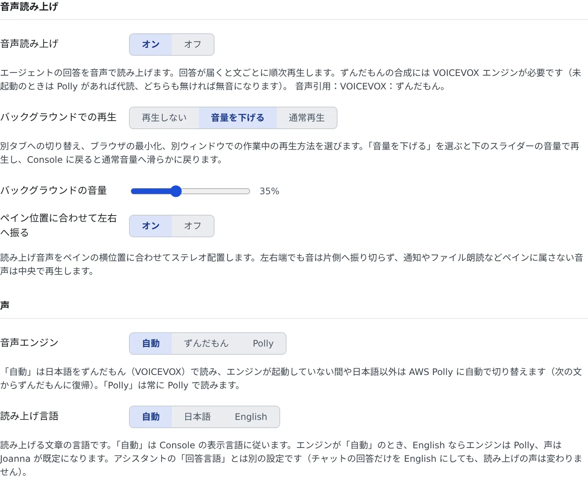

# 読み上げを使う

[English](read-aloud.md) | 日本語

セッションやアシスタントの回答を、音声で読み上げられます。画面から目を離していても、何が返ってきたか、何を聞かれているかが分かります。

## 全体像

| あなたがやること | 起きること |
|---|---|
| 「音声読み上げ」をオンにする | 回答が届くと、文ごとに順に読み上げる |
| 声・読み方を選ぶ | 次に読み上げる文から変わる |
| 読み仮名辞書に書く | 書いた表記を、指定した読みで読む |

## 読み上げを始める

**⚙設定 →「読み上げ」** を開き、「**音声読み上げ**」を「**オン**」にします。既定ではオフです。



- オン・オフは、このブラウザだけの設定です。ほかの項目はサーバーに保存され、別の PC やブラウザでも同じになります
- オンにすると、アクティブなペインに届いた新しい回答を読み上げます。どの回答も、ターンの「**読み上げ**」ボタンでいつでも聞けます
- 別のタブに切り替えている間の再生は、「**バックグラウンドでの再生**」で「**再生しない**」「**音量を下げる**」（既定）「**通常再生**」から選びます

## 声を選ぶ

「**声**」のまとまりで選びます。

| 項目 | 決めること |
|---|---|
| 音声エンジン | 「**自動**」（既定）「**ずんだもん**」「**Polly**」。「自動」は日本語をずんだもん（VOICEVOX）で、日本語以外とエンジンが起動していない間は AWS Polly で読みます |
| 読み上げ言語 | 「**自動**」（表示言語に従う）「**日本語**」「**English**」。エンジンが「自動」で English のときは Polly で読みます |
| 話者（ずんだもん）・話者（Polly） | エンジンごとの声 |
| セッションごとに声を変える | セッション名から声を割り当て、どのセッションの回答かを声で聞き分けられるようにする。既定ではオンです |
| キャラクター | セッションに割り当てるキャラクターと、キャラクターごとのスタイル・速度。▶ で試聴できます |
| 内容で感情を変える | エラーや失敗の文と、成功や完了の文で、スタイルを変えて読む |
| 読み上げ速度 | 「**ゆっくり**」「**標準**」「**はやめ**」（既定）「**はやい**」 |

- 読み上げ言語は、アシスタントの「**回答言語**」とは別の設定です。チャットの回答だけを English にしても、読み上げの声は変わりません
- 配備に VOICEVOX のエンジンがないときは、すべて Polly で読みます。ずんだもん向けの項目は表示されません
- ずんだもんのエンジンが止まっているときは、その旨と「**ずんだもんを呼ぶ**」のボタンが出ます。呼ぶと 1 分ほどで読み始め、それまでは Polly が代わりに読みます

## いつ読むかを決める

「**自動読み上げ**」のまとまりで選びます。

| 項目 | 決めること |
|---|---|
| 新しい回答を自動で読み上げ | アクティブなペインに新しい回答が届いたら読む。既定ではオンです |
| 作業過程を小声で読む | ツールを使っている途中の経過も、小声で読む |
| 開いている全ペインで読む | アクティブなペイン以外の新着回答も読む |
| 長い回答は要約して読む | 目安 500 字を超える回答を、AI が 2 文に要約して読む。ワークスペースの起動が必要です |
| 確認・質問を読み上げる | 質問カード・プランの承認・許可の要求が来たら、質問文と選択肢を読む |

見ていないセッションを声で知らせるのは、別の設定です（[通知を受け取る](notifications.ja.md#音声で知らせる)）。

## 読み方を整える

「**読み方**」のまとまりで選びます。

| 項目 | 決めること |
|---|---|
| コード片を省略して読む | バッククォートで囲んだコード片を、頭だけ読んで省く |
| 助詞のあとで一呼吸 | 「を・は・で・に・と」の後に漢字が続くところで、小さな間を入れる |
| 英語をカタカナ読み | 英単語を、ずんだもんの声のままカタカナ英語で読む |
| 読み仮名辞書 | 1 行に 1 件、`表記=読み` の形で書く。`#` で始まる行はコメントです |

```text
GPT-4=ジーピーティーフォー
神=かみ
```

- 読み仮名辞書は、ほかの読み方の処理より先に効きます。管理者が設定したテナント共通の辞書があれば一緒に効き、同じ表記ならここに書いたものが優先されます
- 「**詳細**」の「**音声キャッシュ**」で、一度読んだ音声を保持する期間を選べます。同じ文をもう一度読むときは、待たずに再生されます

## 元に戻す

いちばん下の「**設定を初期状態にリセット**」で、読み上げの設定をすべて初期状態に戻せます。読み仮名辞書は消えません。

## 困ったとき

### 「この環境には VOICEVOX エンジンがありません」と出て、読み上げに失敗する

音声エンジンに「ずんだもん」が選ばれていて、配備に VOICEVOX のエンジンがありません。音声エンジンを「**自動**」か「**Polly**」に変えてください。

### 日本語なのに Polly の声で読まれる

ずんだもんのエンジンが起動していない間は、Polly が代わりに読みます。エンジンが止まっていれば「**ずんだもんを呼ぶ**」を押します。
「ずんだもんの読み上げは管理者が無効にしています」と出ているときは、Polly だけで読みます。

### 別のタブにいると聞こえない

「**バックグラウンドでの再生**」が「**再生しない**」になっていないか確かめます。

## 関連

- [通知を受け取る](notifications.ja.md)：見ていないセッションを声で知らせる
- [表示とアカウントを変える](display.ja.md)
