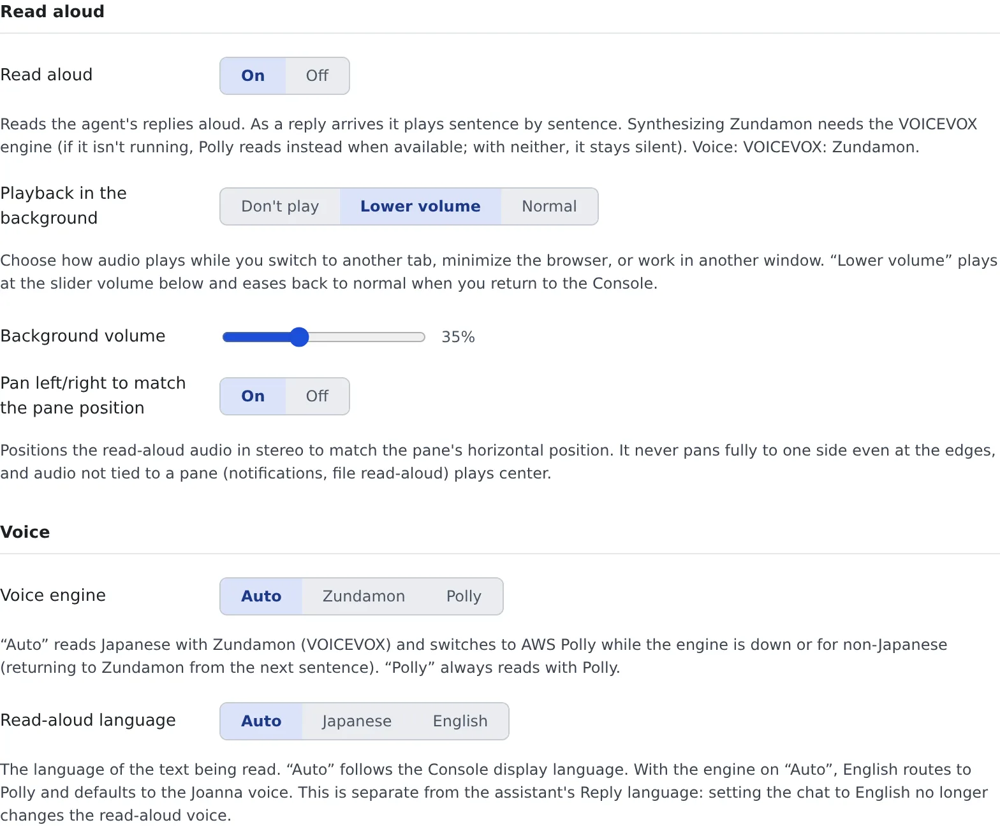

# Use read-aloud

English | [日本語](read-aloud.ja.md)

Have session and assistant replies read aloud. Even with your eyes off the screen, you know what came back and what you are being asked.

## How it works

| What you do | What happens |
|---|---|
| Turn "Read aloud" on | A reply is read sentence by sentence as it arrives |
| Choose the voice and how it reads | The next sentence read uses it |
| Write entries in the reading dictionary | What you wrote is read the way you specified |

## Start reading aloud

Open **⚙ Settings → "Read aloud"** and set "**Read aloud**" to "**On**". It is off by default.



- On or off is a setting of this browser only. Everything else is saved on the server and is the same on another PC or browser
- When it is on, new replies in the active pane are read. Any reply can be heard at any time with the turn's "**Read aloud**" button
- "**Playback in the background**" chooses what happens while you are in another tab: "**Don't play**", "**Lower volume**" (the default) or "**Normal**"

## Choose the voice

Set these in the "**Voice**" group.

| Setting | What it decides |
|---|---|
| Voice engine | "**Auto**" (the default), "**Zundamon**" or "**Polly**". "Auto" reads Japanese with Zundamon (VOICEVOX), and anything else, or anything while the engine is not running, with AWS Polly |
| Read-aloud language | "**Auto**" (follows the display language), "**Japanese**" or "**English**". With the engine on "Auto", English is read by Polly |
| Speaker (Zundamon), Speaker (Polly) | The voice for each engine |
| Use a different voice per session | Assigns a voice from the session's name, so you can tell by ear which session a reply came from. On by default |
| Characters | The characters given to sessions, with each one's style and speed. Press ▶ to preview |
| Vary emotion by content | Reads sentences about errors and failures, and sentences about success and completion, in different styles |
| Reading speed | "**Slow**", "**Normal**", "**Fast**" (the default) or "**Faster**" |

- The read-aloud language is a separate setting from the assistant's "**Reply language**". Setting only the chat's replies to English does not change the voice
- On a deployment without a VOICEVOX engine, everything is read by Polly, and the Zundamon settings are not shown
- While the Zundamon engine is stopped, the tab says so and offers "**Call Zundamon**". Called, it starts reading in about a minute; Polly reads until then

## Choose when it reads

Set these in the "**Auto read-aloud**" group.

| Setting | What it decides |
|---|---|
| Auto-read new replies | Reads a new reply that arrives in the active pane. On by default |
| Read the work-in-progress quietly | Also reads, quietly, what happens while tools run |
| Read across all open panes | Also reads new replies in panes other than the active one |
| Summarize long replies before reading | AI summarizes a reply of more than about 500 characters into two sentences and reads that. Needs the workspace running |
| Read confirmations/questions | Reads the question and its options when a question card, plan approval or permission request arrives |

Announcing sessions you are not watching is a separate setting ([Get notified](notifications.md#be-told-by-voice)).

## Tune how it reads

Set these in the "**How it reads**" group.

| Setting | What it decides |
|---|---|
| Abbreviate code snippets when reading | Reads only the start of a snippet in backquotes and skips the rest |
| Pause after particles | Adds a short pause where a Japanese particle (を・は・で・に・と) is followed by a kanji |
| Read English in katakana | Reads English words as katakana English, in Zundamon's voice |
| Reading dictionary | One entry per line, in the form `written=reading`. A line starting with `#` is a comment |

```text
GPT-4=ジーピーティーフォー
神=かみ
```

- The reading dictionary is applied before the other reading rules. A tenant-wide dictionary set by an administrator applies too, and for the same written form your entry wins
- "**Audio cache**" under "**Advanced**" chooses how long audio already read is kept, so the same text plays again without waiting

## Reset it

"**Reset settings to initial state**" at the bottom returns every read-aloud setting to its initial value. The reading dictionary is kept.

## When it goes wrong

### "This deployment has no VOICEVOX engine" and nothing is read

The voice engine is set to Zundamon, and the deployment has no VOICEVOX engine. Switch the voice engine to "**Auto**" or "**Polly**".

### Japanese is read in a Polly voice

Polly reads while the Zundamon engine is not running. If the engine is stopped, press "**Call Zundamon**".
If the tab says "An administrator has switched Zundamon off", Polly is the only voice.

### Nothing is heard from another tab

Check that "**Playback in the background**" is not set to "**Don't play**".

## Related

- [Get notified](notifications.md): announce sessions you are not watching by voice
- [Change the display and your account](display.md)
