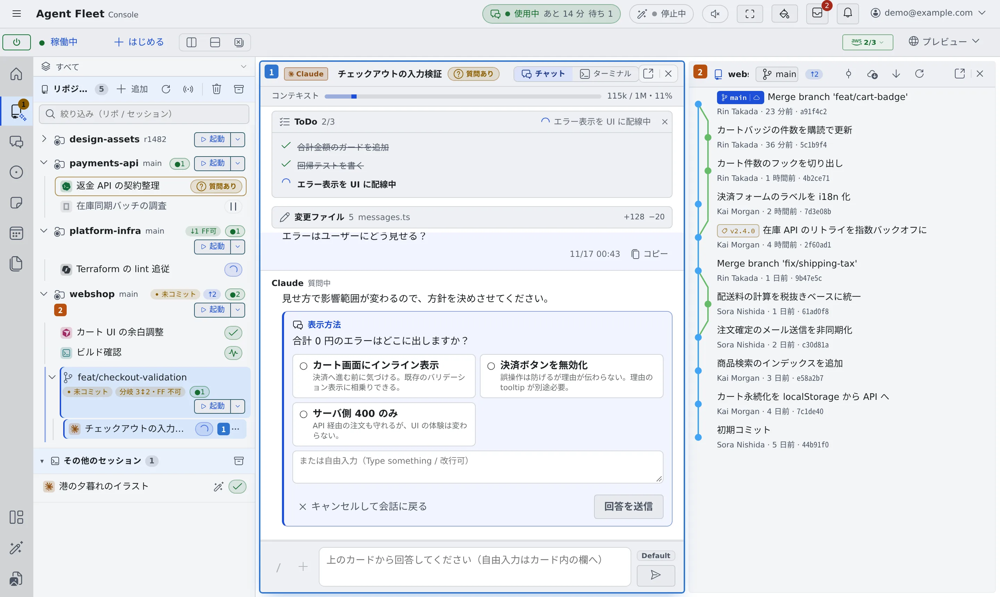

# 画面の見かた

[English](console-tour.md) | 日本語

Console の画面は 5 つの領域に分かれています。どこに何があるかを知っておくと、ほかのページの
「左ペインの…」「ワークスペース操作バーの…」がすぐに見つかります。

## 全体像

| 領域 | 置いてあるもの |
|---|---|
| 上部バー | 受信箱・通知・外観・アカウントメニュー |
| ワークスペース操作バー | ワークスペースの起動・停止、「はじめる」、ペインの分割 |
| アクティビティバー | 左端に縦に並ぶアイコンの列。左ペインに何を出すかを選び、ホームなどのペインを開きます |
| 左ペイン | 一度に 1 つのビュー: セッション・アシスタント・課題管理・メモキュー・スケジュール・ファイルのどれか |
| メイン領域 | 開いたセッション・ファイル・コミットグラフなど。ペインに分けて並べられます |

## 上部バー

| もの | できること |
|---|---|
| ≡（左端のボタン） | 左ペインを出す・隠す。アクティビティバーは残ります。ダブルクリックで、左ペインの出し方（押し出す・重ねる）を切り替えます |
| 受信箱 | ほかのメンバーからの依頼やメッセージを見る |
| 通知（ベル） | ターンの完了や質問などの通知を見る |
| 外観 | 言語・メイン領域の配置・テーマ・配色を変える |
| アカウントメニュー（右端の自分のアドレス） | 「**テナント**」の切り替え、「**利用ガイド**」、「**はじめかたガイド**」、「**設定**」、「**ログアウト**」 |

このガイドで「⚙設定」と書いているのは、アカウントメニューの「**設定**」で開く画面です。「**利用ガイド**」は、このガイドをドキュメントサイトとしてブラウザの新しいタブで開きます。

## ワークスペース操作バー

| もの | できること |
|---|---|
| 電源ボタンと状態 | ワークスペースを起動・停止する。状態は「稼働中」「起動中…」「停止」などで出ます |
| ＋ はじめる | セッションやチャット、shell を始める（[セッションを始める](../sessions/start.ja.md)） |
| 右に分割・下に分割・全て閉じる | 「はじめる」の次に並ぶ 3 つのアイコン。メイン領域のペインを増やす・閉じる（[画面を分けて並べる](panes.ja.md)） |
| プレビュー | ワークスペースで動かしたアプリをブラウザで見る |

## アクティビティバー

上の組のアイコンは、左ペインに出すビューを選びます。アイコンにポインタを載せると名前が出ます。

| アイコン | 左ペインに出るもの |
|---|---|
| セッション | クローンしたリポジトリとその下で動くセッション、続いて「**その他のセッション**」（ホームや shell）と「**共有セッション**」 |
| アシスタント | リポジトリを使わないチャットの一覧と「＋」 |
| 課題管理 | 接続した Jira や GitHub の課題（[課題管理サービスを接続する](../integrations/issue-tracker.ja.md)） |
| メモキュー | 書き溜めた指示 |
| スケジュール | 決まった時刻にセッションを動かす予定。配備で使えるときだけ出ます |
| ファイル | ワークスペースのファイルツリー |

- 表示中のビューのアイコンを押すと、左ペインが畳まれます。どれかのアイコンを押すと戻ります
- アイコンに付く印は、いま見ていないビューのことを知らせます

| 印 | 意味 |
|---|---|
| セッションの橙色の数字 | あなたの返事を待っているセッションの数。答えるまで残ります |
| セッション・アシスタントの青い点 | 未読があります |
| 課題管理の青い数字 | 前にビューを開いてから動きのあった課題やプルリクエストの数 |
| スケジュールの赤い点 | スケジュールの直近の実行が失敗しました |

残りのアイコンはメイン領域にペインを開き、左ペインはそのままにします。いちばん上の「**ホーム**」と、
足元の「**セッション一覧**」「**画像生成**」「**生成した画像を開く**」です。「画像生成」は、配備に画像エンジンが
あるときだけ出ます。

## 左ペイン

左ペインには、アクティビティバーで選んだビューが出ます。

- 「**セッション**」「**アシスタント**」「**スケジュール**」「**ファイル**」のビューは、作業グループのバー（「すべて」）から
  始まります。出すものを名前を付けたグループで絞れます。「すべて」なら全部出ます。アクティビティバーの印も、
  選んだグループに並ぶものだけを数えます
- セッションのビューでは、「**その他のセッション**」「**共有セッション**」の見出しを押すと畳んだり開いたりできます。
  共有セッションは、共有がないときは出ません

ワークスペースが止まっているときは、セッションのビューで「その他のセッション」の代わりに「**セッション履歴**」が出て、
すべてのセッションが 1 つの一覧に並びます。見ることはできますが、操作はワークスペースを起動してからです。

セッションの行に付く印の意味は [セッションの状態を読む](../sessions/status.ja.md) にあります。

## メイン領域

開いたものはメイン領域のペインに表示されます。何も開いていないときは「**ホーム**」が出ます。

### ホーム

| 見出し | 並ぶもの |
|---|---|
| あなたの返事を待っています | 質問・許可・プランの承認を待っているセッション |
| 続きから | 再開できるセッション。新しいものから並びます |
| ひと目で | マシン・稼働時間・エージェント・モデル別の使用量・利用上限のタイル。タイルから詳しい画面を開けます |
| 新しく始める | 「はじめる」と「チャットをはじめる」 |

- はじめて使うときは、上に「Agent Fleet へようこそ」のカードが出ます（[最初のセッションを始める](quickstart.ja.md)）
- 「ひと目で」は畳めます。畳んだかどうかはこのブラウザに残ります。スマートフォンでは最初から畳まれています
- ペインをすべて閉じるとホームに戻ります。アクティビティバーのいちばん上の「**ホーム**」か、リーダーキーのあと `g` `h` でも開けます

## 関連

- [キーボードとコマンドパレットで操作する](shortcuts.ja.md)
- [画面を分けて並べる](panes.ja.md)
- [スマートフォンで使う](phone.ja.md)
- [アイコン・バッジ・メニュー](../../ref/console-ui.ja.md)：画面の印の意味
- [設定](../../ref/settings.ja.md)：設定のタブの一覧
