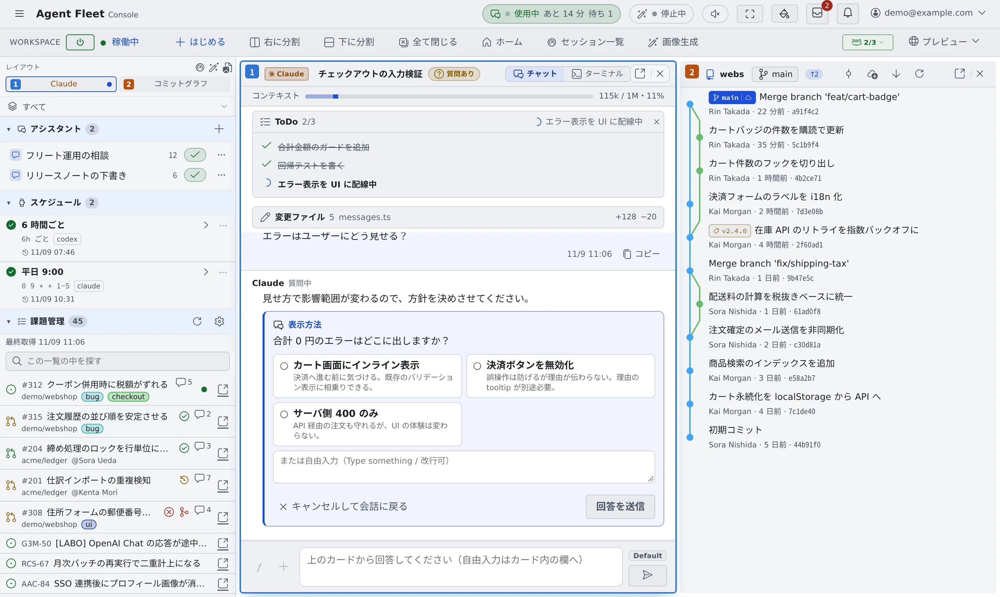

# 画面の見かた

[English](console-tour.md) | 日本語

Console の画面は 4 つの領域に分かれています。どこに何があるかを知っておくと、ほかのページの
「左ペインの…」「ワークスペース操作バーの…」がすぐに見つかります。

## 全体像

| 領域 | 置いてあるもの |
|---|---|
| 上部バー | 受信箱・通知・外観・アカウントメニュー |
| ワークスペース操作バー | ワークスペースの起動・停止、「はじめる」、ペインの分割、ホーム |
| 左ペイン | アシスタント・課題管理・メモキュー・リポジトリとセッションの一覧 |
| メイン領域 | 開いたセッション・ファイル・コミットグラフなど。ペインに分けて並べられます |

## 上部バー

| もの | できること |
|---|---|
| ≡（左端のボタン） | 左ペインを出す・隠す。ダブルクリックで、左ペインの出し方（押し出す・重ねる）を切り替えます |
| 受信箱 | ほかのメンバーからの依頼やメッセージを見る |
| 通知（ベル） | ターンの完了や質問などの通知を見る |
| 外観 | 言語・メイン領域の配置・テーマ・配色を変える |
| アカウントメニュー（右端の自分のアドレス） | 「**テナント**」の切り替え、「**利用ガイド**」、「**はじめかたガイド**」、「**設定**」、「**ログアウト**」 |

このガイドで「⚙設定」と書いているのは、アカウントメニューの「**設定**」で開く画面です。「**利用ガイド**」は、このガイドをドキュメントサイトとしてブラウザの新しいタブで開きます。

## ワークスペース操作バー

| もの | できること |
|---|---|
| 電源ボタンと状態 | ワークスペースを起動・停止する。状態は「稼働中」「起動中…」「停止」などで出ます |
| ＋ はじめる | セッションやチャット、shell を始める（[セッションを始める](../sessions/start.ja.md)） |
| 右に分割・下に分割・全て閉じる | メイン領域のペインを増やす・閉じる（[画面を分けて並べる](panes.ja.md)） |
| ホーム・セッション一覧・画像生成 | それぞれの画面をメイン領域に開く |
| プレビュー | ワークスペースで動かしたアプリをブラウザで見る |

## 左ペイン

上から次の順に並びます。見出しを押すと、その項目を畳んだり開いたりできます。

| 項目 | 中身 |
|---|---|
| レイアウト | ペインを分けているときだけ出る、いまのペインの配置図。押すとそのペインに移ります |
| 作業グループ（「すべて」） | 左ペインに出すものを、名前を付けたグループで絞ります。「すべて」なら全部出ます |
| アシスタント | リポジトリを使わないチャットの一覧と「＋」 |
| スケジュール | 決まった時刻にセッションを動かす予定。配備で使えるときだけ出ます |
| 課題管理 | 接続した Jira や GitHub の課題（[課題管理サービスを接続する](../integrations/issue-tracker.ja.md)） |
| メモキュー | 書き溜めた指示 |
| リポジトリ | クローンしたリポジトリと、その下で動くセッション |
| その他のセッション | リポジトリに属さないセッション（ホームや shell） |
| 共有セッション | ほかのメンバーが共有してくれた会話。共有がないときは出ません |
| ファイル | ワークスペースのファイルツリー。最初は畳まれています |

ワークスペースが止まっているときは、「リポジトリ」と「その他のセッション」の代わりに「**セッション履歴**」が出て、
すべてのセッションが 1 つの一覧に並びます。見ることはできますが、操作はワークスペースを起動してからです。

セッションの行に付く印の意味は [セッションの状態を読む](../sessions/status.ja.md) にあります。

## メイン領域

開いたものはメイン領域のペインに表示されます。何も開いていないときは「**ホーム**」が出ます。

### ホーム

| 見出し | 並ぶもの |
|---|---|
| あなたの返事を待っています | 質問・許可・プランの承認を待っているセッション |
| 続きから | 再開できるセッション。新しいものから並びます |
| ひと目で | マシン・稼働時間・エージェント・モデル別の使用量・利用上限のタイル。タイルから詳しい画面を開けます |
| 新しく始める | 「はじめる」と「チャットをはじめる」 |

- はじめて使うときは、上に「Agent Fleet へようこそ」のカードが出ます（[最初のセッションを始める](quickstart.ja.md)）
- 「ひと目で」は畳めます。畳んだかどうかはこのブラウザに残ります。スマートフォンでは最初から畳まれています
- ペインをすべて閉じるとホームに戻ります。ワークスペース操作バーの「**ホーム**」か、リーダーキーのあと `g` `h` でも開けます

## 関連

- [キーボードとコマンドパレットで操作する](shortcuts.ja.md)
- [画面を分けて並べる](panes.ja.md)
- [スマートフォンで使う](phone.ja.md)
- [アイコン・バッジ・メニュー](../../ref/console-ui.ja.md)：画面の印の意味
- [設定](../../ref/settings.ja.md)：設定のタブの一覧
