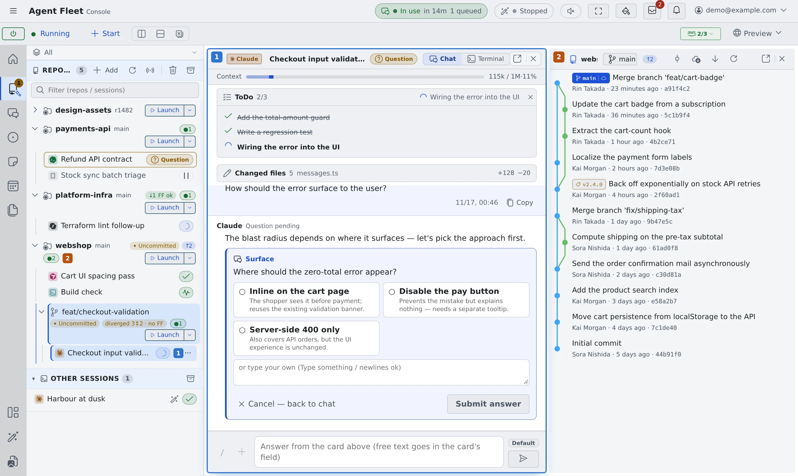

# Find your way around the screen

English | [日本語](console-tour.ja.md)

The Console's screen has five areas. Knowing what sits where makes "in the left pane…" and "on the workspace action bar…"
on the other pages easy to find.

## How it works

| Area | What is there |
|---|---|
| Top bar | Inbox, notifications, Appearance, the account menu |
| Workspace action bar | Workspace start and stop, Start, pane splitting |
| Activity bar | The column of icons at the left edge. It chooses what the left pane shows, and opens Home and other panes |
| Left pane | One view at a time: sessions, Assistants, the issue tracker, the memo queue, auto-run, memory, schedules or files |
| Main area | What you opened: sessions, files, the commit graph and more. It can be split into panes |

## Top bar

| Item | What it does |
|---|---|
| ≡ (the button at the left end) | Shows or hides the left pane; the activity bar stays. A double-click switches how the left pane appears (push or overlay) |
| Inbox | Requests and messages from other members |
| Notifications (the bell) | Notifications such as a finished turn or a question |
| Appearance | Language, main area layout, theme and colours |
| Account menu (your address at the right end) | **Tenant** switching, **User guide**, **Getting-started guide**, **Settings**, **Sign out** |

What this guide calls "⚙ Settings" is the screen that **Settings** in the account menu opens. **User guide** opens
this guide on the docs site in a new browser tab.

## Workspace action bar

| Item | What it does |
|---|---|
| Power button and state | Starts and stops the workspace. The state reads "Running", "Starting…", "Stopped" and so on |
| ＋ Start | Starts a session, a chat or a shell ([Start a session](../sessions/start.md)) |
| Split right, Split down, Close all | The three icons after Start. Adds or closes panes in the main area ([Split the screen into panes](panes.md)) |
| Preview | Shows an app you run in the workspace in the browser |

## Activity bar

The icons in the upper group choose the view the left pane shows. Hover over an icon to read its name.

| Icon | What the left pane shows |
|---|---|
| Sessions | The cloned repositories with the sessions running under them, then **Other sessions** (home or a shell). Runs that memo auto-run started are not listed here; they are in **Auto-run** |
| Shared sessions | The conversations other members shared with you, and handoffs waiting for your decision (a number on the icon) |
| Assistants | The list of chats that use no repository, and **+** |
| Issue tracker | Issues from the Jira or GitHub you connected ([Connect an issue tracker](../integrations/issue-tracker.md)) |
| Memo queue | The instructions you jotted down |
| Auto-run | One row per run of a memo auto-run category: its state, the work item, the pull request and how long it has run. Press a row to open its session ([See the runs](../chat/memo-auto-run.md#see-the-runs)) |
| Memory | Agent memory: the tidy-up's suggestions and the memories, with search and filters ([Read and correct agent memory](../memory/overview.md)) |
| Schedules | Sessions set to run at a fixed time. Shown only where the deployment offers it |
| Files | The workspace's file tree |

- Press the icon of the view on screen to fold the left pane away. Press any icon to bring it back
- A mark on an icon tells you about a view you are not looking at:

| Mark | Meaning |
|---|---|
| Amber number on Sessions | Sessions waiting for your answer. It stays until you answer |
| Blue dot on Sessions or Assistants | Something there is unread |
| Blue number on Issue tracker | Issues or pull requests that moved since you last opened the view |
| Red dot on Schedules | The latest run of a schedule failed |
| Amber number on Memo queue | Memos waiting for your approval in an auto-run category. It stays until you approve or delete them ([Run memos automatically](../chat/memo-auto-run.md#approve)) |
| Amber number on Memory | Memory suggestions waiting for your decision. It stays until you approve or reject them |

The other icons open a pane in the main area and leave the left pane as it is: **Home** at the top, and
**Sessions overview**, **Images** and **Open generated images** at the foot. Images appears only where the deployment
has an image engine.

## Left pane

The left pane shows the view chosen on the activity bar.

- The **Sessions**, **Assistants**, **Schedules** and **Files** views start with the working-set bar ("All"). It narrows
  what is listed to a named group; "All" shows everything. The marks on the activity bar count only what the chosen
  group lists
- In the Sessions view, click the **Other sessions** heading to fold or unfold it. The Shared sessions view says so when nothing is shared with you

While the workspace is stopped, **Session history** takes the place of Other sessions in the Sessions view and lists every
session in one list. You can look at it; acting on a session waits until the workspace is started.

The marks on a session row are explained in [Read a session's state](../sessions/status.md).

## Main area

What you open is shown in a pane of the main area. When nothing is open, **Home** is shown.

### Home

| Heading | What it lists |
|---|---|
| Waiting for you | Sessions waiting for an answer, a permission or a plan approval |
| Continue | Sessions you can pick up again, most recent first |
| At a glance | Tiles for the machine, running time, agents, model usage and usage limits. Each tile opens its detailed view |
| Start something | Start and Start chatting |

- The first time, the "Welcome to Agent Fleet" card sits on top ([Start your first session](quickstart.md))
- "At a glance" can be folded. Whether it is folded is kept in this browser. On a phone it starts folded
- Closing every pane brings you back to Home. **Home** at the top of the activity bar, or the leader key followed by `g` `h`, opens it too

## Related

- [Use the keyboard and the command palette](shortcuts.md)
- [Split the screen into panes](panes.md)
- [Use it on a phone](phone.md)
- [Icons, badges and menus](../../ref/console-ui.md): what the marks on screen mean
- [Settings](../../ref/settings.md): every settings tab
