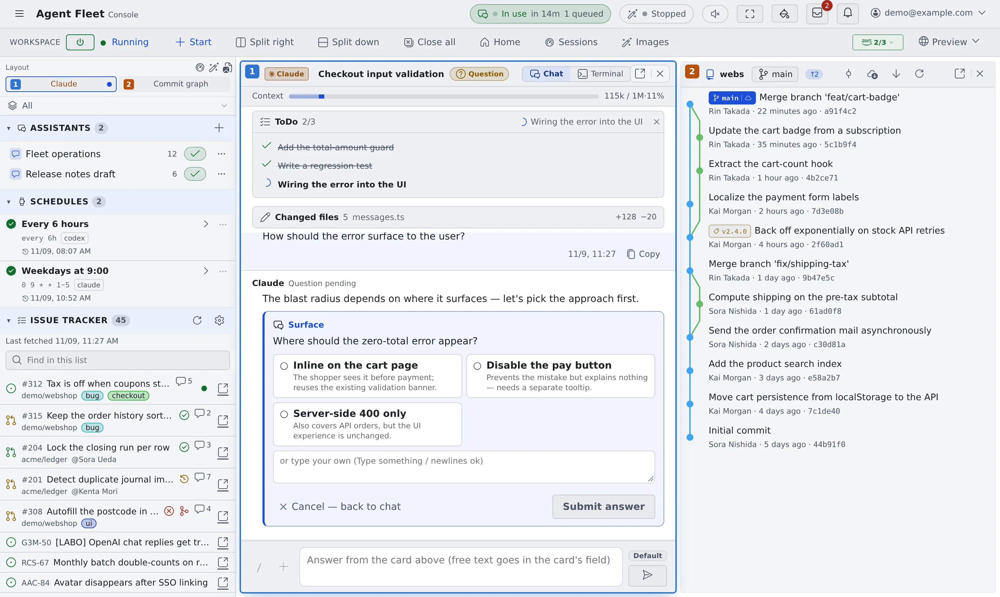

# Find your way around the screen

English | [日本語](console-tour.ja.md)

The Console's screen has four areas. Knowing what sits where makes "in the left pane…" and "on the workspace action bar…"
on the other pages easy to find.

## How it works

| Area | What is there |
|---|---|
| Top bar | Inbox, notifications, Appearance, the account menu |
| Workspace action bar | Workspace start and stop, Start, pane splitting, Home |
| Left pane | Assistants, the issue tracker, the memo queue, the lists of repositories and sessions |
| Main area | What you opened: sessions, files, the commit graph and more. It can be split into panes |

## Top bar

| Item | What it does |
|---|---|
| ≡ (the button at the left end) | Shows or hides the left pane. A double-click switches how the left pane appears (push or overlay) |
| Inbox | Requests and messages from other members |
| Notifications (the bell) | Notifications such as a finished turn or a question |
| Appearance | Language, main area layout, theme and colours |
| Account menu (your address at the right end) | **Tenant** switching, **User guide**, **Getting-started guide**, **Settings**, **Sign out** |

What this guide calls "⚙ Settings" is the screen that **Settings** in the account menu opens.

## Workspace action bar

| Item | What it does |
|---|---|
| Power button and state | Starts and stops the workspace. The state reads "Running", "Starting…", "Stopped" and so on |
| ＋ Start | Starts a session, a chat or a shell ([Start a session](../sessions/start.md)) |
| Split right, Split down, Close all | Adds or closes panes in the main area ([Split the screen into panes](panes.md)) |
| Home, Sessions, Images | Opens that view in the main area |
| Preview | Shows an app you run in the workspace in the browser |

## Left pane

The sections come in this order. Click a heading to fold or unfold it.

| Section | What it holds |
|---|---|
| Layout | A map of the current panes, shown only when the main area is split. Click a pane to move to it |
| Working set ("All") | Narrows what the left pane shows to a named group. "All" shows everything |
| Assistants | The list of chats that use no repository, and **+** |
| Schedules | Sessions set to run at a fixed time. Shown only where the deployment offers it |
| Issue tracker | Issues from the Jira or GitHub you connected ([Connect an issue tracker](../integrations/issue-tracker.md)) |
| Memo queue | The instructions you jotted down |
| Repositories | The cloned repositories and the sessions running under them |
| Other sessions | Sessions that belong to no repository (home or a shell) |
| Shared sessions | Conversations other members shared with you. Not shown when there are none |
| Files | The workspace's file tree. Folded at first |

While the workspace is stopped, **Session history** takes the place of Repositories and Other sessions and lists every session
in one list. You can look at it; acting on a session waits until the workspace is started.

The marks on a session row are explained in [Read a session's state](../sessions/status.md).

## Main area

What you open is shown in a pane of the main area. When nothing is open, **Home** is shown.

### Home

| Heading | What it lists |
|---|---|
| Waiting for you | Sessions waiting for an answer, a permission or a plan approval |
| Continue | Sessions you can pick up again, most recent first |
| At a glance | Tiles for the machine, running time, agents, model usage and usage limits. Each tile opens its detailed view |
| Start something | Start and Start chatting |

- The first time, the "Welcome to Agent Fleet" card sits on top ([Start your first session](quickstart.md))
- "At a glance" can be folded. Whether it is folded is kept in this browser. On a phone it starts folded
- Closing every pane brings you back to Home. **Home** on the workspace action bar, or the leader key followed by `g` `h`, opens it too

## Related

- [Use the keyboard and the command palette](shortcuts.md)
- [Split the screen into panes](panes.md)
- [Use it on a phone](phone.md)
- [Icons, badges, and menus](../../member/badges-and-menus.md): what the marks on screen mean
- [Settings](../../ref/settings.md): every settings tab
