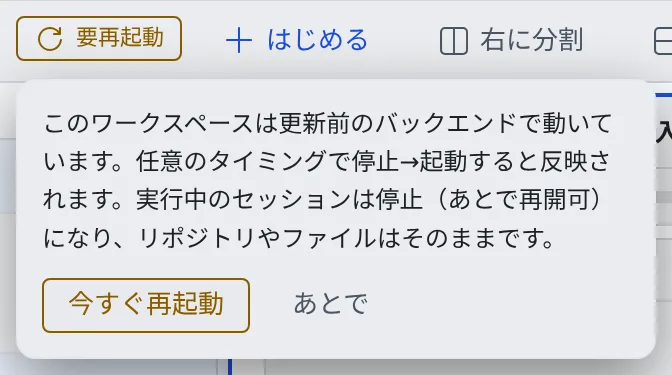

# 一日の終わりにワークスペースを止める

[English](end-of-day.md) | 日本語

作業が終わったら、ワークスペースを止めて構いません。リポジトリ・作業中の変更・セッションは残り、次に起動すれば続きから始められます。

## 全体像

| あなたがやること | 起きること |
|---|---|
| 大事な変更をコミットして push する | 変更がワークスペースの外にも残る |
| ワークスペース操作バーの電源ボタンで止める | 実行中のセッションは「停止」になり、ファイルとログインは残る |
| 次の日に電源ボタンで起動する | 止めたセッションを、押すだけで再開できる |

## 止める前に

- 大事な変更はコミットして push します。コミットしていない変更は、ワークスペースの中にしかありません（[Git のサービスを接続する](../code/connect-git.ja.md#push-する)）
- 区切りのいいセッションは、「⋯」メニューの「**停止する（あとで再開できる）**」で止めておくと、次にすぐ再開できます（[セッションを止める・再開する](../sessions/stop-resume.ja.md)）
- 動かしたままにしたいセッションは、止めなくても構いません

## ワークスペースを止める

1. ワークスペース操作バーの電源ボタンを押します
2. 確認で「**停止する**」を押します

止めても、次のものは残ります。

| 残るもの | 次に起動したとき |
|---|---|
| クローンしたリポジトリと、コミット前の変更 | そのまま使えます |
| セッションの一覧 | 「停止」として残り、押すと再開できます |
| エージェントや Git のサービスへのログイン | そのまま使えます |

- ワークスペースが止まっていても、左ペインの「セッション履歴」でセッションの一覧は見られます。中の操作は起動してからです
- プレビューや opencode web は切断されます

> [!TIP]
> 止め忘れても大丈夫です。テナントで自動停止が有効なら、しばらく操作がないとワークスペースは自動で止まります。
> 長い作業を止めたくないときは [終わったら止める・起こしたままにする](../sessions/auto-stop.ja.md) を見てください。

## 「新しいバージョンがあります」と「要再起動」

Console が更新されると、「**新しいバージョンがあります**」の通知が出ます。

- 通知の「**更新**」はブラウザを読み込み直すだけです。実行中のセッションは止まりません
- 更新にワークスペース側の更新も含まれていると、ワークスペース操作バーに「**要再起動**」のバッジが出ます

「要再起動」を押して「**今すぐ再起動**」を選ぶと、ワークスペースを止めてから起動し直します。

- 実行中のセッションは「停止」になり、あとで再開できます。リポジトリやファイルはそのままです
- 急ぐ必要はありません。一日の終わりに止めて、次の日に起動すれば反映されます。新しいバージョンで起動すると、バッジは消えます

何が変わったかは [更新履歴](../../../deploy/release/notes/SUMMARY.ja.md) にあります。

## 関連

- [セッションを止める・再開する](../sessions/stop-resume.ja.md)
- [終わったら止める・起こしたままにする](../sessions/auto-stop.ja.md)
- [ワークスペースを作り直す](../workspace/recreate.ja.md)：止めて起動しても直らないとき
