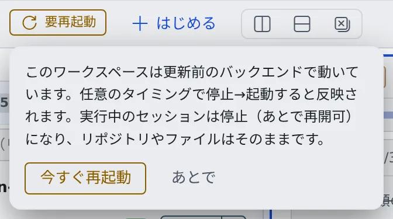

# 一日の終わりにワークスペースを止める

[English](end-of-day.md) | 日本語

作業が終わったら、ワークスペースを停止できます。停止すると実行中のターンも中断します。ホームディレクトリにあるリポジトリや変更と、セッションの履歴は残ります。

## 全体像

| あなたがやること | 起きること |
|---|---|
| 大事な変更をコミットして push する | 変更がワークスペースの外にも残る |
| ワークスペース操作バーの電源ボタンで止める | 実行中のセッションが止まり、作業ディスクがある配備では `/scratch` の中身が消える |
| 次の日に電源ボタンで起動する | 停止中のセッションを開いて再開できる |

## 止める前に

- 大事な変更はコミットして push します。コミットしていない変更は、ワークスペースの中にしかありません（[Git のサービスを接続する](../code/connect-git.ja.md#push-する)）
- 実行中のターンを最後まで進めたいときは、ターンが終わってからワークスペースを停止してください
- 作業ディスクがある配備では、`/scratch` にある必要なファイルを停止前にホームディレクトリへコピーしてください。`target` や `build` から `/scratch` を参照している場合は、起動後にビルドし直します（[af-scratch](../../ref/cli/af-scratch.ja.md)）

## ワークスペースを止める

1. ワークスペース操作バーの電源ボタンを押します
2. 確認で「**停止する**」を押します

止めても、次のものは残ります。

| 残るもの | 次に起動したとき |
|---|---|
| クローンしたリポジトリと、コミット前の変更 | そのまま使えます |
| セッションの一覧と履歴 | 停止中の行を開き、「**再開して続ける**」を押します（[セッションを止める・再開する](../sessions/stop-resume.ja.md)） |
| エージェントや Git のサービスへのログイン | そのまま使えます |

- ワークスペースが止まっていても、左ペインの「セッション履歴」でセッションの一覧は見られます。中の操作は起動してからです
- プレビューや opencode web は切断されます

> [!TIP]
> 止め忘れても大丈夫です。テナントで自動停止が有効なら、しばらく操作がないとワークスペースは自動で止まります。
> 長い作業を止めたくないときは [終わったら止める・動かしたままにする](../sessions/auto-stop.ja.md) を見てください。

## 「新しいバージョンがあります」と「要再起動」

Console が更新されると、「**新しいバージョンがあります**」の通知が出ます。

- 通知の「**更新**」はブラウザを読み込み直すだけです。実行中のセッションは止まりません
- 更新にワークスペース側の更新も含まれていると、ワークスペース操作バーに「**要再起動**」のバッジが出ます

「要再起動」を押して「**今すぐ再起動**」を選ぶと、ワークスペースを止めてから起動し直します。

- 停止して起動するときと同様に、実行中のセッションは停止し、起動後に再開できます。ホームディレクトリの中身は残り、作業ディスクがある配備では `/scratch` の中身が消えます
- 急ぐ必要はありません。一日の終わりに止めて、次の日に起動すれば反映されます。新しいバージョンで起動すると、バッジは消えます

何が変わったかは [更新履歴](../../../deploy/release/notes/SUMMARY.ja.md) にあります。

## 関連

- [セッションを止める・再開する](../sessions/stop-resume.ja.md)
- [終わったら止める・動かしたままにする](../sessions/auto-stop.ja.md)
- [ワークスペースを作り直す](../workspace/recreate.ja.md)：止めて起動しても直らないとき
