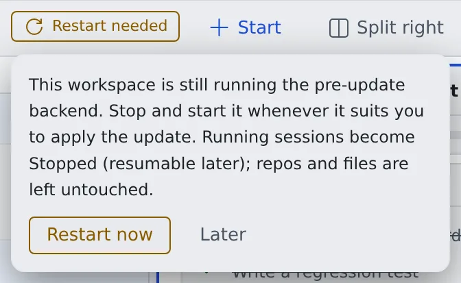

# Stop the workspace at the end of the day

English | [日本語](end-of-day.ja.md)

When you are done, you can stop your workspace. Repositories, uncommitted work and sessions stay, and the next start picks up where you left off.

## How it works

| What you do | What happens |
|---|---|
| Commit and push the changes that matter | The changes also exist outside the workspace |
| Stop it with the power button on the workspace action bar | Running sessions become "stopped"; files and logins stay |
| Start it with the power button the next day | A click resumes each stopped session |

## Before you stop

- Commit and push the changes that matter. Uncommitted changes exist only inside the workspace ([Connect a Git service](../code/connect-git.md#push))
- Stop a session at a good break with **Stop (resumable later)** in its ⋯ menu, and it resumes straight away next time ([Stop and resume a session](../sessions/stop-resume.md))
- A session you want to keep running does not need to be stopped

## Stop the workspace

1. Press the power button on the workspace action bar
2. Press **Stop** in the confirmation

When it is stopped, these stay.

| What stays | At the next start |
|---|---|
| Cloned repositories and uncommitted changes | Ready to use |
| The list of sessions | Kept as stopped; click one to resume it |
| Logins to agents and Git services | Ready to use |

- While the workspace is stopped, **Session history** in the left pane still lists the sessions. Acting on them waits until it is started
- Previews and opencode web are disconnected

> [!TIP]
> Forgetting to stop it is fine. Where the tenant has auto-stop on, the workspace stops by itself after a while without activity.
> To keep a long job from being stopped, see [Stop when done, or keep a session awake](../sessions/auto-stop.md).

## "A new version is available" and "Restart needed"

When the Console is updated, an **A new version is available** notification appears.

- **Update** on the notification only reloads the browser. Running sessions do not stop
- When the update includes the workspace side as well, a **Restart needed** badge appears on the workspace action bar

Press **Restart needed** and choose **Restart now** to stop the workspace and start it again.

- Running sessions become stopped and can be resumed later. Repositories and files stay as they are
- There is no hurry. Stopping at the end of the day and starting the next day applies it too. The badge goes away once the workspace starts on the new version

What changed is in the [release history](../../../deploy/release/notes/SUMMARY.md).

## Related

- [Stop and resume a session](../sessions/stop-resume.md)
- [Stop when done, or keep a session awake](../sessions/auto-stop.md)
- [Recreate the workspace](../workspace/recreate.md): when stopping and starting does not fix it
