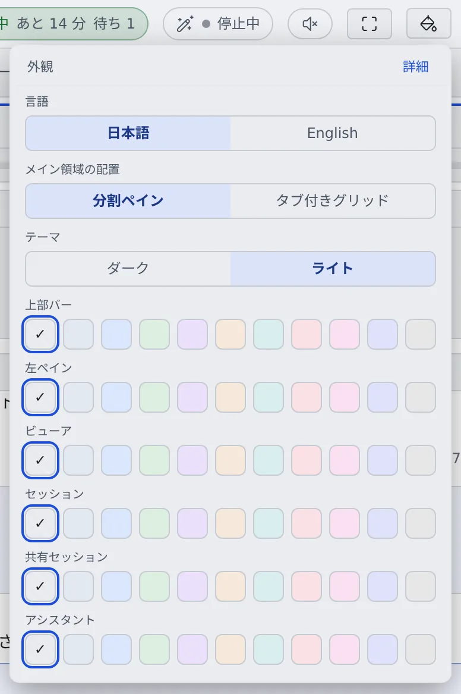

# 画面を分けて並べる

[English](panes.md) | 日本語

メイン領域をいくつかのペインに分けて、セッション・ファイル・コミットグラフを並べて見られます。
1 つの作業を進めながら、別の作業を横で見張るのに向いています。

## 全体像

| あなたがやること | 起きること |
|---|---|
| 項目を Ctrl+クリックする、またはバーの「右に分割」「下に分割」を押す | 新しいペインが開く |
| ペインのつまみや境界をドラッグする | ペインを入れ替える・大きさを変える |
| 「外観」でメイン領域の配置を選ぶ | 分割ペインとタブ付きグリッドを切り替える |

## 新しいペインで開く

- セッション・リポジトリ・ファイルの項目を **Ctrl+クリック**（または中クリック）すると、今のペインを置き換えずに新しいペインで開きます
- アシスタントのチャットは、右クリックの「**新しいペインで開く**」で開きます
- ワークスペース操作バーの「**右に分割**」「**下に分割**」でも、空のペインを足せます

## 並べ替える・閉じる

| やりたいこと | 操作 |
|---|---|
| 入れ替える | ペインの上のつまみを、ほかのペインへドラッグします |
| 大きさを変える | ペインの境界をドラッグします |
| 閉じる | ペインの閉じるボタン。中クリックか Ctrl+クリックなら、確認なしで閉じます |
| 全部閉じる | ワークスペース操作バーの「**全て閉じる**」。ホームに戻ります |

## 配置を選ぶ

上部バーの「**外観**」（ペンキ缶のボタン）か、⚙設定 →「表示」の「**メイン領域の配置**」で切り替えます。

| 配置 | 向いているとき |
|---|---|
| 分割ペイン | 少しのものを、大きさを変えながら並べたいとき |
| タブ付きグリッド（既定） | 開くものが多いとき。マスの数を増やさずに、各マスの中をタブで切り替えます |

- 配置はこのブラウザだけに残ります。2 つの配置はそれぞれの並びを別に覚えているので、行き来しても崩れません
- タブ付きグリッドで表示中のタブを閉じると、その前に表示していたタブに戻ります
- タブ付きグリッドでセッションのタブを右クリックすると、左ペインのそのセッションの行と同じメニューが出ます

並べられる数は次のとおりです。

| 画面 | 上限 |
|---|---|
| パソコン・分割ペイン | 4 列 × 2 段 |
| パソコン・タブ付きグリッド | 3 列 × 2 段、タブは全体で 24 枚 |
| スマートフォン | 1 列、2 枚 |

## 別のタブへ切り離す

ペインの右上の切り離しボタンで、そのペインをブラウザの別のタブへ移せます。元の画面からはなくなります。

- 別のタブの上部には細いタイトルバーが出て、「**フル Console に展開**」で通常の Console に広げられます
- サブディスプレイにセッションを 1 つだけ出しておく、といった使い方に向きます
- 切り離せないペインでは「このペインは別タブへ切り離せません」と出ます

## チャットとターミナルを切り替える

ターミナル（CLI）で動いているセッションは、ペインの上の「**チャット**」「**ターミナル**」で、会話の表示と端末の表示を切り替えられます。
マネージドのセッションはチャットの表示だけです（[セッションを始める](../sessions/start.ja.md#実行方式を選ぶ)）。

## 関連

- [キーボードとコマンドパレットで操作する](shortcuts.ja.md)：ペインを移るキー
- [画面の見かた](console-tour.ja.md)
- [アイコン・バッジ・メニュー](../../member/badges-and-menus.ja.md)：Ctrl+クリックで開くときの項目ごとの違い
