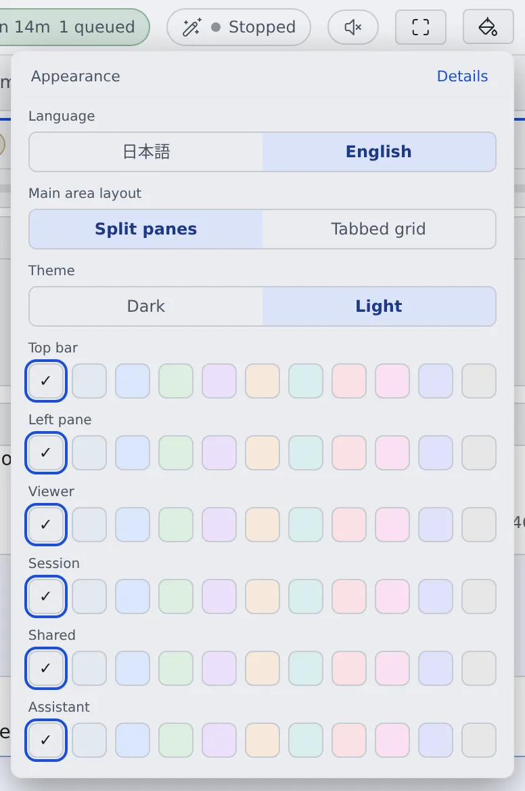

# Split the screen into panes

English | [日本語](panes.ja.md)

Split the main area into panes and look at sessions, files and the commit graph side by side.
It suits moving one piece of work forward while keeping an eye on another.

## How it works

| What you do | What happens |
|---|---|
| Ctrl+click an item, or press Split right or Split down on the bar | A new pane opens |
| Drag a pane's handle or a border | Swaps panes or resizes them |
| Choose the main area layout in Appearance | Switches between split panes and the tabbed grid |

## Open in a new pane

- **Ctrl+click** (or middle-click) a session, repository or file and it opens in a new pane instead of replacing the current one
- An assistant chat opens in a new pane from **Open in a new pane** on its right-click menu
- **Split right** and **Split down** on the workspace action bar add an empty pane too

## Rearrange and close

| What you want | How |
|---|---|
| Swap | Drag the handle at the top of a pane onto another pane |
| Resize | Drag the border between panes |
| Close | The pane's close button. A middle-click or Ctrl+click closes it without asking |
| Close everything | **Close all** on the workspace action bar. You are back on Home |

## Choose the layout

Switch it from **Appearance** on the top bar (the paint bucket), or from **Main area layout** in ⚙ Settings → Display.

| Layout | Suits |
|---|---|
| Split panes | A few things laid out, resized as you go |
| Tabbed grid (default) | Many things open. Each cell switches between tabs instead of adding cells |

- The layout is kept in this browser only. Each layout keeps its own arrangement, so switching back and forth does not undo it
- In the tabbed grid, closing the tab on show brings back the tab you showed before it
- In the tabbed grid, right-clicking a session's tab opens the same menu as that session's row in the left pane

How many you can lay out:

| Screen | Limit |
|---|---|
| Computer, split panes | 4 columns × 2 rows |
| Computer, tabbed grid | 3 columns × 2 rows, 24 tabs in all |
| Phone | 1 column, 2 panes |

## Move a pane to its own tab

The detach button at a pane's top right moves the pane to a separate browser tab. It leaves the original screen.

- The new tab has a thin title bar, and **Expand to full console** turns it into the regular Console
- It suits keeping one session on a second display
- A pane that cannot move says "This pane cannot be moved to its own tab"

## Switch between chat and terminal

A session running in Terminal (CLI) switches between the conversation and the terminal with **Chat** and **Terminal** at the top of the pane.
Managed sessions have the chat view only ([Start a session](../sessions/start.md#choose-the-execution-method)).

## Related

- [Use the keyboard and the command palette](shortcuts.md): keys for moving between panes
- [Find your way around the screen](console-tour.md)
- [Icons, badges, and menus](../../member/badges-and-menus.md): what Ctrl+click opens, item by item
