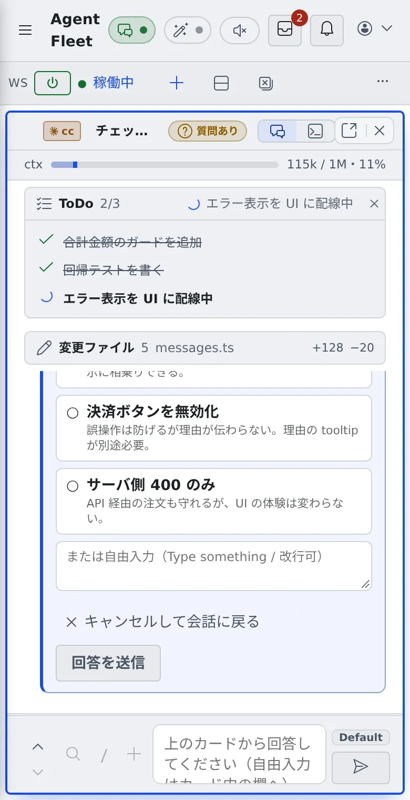

# スマートフォンで使う

[English](phone.md) | 日本語

スマートフォンのブラウザでも Console を開けます。セッションの進み具合を見て、質問に答えたり短い返事を送ったりするのに向いています。
込み入った編集はパソコンで行うのがおすすめです。

## 全体像

| あなたがやること | 起きること |
|---|---|
| ≡ で左ペインを出して、セッションを選ぶ | 選んだセッションが画面いっぱいに開き、左ペインは自動で閉じる |
| 画面を左右にスワイプする | 稼働中のセッションを順に切り替える |
| 端末の下のキー列を押す | ソフトキーボードで押しにくいキーを送る |

## 左ペインを出す

- 画面の左上の **≡** を押すと、左ペインが出ます。項目を選ぶと自動で閉じます
- 画面の左端から右へスワイプしても出せます。左ペインが開いているときに左へスワイプすると閉じます
- ブラウザの戻る操作で、もう一度開きます

## セッションを順に見る

画面を右へスワイプすると、左ペインの一覧で 1 つ下の稼働中のセッションに、左へスワイプすると 1 つ上に切り替わります。

- 切り替わると、「2/3 セッション名」のように何件中の何番目かが一瞬出ます。端まで来ると反対の端に回ります
- shell と SSM のセッションは飛ばします。作業グループを選んでいるときは、そのグループの中だけを回ります
- 画面の左端から始めた右へのスワイプは、左ペインを出す操作になります。次のセッションへ進むときは、左端を避けてスワイプしてください
- 入力欄・ブラウザペイン・コードブロックのように横にスクロールする場所の上では、切り替わりません

## 端末を操作する

ターミナル（CLI）のセッションや shell では、端末の下にキーの列が出ます。

| キー | 送るもの |
|---|---|
| `Esc` `Tab` | Esc、Tab |
| `←` `↑` `↓` `→` | 矢印キー |
| `^C` | Ctrl+C（実行中のコマンドを止める） |
| `⏎` | Enter |

- ソフトキーボードを出さずに送れます
- 端末の上を 1 本指で縦にスワイプすると、過去の出力に戻れます。vim のように画面全体を使うアプリでは、そのアプリのスクロールになります

## バーと通知

- 画面が狭いと、ワークスペース操作バーに収まらないボタンは **⋯** のメニューに移ります。まず「ホーム」「セッション一覧」「画像生成」、次に「下に分割」「全て閉じる」が移ります
- 通知は上のバーのすぐ下に出て、入力欄には重なりません。外側をタップすると消えます。「更新」などのボタンが付いた通知は × でだけ閉じます
- ホームの「ひと目で」は、最初から畳まれています

## 関連

- [画面の見かた](console-tour.ja.md)
- [セッションに返事をする](../sessions/reply.ja.md)
- [ターミナル](../../member/08-terminal.ja.md)：端末のコピー＆ペースト
