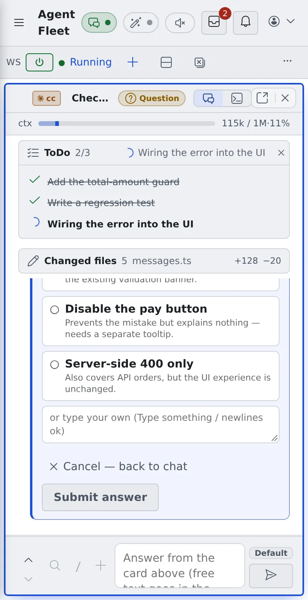

# Use it on a phone

English | [日本語](phone.ja.md)

The Console opens in a phone's browser too. It suits checking how sessions are doing, answering a question or sending a short reply.
Involved editing is better done on a computer.

## How it works

| What you do | What happens |
|---|---|
| Bring out the left pane with ≡ and pick a session | The session fills the screen and the left pane closes by itself |
| Swipe the screen sideways | Steps through the running sessions |
| Press the key row under the terminal | Sends keys that are awkward on a soft keyboard |

## Bring out the left pane

- Press **≡** at the top left to bring out the left pane. Picking an item closes it by itself
- A swipe to the right that starts at the left edge of the screen brings it out too. With the left pane open, a swipe to the left closes it
- The browser's back gesture opens it again

## Step through the sessions

Swipe the screen to the right to move to the running session one row below in the left pane's list, and to the left to move one row up.

- Where you landed shows briefly, as "2/3 session name". At either end it wraps around
- shell and SSM sessions are skipped. With a working set chosen, it steps only through that set
- A swipe to the right that starts at the left edge brings out the left pane instead. To move to the next session, start the swipe away from the edge
- Over an input box, the browser pane or anything that scrolls sideways, such as a code block, it does not switch

## Operate the terminal

In a Terminal (CLI) session or a shell, a row of keys sits under the terminal.

| Key | Sends |
|---|---|
| `Esc` `Tab` | Esc, Tab |
| `←` `↑` `↓` `→` | Arrow keys |
| `^C` | Ctrl+C (stops the running command) |
| `⏎` | Enter |

- They are sent without bringing up the soft keyboard
- Swipe vertically on the terminal with one finger to go back through past output. In an app that uses the whole screen, such as vim, it scrolls that app

## The bar and notifications

- On a narrow screen, buttons that do not fit on the workspace action bar move into its **⋯** menu: Home, Sessions and Images first, then Split down and Close all
- Notifications appear just below the top bar and do not cover the input box. Tap outside to dismiss them. A notification with a button, such as Update, closes only with ×
- "At a glance" on Home starts folded

## Related

- [Find your way around the screen](console-tour.md)
- [Reply to a session](../sessions/reply.md)
- [Terminal](../../member/08-terminal.md): copy and paste in the terminal
