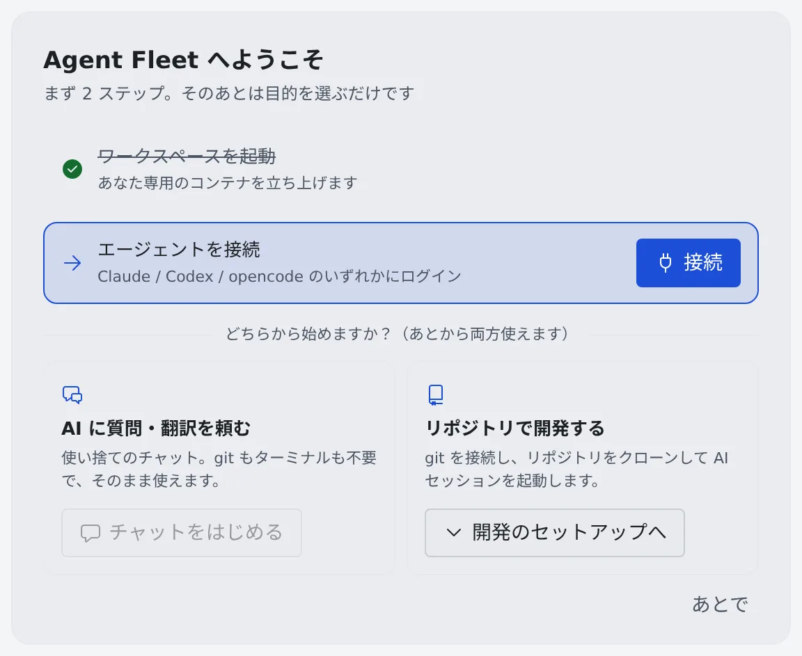

# 最初のセッションを始める

[English](quickstart.md) | 日本語

サインインしてから、最初のチャットかセッションでエージェントの返事を受け取るまでの流れです。
ホームに出るカードに沿って進めれば、数分で終わります。

## 全体像

| あなたがやること | エージェントがやること |
|---|---|
| Console にサインインする | — |
| ワークスペースを起動し、エージェントを接続する | — |
| チャットを始めるか、リポジトリでセッションを起動する | 最初のメッセージやプロンプトを受け取って、作業を始める |
| 返事を読み、必要ならカードに答える | 返事を書き、判断が要るところであなたを待つ |

## 1. サインインする

1. 管理者から案内された Console の URL をブラウザで開きます
2. 出てきたボタン（Google・Microsoft など）から、会社のアカウントでサインインします

ボタンが複数あるときは、管理者に案内された方法を使います。許可されたアカウントだけが入れます。

> [!NOTE]
> 複数のテナント（部署などのグループ）に所属していると、右上のアカウントメニューに「**テナント**」が出ます。
> 作業したいテナントをそこで選びます。ワークスペースはテナントごとに分かれています。

## 2. ようこそカードの 2 ステップを済ませる

サインインすると、ホームの上に「**Agent Fleet へようこそ**」のカードが出ます。済んだ項目には自動でチェックが付きます。

1. 「**ワークスペースを起動**」の「**起動**」を押します。「起動中…」のあと、チェックが付きます
2. 「**エージェントを接続**」の「**接続**」を押し、使うエージェントにログインします（[エージェントを選ぶ](../agents/choose.ja.md)）

- ワークスペースが動いていないと、接続を含め、ほかの操作はできません
- 管理者がチームのエージェントを決めていると、「このチームの既定は Claude です」のように名前が出ます。ほかのエージェントでもチェックは付きます

## 3. 始め方を選ぶ

「**どちらから始めますか？**」の 2 つから選びます。あとから両方使えます。

| 選ぶもの | 次にやること |
|---|---|
| AI に質問・翻訳を頼む | 「**チャットをはじめる**」を押すと、アシスタントとのチャットが開きます。git もターミナルも要りません |
| リポジトリで開発する | 「**開発のセットアップへ**」を押すと、続きの 2 つの手順が開きます（下の表） |

「リポジトリで開発する」の続きは次のとおりです。

| 手順 | やること |
|---|---|
| git プロバイダを接続（任意） | private リポジトリをクローン・push するなら、GitHub や Bitbucket を接続します（[Git のサービスを接続する](../code/connect-git.ja.md)） |
| リポジトリをクローンしてセッション開始 | 「**はじめる**」から、クローンとセッションの起動をまとめて行います（[セッションを始める](../sessions/start.ja.md)） |

クローンだけ先に済ませたいときや、まだリポジトリがないときは [リポジトリをクローンする](../code/clone.ja.md) を見てください。

## 4. 最初の返事を受け取る

チャットやセッションにメッセージを送ると、エージェントが返事を書きます。

- セッションが質問・許可・プランで止まると、行に印が付き、カードが出ます。答え方は [セッションに返事をする](../sessions/reply.ja.md) にあります
- 最初のセッションかチャットを始めると、ようこそカードはホームから消えます。以降のホームには、返事待ちのセッションと続きの作業が並びます（[画面の見かた](console-tour.ja.md#ホーム)）

## カードを閉じても大丈夫

カードの右下の「**あとで**」で閉じられます。

- 閉じたことはこのテナントでのあなたの所属に記録されるので、ほかのブラウザやデバイスでサインインしても出ません。所属するほかのテナントでは、もう一度出ます
- 同じチェックリストは、アカウントメニューの「**はじめかたガイド**」からいつでも開き直せます

カードの各項目は、ふだんの画面では次の場所にあります。

| カードの項目 | ふだんの画面での場所 |
|---|---|
| ワークスペースを起動 | ワークスペース操作バーの電源ボタン |
| エージェントを接続 | ⚙設定 →「エージェント」 |
| チャットをはじめる | 左ペインの「**アシスタント**」の「＋」 |
| git プロバイダを接続 | ⚙設定 →「Git ホスティング」 |
| リポジトリをクローンしてセッション開始 | ワークスペース操作バーの「**はじめる**」 |

## 困ったとき

### 「チャットをはじめる」が押せない

「上の 2 ステップを済ませると使えます」と出ているときは、ワークスペースの起動とエージェントの接続がまだです。
2 つともチェックが付いてから押してください。

### サインインの方法や URL がわからない

テナントの設定で決まるので、管理者に確かめてください。所属するテナントがないときは「所属するテナントがありません。管理者に追加を依頼してください。」と出ます。

ほかの症状は [困ったとき](../README.ja.md#困ったとき) にあります。

## 関連

- [用語と全体像](concepts.ja.md)
- [画面の見かた](console-tour.ja.md)
- [一日の終わりにワークスペースを止める](end-of-day.ja.md)
