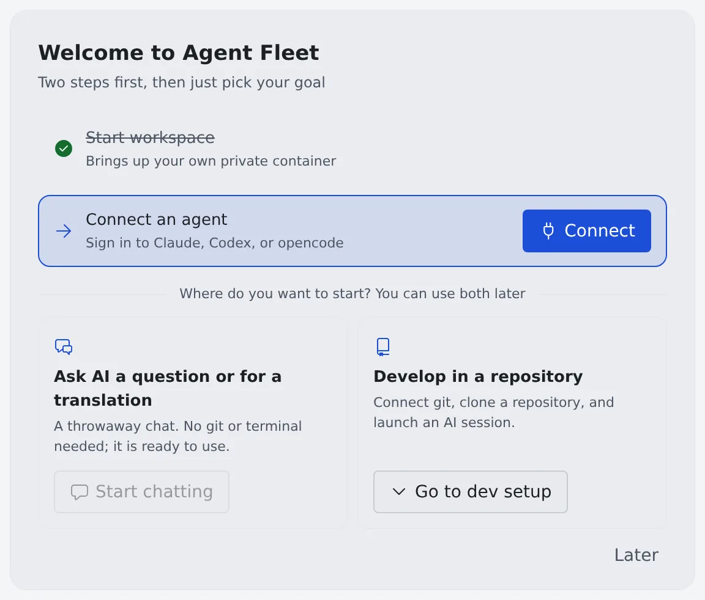

# Start your first session

English | [日本語](quickstart.ja.md)

The path from signing in to an agent's first reply in a chat or a session.
Follow the card on Home and it takes a few minutes.

## How it works

| What you do | What the agent does |
|---|---|
| Sign in to the Console | — |
| Start the workspace and connect an agent | — |
| Start a chat, or launch a session in a repository | Takes the first message or prompt and starts working |
| Read the reply, and answer a card when one appears | Writes the reply, and waits for you where a decision is needed |

## 1. Sign in

1. Open the Console URL your administrator gave you in the browser
2. Sign in with your company account from the button you see (Google, Microsoft and so on)

When there are several buttons, use the one your administrator told you to. Only permitted accounts get in.

> [!NOTE]
> If you belong to several tenants (groups such as departments), the account menu at the top right shows **Tenant**.
> Pick the tenant you want to work in there. Workspaces are separate per tenant.

## 2. Finish the two steps on the welcome card

After you sign in, Home shows the **Welcome to Agent Fleet** card. Finished items are checked off automatically.

1. Press **Start** on **Start workspace**. After "Starting…" the item is checked off
2. Press **Connect** on **Connect an agent** and sign in to the agent you use ([Choose an agent](../agents/choose.md))

- Nothing else works, connecting included, until the workspace is running
- When your administrator has chosen the team's agent, the step names it ("Your team's default is Claude"). Any other agent checks the item off too

## 3. Choose how to start

Pick one of the two under **Where do you want to start?** You can use both later.

| Choice | What comes next |
|---|---|
| Ask AI a question or for a translation | **Start chatting** opens a chat with the assistant. You need neither git nor a terminal |
| Develop in a repository | **Go to dev setup** opens the next two steps (the table below) |

The steps under "Develop in a repository" are these.

| Step | What you do |
|---|---|
| Connect a git provider (optional) | Connect GitHub or Bitbucket if you will clone or push private repositories ([Connect a Git service](../code/connect-git.md)) |
| Clone a repository and start a session | Clone and launch a session in one go from **Start** ([Start a session](../sessions/start.md)) |

To clone first, or when you have no repository yet, see [Clone a repository](../code/clone.md).

## 4. Get the first reply

Send a message in the chat or the session and the agent writes a reply.

- When a session stops at a question, a permission request or a plan, its row gets a mark and a card appears. How to answer is in [Reply to a session](../sessions/reply.md)
- Once you start your first session or chat, the welcome card leaves Home. From then on Home lists the sessions waiting for you and the work to continue ([Find your way around the screen](console-tour.md#home))

## It's fine to close the card

**Later** at the bottom right of the card closes it.

- That you closed it is kept for your membership in this tenant, so it does not come back when you sign in from another device. In another tenant you belong to, it is shown again
- You can reopen the same checklist at any time from **Getting-started guide** in the account menu

Each item on the card has a place on the regular screen.

| Card item | Where it is on the regular screen |
|---|---|
| Start workspace | The power button on the workspace action bar |
| Connect an agent | ⚙ Settings → Agents |
| Start chatting | **+** under **Assistants** in the left pane |
| Connect a git provider | ⚙ Settings → Git hosting |
| Clone a repository and start a session | **Start** on the workspace action bar |

## When it goes wrong

### "Start chatting" cannot be pressed

When "Available once you finish the two steps above" is shown, the workspace is not started or no agent is connected yet.
Press it once both items are checked.

### You don't know the sign-in method or the URL

They are set per tenant, so ask your administrator. When you belong to no tenant, the Console says "You don't belong to any tenant yet. Ask an administrator to add you."

Other symptoms are in [Troubleshooting](../README.md#troubleshooting).

## Related

- [Terms and the big picture](concepts.md)
- [Find your way around the screen](console-tour.md)
- [Stop the workspace at the end of the day](end-of-day.md)
