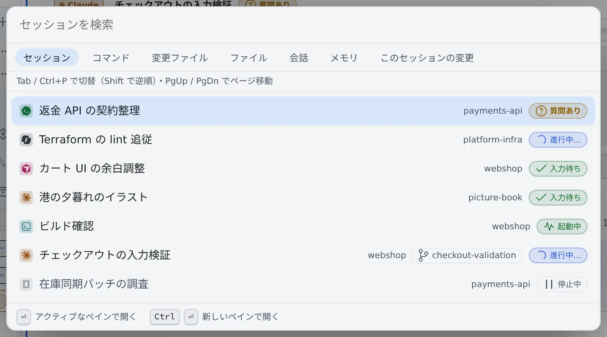

# キーボードとコマンドパレットで操作する

[English](shortcuts.md) | 日本語

マウスを使わずに、セッションを開き、ペインを移り、コマンドを実行できます。
覚えるのは、コマンドパレット（**Ctrl+P**）とリーダーキー（**Ctrl+K**）の 2 つだけで足ります。

## 全体像

| あなたがやること | 起きること |
|---|---|
| **Ctrl+P**（macOS は **⌘P**）を押して名前を入れる | セッション・コマンド・ファイル・過去の会話を探して開く |
| **Ctrl+K**（macOS は **⌘K**）のあと文字を続けて押す | ペイン・セッション・ワークスペースの操作を実行する |
| **Alt** と 1 文字を押す | よく使う操作を 1 回で実行する |
| **?** を押す | ショートカットの一覧を見る |

## コマンドパレットで探して開く

**Ctrl+P**（macOS は **⌘P**）でコマンドパレットが開きます。最初は「**セッション**」の一覧です。

| キー | 動き |
|---|---|
| ↑ ↓ / Enter | 候補を選んで開く・実行する |
| Ctrl+Enter（macOS は ⌘Enter） | セッションやファイルを、新しいペインで開く |
| PageUp / PageDown | 1 画面ぶん選択を動かす |
| Tab / もう一度 Ctrl+P | 探す対象を次へ切り替える |
| Shift+Tab / Ctrl+Shift+P | 探す対象を 1 つ前へ戻す |
| Esc | 閉じて、開く前の場所に戻る |

探す対象は次のとおりです。

| 対象 | 探すもの |
|---|---|
| セッション | ワークスペースのセッション。返事を待っているものが上に来ます |
| コマンド | 画面の操作（ペインの分割、設定を開く、など） |
| 変更ファイル・ファイル | リポジトリのファイル |
| 会話 | 稼働中・停止中・アーカイブ済みを含む、すべてのセッションの会話 |
| メモリ | エージェントメモリ。オンのときだけ出ます |
| このセッションの変更 | いまのペインのセッションが変更したファイル |

- セッションの一覧の順番は、パレットを開いた瞬間に固まります。見ている間に行が入れ替わることはありません
- `#1662`・`PROJ-123` のように課題やプルリクエストの番号を入れると、その番号に結び付いたセッションが先頭に出ます。番号全体で照合するので、`#12` で `#1662` は見つかりません
- 「会話」で Enter を押すと、そのセッションを一致したターンまでスクロールして開きます。ツールの出力やエージェントの思考は対象外です
- アーカイブ済みのセッションはそのままでは開けないため、Enter を押すとそのセッションだけに絞ったアーカイブが開きます。そこで復元してください。「すべて表示」でアーカイブ全体に戻ります
- 「会話」の結果には、タイトルの下にセッションの ID とブランチ（無ければフォルダ名）が出ます。同じタイトルのセッションを見分けるのに使えます

## リーダーキーで操作する

**Ctrl+K**（macOS は **⌘K**）を押してから、続けて文字を押します。少し待つと、次に押せるキーの一覧が出るので、
並びを覚えていなくても使えます。

| 最初の文字 | グループ | 例 |
|---|---|---|
| p | ペイン / レイアウト | `p r` 右に分割、`p d` 下に分割、`p w` 閉じる |
| s | セッション | `s n` 新規セッション、`s l` セッション一覧 |
| w | ワークスペース | `w s` 起動 / 停止、`w b` 左レールの表示切替、`w t` テーマ切替 |
| g | パネルを開く | `g h` ホーム、`g s` セッション一覧、`g n` 通知センター |
| n | 通知 | `n m` 音声読み上げオン/オフ |
| v | ビュー | `v p` Markdown 表示モード、`v r` 朗読モード |

- **Backspace** で 1 段戻り、**Esc** で取り消します
- `;` でコマンドパレットが開きます。ターミナルにフォーカスがあって Ctrl+P がターミナルに渡るときに使います

## Alt でひと押しの操作

| キー | 操作 |
|---|---|
| Alt+N | 新規セッション（「はじめる」を開く） |
| Alt+U | 次の要対応セッションへ移動。返事を待っているものが先、次に未読の通知があるもの |
| Alt+W / Alt+Shift+W | タブ・ペインを閉じる / 全ペインを閉じる |
| Alt+1〜8 | ペイン 1〜8 へフォーカス |
| Alt+[ / Alt+] | 前 / 次のペインへ |
| Alt+PageUp / Alt+PageDown | 前 / 次のタブへ |
| Alt+A | メモを追加 |
| Alt+G | 作業グループを切り替え |
| Alt+/ | 左ペインの絞り込み欄へ |
| Alt+Q | 音声読み上げのオン/オフ。読み上げている最中なら、その読み上げを止めます |
| Alt+, | 設定を開く |
| Alt+= / Alt+- / Alt+0 | いま見ているペインの文字を大きく / 小さく / 既定に戻す |

ほかにも次のキーがあります。

| キー | 操作 |
|---|---|
| Ctrl+B（macOS は ⌘B） | 左ペインを出す・隠す |
| F6 / Shift+F6 | 左ペイン・メイン領域・バーの間でフォーカスを移す |
| ? | ショートカットの一覧を開く |

> [!NOTE]
> 全画面表示の間は、Ctrl+W のようにブラウザが先に使うキーもターミナルに届きます。Esc はそうならないので、全画面はいつでも Esc で抜けられます。

## キーを変える

⚙設定 →「**キー操作**」で変えます。

| 設定 | できること |
|---|---|
| ショートカットの割り当て | Alt などの直接のキーと、リーダー・コマンドパレット・ショートカット一覧のキーを変える。リーダーのあとに続く文字の並びは変えられません |
| 端末入力の優先 | 端末にフォーカスがある間は、Ctrl のキーを端末に渡す。アプリ側ではリーダーだけが効きます |
| shell / SSM 端末へキーをすべて渡す | shell と SSM の端末では、リーダーとコマンドパレットのキーも端末に渡す。既定ではオフです |
| 送信キー | 「Ctrl+Enter で送信」（Enter で改行）と「Enter で送信」（Shift+Enter で改行）から選ぶ。既定は「Ctrl+Enter で送信」です。セッションとアシスタントのチャットに共通です |
| 返信サジェスト | 入力欄の上に短い返信の候補を出す（[セッションに返事をする](../sessions/reply.ja.md#返信サジェストを使う)）。「1 回だけの候補を消去」は 1 回しか送っていない候補だけを、「学習をすべて消去」は学習した候補と消した候補をまとめて消します |

## 困ったとき

### Ctrl+Shift+P でパレットの対象が戻らない

ブラウザによっては Ctrl+Shift+P をブラウザ自身が使います（Firefox のプライベートウィンドウなど）。
その場合は **Shift+Tab** で戻ってください。

### 「会話」で「索引を作成中です」と出る

全セッションの会話を読み終えるまで、1〜2 分かかることがあります。その間も結果は出ますが、そろっていないことがあります。

### 「メモリ」で何も探せない

エージェントメモリはワークスペースの中にあるので、ワークスペースが起動している間だけ探せます。

## 関連

- [画面の見かた](console-tour.ja.md)
- [画面を分けて並べる](panes.ja.md)
- [ターミナルを使う](../files/terminal.ja.md)：ターミナルの中のコピー＆ペーストや文字のサイズ
- [エージェントのメモリを見る・直す](../memory/overview.ja.md)
