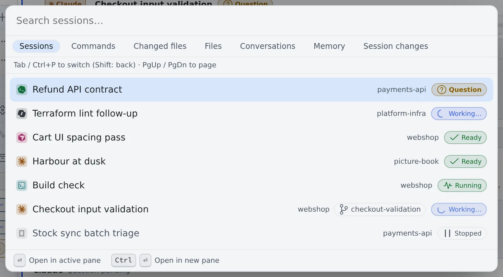

# Use the keyboard and the command palette

English | [日本語](shortcuts.ja.md)

Open sessions, move between panes and run commands without the mouse.
Two keys are enough to remember: the command palette (**Ctrl+P**) and the leader key (**Ctrl+K**).

## How it works

| What you do | What happens |
|---|---|
| Press **Ctrl+P** (**⌘P** on macOS) and type a name | Finds and opens sessions, commands, files and past conversations |
| Press **Ctrl+K** (**⌘K** on macOS), then letters | Runs pane, session and workspace actions |
| Press **Alt** and one key | Runs a frequent action in one press |
| Press **?** | Shows the shortcut list |

## Find and open with the command palette

**Ctrl+P** (**⌘P** on macOS) opens the command palette. It starts on the **Sessions** list.

| Key | What it does |
|---|---|
| ↑ ↓ / Enter | Pick a candidate and open or run it |
| Ctrl+Enter (⌘Enter on macOS) | Open a session or a file in a new pane |
| PageUp / PageDown | Move the selection one screen |
| Tab / Ctrl+P again | Switch to the next thing to search |
| Shift+Tab / Ctrl+Shift+P | Switch back one |
| Esc | Close and return to where you were |

What it searches:

| Mode | What it finds |
|---|---|
| Sessions | The workspace's sessions. Those waiting for you come first |
| Commands | Screen actions (split a pane, open settings and so on) |
| Changed files, Files | Files in the repositories |
| Conversations | The conversations of every session, running, stopped and archived |
| Memory | Agent memory. Shown only while it is on |
| Session changes | The files changed by the session in the current pane |

- The order of the sessions list is fixed the moment the palette opens. Rows do not swap places while you read
- Type an issue or pull request number such as `#1662` or `PROJ-123` and the sessions tied to it come first. The whole number is matched, so `#12` does not find `#1662`
- Enter on a result in Conversations opens that session scrolled to the matching turn. Tool output and the agent's thinking are not searched

## Act with the leader key

Press **Ctrl+K** (**⌘K** on macOS), then the letters. After a moment a list of the keys you can press next appears, so you
do not need to remember the sequences.

| First letter | Group | Examples |
|---|---|---|
| p | Panes / layout | `p r` split right, `p d` split down, `p w` close |
| s | Session | `s n` new session, `s l` sessions overview |
| w | Workspace | `w s` start / stop, `w b` toggle left rail, `w t` toggle theme |
| g | Open panel | `g h` Home, `g s` sessions overview, `g n` notification center |
| n | Notifications | `n m` toggle voice read-aloud |
| v | View | `v p` Markdown display mode, `v r` read-aloud view |

- **Backspace** goes back one level and **Esc** cancels
- `;` opens the command palette. Use it when the terminal has focus and Ctrl+P goes to the terminal

## One-press actions with Alt

| Key | Action |
|---|---|
| Alt+N | New session (opens Start) |
| Alt+U | Jump to the next session that needs you: those waiting for an answer first, then those with unread notifications |
| Alt+W / Alt+Shift+W | Close the tab or pane / close all panes |
| Alt+1–8 | Focus pane 1–8 |
| Alt+[ / Alt+] | Previous / next pane |
| Alt+PageUp / Alt+PageDown | Previous / next tab |
| Alt+A | Add memo |
| Alt+G | Cycle working set |
| Alt+/ | Focus the left pane's filter |
| Alt+Q | Toggle voice read-aloud. While something is being read, stops it |
| Alt+, | Open settings |
| Alt+= / Alt+- / Alt+0 | Bigger / smaller / default text in the pane you are looking at |

A few more keys:

| Key | Action |
|---|---|
| Ctrl+B (⌘B on macOS) | Show or hide the left pane |
| F6 / Shift+F6 | Move focus between the left pane, the main area and the bars |
| ? | Open the shortcut list |

> [!NOTE]
> In fullscreen, keys the browser normally takes first, such as Ctrl+W, reach the terminal. Esc does not, so Esc always leaves fullscreen.

## Change the keys

Change them in ⚙ Settings → **Keyboard**.

| Setting | What it does |
|---|---|
| Shortcut assignments | Change the direct keys such as Alt, and the keys for the leader, the command palette and the shortcut list. The letters that follow the leader cannot be changed |
| Terminal input priority | While the terminal has focus, Ctrl keys go to the terminal. Only the leader still works in the app |
| Pass all keys to shell / SSM terminals | In shell and SSM terminals, the leader and command palette keys go to the terminal too. Off by default |
| Send key | Choose "Send with Ctrl+Enter" (Enter adds a line) or "Send with Enter" (Shift+Enter adds a line). The default is "Send with Ctrl+Enter". It applies to session and assistant chats alike |
| Reply suggestions | Show short reply candidates above the composer ([Reply to a session](../sessions/reply.md#use-reply-suggestions)). "Clear used-once" removes only the candidates you sent once; "Clear all learned" removes what was learned and the dismissed candidates together |

## When it goes wrong

### Ctrl+Shift+P does not step the palette back

Some browsers keep Ctrl+Shift+P for themselves (a Firefox private window, for one).
Use **Shift+Tab** instead.

### Conversations says "Building the index"

Reading every session's conversations can take a minute or two. Results show up meanwhile, but may be incomplete.

### Memory finds nothing

Agent memory lives inside the workspace, so it can only be searched while the workspace is running.

## Related

- [Find your way around the screen](console-tour.md)
- [Split the screen into panes](panes.md)
- [Terminal](../../member/08-terminal.md): copy and paste and text size inside the terminal
- [Agent memory](../../member/18-agent-memory.md)
