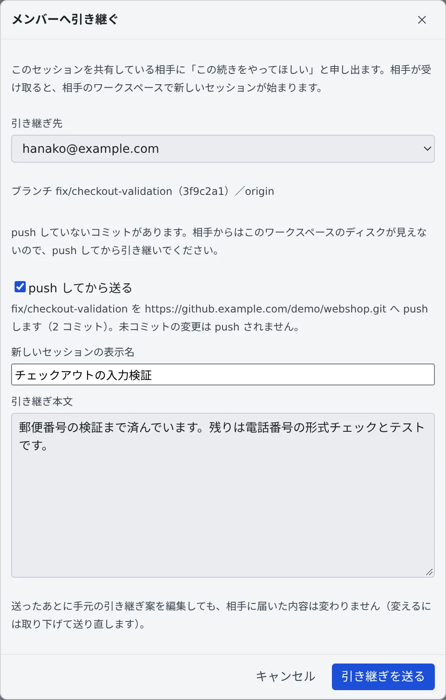

# セッションをメンバーに渡す

[English](hand-over.md) | 日本語

セッションの続きを、同じテナントのメンバーに頼めます。相手が受け取ると、相手のワークスペースで新しいセッションが始まり、
あなたの push したブランチから作業を続けてもらえます。

## 全体像

| あなたがやること | 相手とエージェントがやること |
|---|---|
| セッションを相手に共有し、「**メンバーへ引き継ぐ…**」で引き継ぎ本文を送る | 相手の受信箱・通知・共有された会話に、引き継ぎが届く |
| push していないコミットがあれば「**push してから送る**」を選ぶ | 相手が「**引き継ぐ**」を押すと、相手のワークスペースで新しいセッションが起動し、引き継ぎ本文を最初の指示として受け取る |
| 届いた結果を、カードの状態で確かめる | 相手が受け取らなければ、7 日で期限切れになる |

> [!NOTE]
> セッションの ⋯ メニューには、似た項目が 3 つあります。
>
> | 項目 | 何が起きるか |
> |---|---|
> | **共有する…** | 会話を相手に読み取り専用で見せます。新しいセッションは始まりません（[会話を共有する](share.ja.md)） |
> | **別のエージェントへ引き継ぐ…** | 文脈を持った新しいセッションを、**自分の**ワークスペースで始めます（[別のセッションやエージェントに引き継ぐ](../sessions/handoff.ja.md)） |
> | **メンバーへ引き継ぐ…** | このページです。新しいセッションは**相手の**ワークスペースで始まります |

## 送る前に確かめること

- **相手にこのセッションを共有していること。** 送れるのは、このセッションをすでに共有しているメンバーだけです。
  「閲覧のみ」の共有で足ります。誰にも共有していなければ、ダイアログに「**このセッションを共有する**」が出ます
- **自分のワークスペースが動いていること。** 作業フォルダが残っている、会話のあるセッションでだけ、メニューに項目が出ます
- **ブランチに乗っていること。** HEAD が detached のときは送れません。先にブランチをチェックアウトしてください

## 引き継ぎを送る

1. 次のどちらかから「**メンバーへ引き継ぐ**」のダイアログを開きます
   - セッションの ⋯ メニューの「**メンバーへ引き継ぐ…**」（メニューの画面は [セッションを止める・再開する](../sessions/stop-resume.ja.md) にあります）。引き継ぎ本文は空なので、自分で書きます
   - 会話の中の引き継ぎ案のカードの「**メンバーへ引き継ぐ**」。カードの案がそのまま入ります。カードは「**別のエージェントへ引き継ぐ…**」で作るほか、エージェントが自分から提案したときにも出ます
2. 「**引き継ぎ先**」で相手を選び、「**新しいセッションの表示名**」と「**引き継ぎ本文**」を書きます
3. 「**引き継ぎを送る**」を押します

相手に届くのは、表示名、引き継ぎ本文、それに作業コピーから読み取ったリポジトリ・ブランチ・コミットです。
ディスク上のファイルは渡されません。

- 受領待ちの申し出は、1 つのセッションにつき 1 件までです
- 送ったあとにカードを編集しても、相手に届いた内容は変わりません

### push していないコミットがあるとき

相手からはあなたのディスクが見えないので、push していないコミットがあるときや、一度も push していないブランチでは
そのまま送れません。ダイアログにその理由が出ます。

| 状態 | 送り方 |
|---|---|
| push していないコミットがある、またはブランチを一度も push していない | 「**push してから送る**」にチェックを入れて送ります。表示されたコミットだけを `origin` の同じ名前のブランチへ push し、もう一度確かめてから送ります。force push・タグ・サブモジュールは扱いません |
| 未コミットの変更がある | 未コミットの変更は push されません。「**未コミットの変更は引き継がれないことを承知のうえで送る**」にチェックを入れたときだけ送れます |
| HEAD が detached | 送れません。ブランチをチェックアウトしてからやり直します |

git に push を断られたときは何も送られず、git のメッセージがダイアログに出ます。

## 届いた引き継ぎを受け取る

受け取る側には、次の 3 か所に引き継ぎが出ます。

- 受信箱の「**受け取った**」の先頭（「**メンバーからの引き継ぎ**」）。受け取るか辞退するまで、受信箱のバッジに数えられます（[受信箱](inbox.ja.md)）
- 通知
- 共有された会話の上のバナー（「**内容を見て引き継ぐ**」）

受け取り方は次のとおりです。

1. 「**引き継ぐ**」を押し、作業コピーを選びます。ワークスペースに作業コピーがまだなければ、先に引き継ぎ元のリポジトリをクローンします
2. 中身が入った状態で、いつもの起動ダイアログが開きます。内容を確かめて起動します

セッションは受け取った人のワークスペースで動き、費用もその人に付きます。受け取らないときは「**辞退する**」を押します。

## 送ったあとの状態

送った側のカードには、申し出の状態が出ます。

| 表示 | 意味 |
|---|---|
| 「… へ引き継ぎ中（受領待ち）」 | 相手の返事を待っています |
| 「… がこの引き継ぎからセッションを起動しています」 | 相手が起動を押しました。この間は取り下げられず、期限切れにもなりません |
| 「… が引き継ぎました」 | 相手のワークスペースでセッションが始まりました |
| 「… に辞退されました」 | 相手が辞退しました |
| 「引き継ぎを取り下げました」 | あなたが取り下げました |
| 「引き継ぎは期限切れになりました」 | 7 日間返事がありませんでした。送った人に通知が届きます |

### 取り下げる・送り直す

取り下げ専用のボタンはありません。受領待ちのあいだにカードの「**新規セッションを起動**」を押すと、確認のあと
（「**取り下げて起動**」）申し出を取り下げてから起動ダイアログが開きます。両方で同じ作業が始まるのを防ぐためです。

本文を変えたいときも、この方法で取り下げてから送り直します。

## 困ったとき

### 「メンバーへ引き継ぐ…」がメニューにない

ワークスペースが止まっているか、作業フォルダがなくなったセッションです。ワークスペースを起動してから開き直してください。
シェルや SSM のターミナルのセッションは引き継げません。

### 引き継ぎ先に相手が出ない

このセッションを、その相手にまだ共有していません。「**このセッションを共有する**」から共有してください。

### 受け取ろうとしたら「起動していません」と出た

申し出が確保されるのは、受け取る人が起動を押したときです。ダイアログを開いただけでは確保されません。
送った人が先に取り下げていたときや、別の画面ですでに起動中のときは、何も起動せずに理由が出ます。
もう受け取れない申し出の通知を開いたときも、その旨が出るだけです。

### 起動を押したが、セッションができたか分からない

起動が確定したあとは、結果が返ってこなくても、申し出は受け取る人のために確保されたままです。

1. もう一度起動を押します。セッションが起動したかどうかが確かめられます
2. 確定から 10 分たっても分からないときは、「**ワークスペースにない — 引き継ぎを返す**」が出ます。押すと申し出を送った人に返せます

返しても、先の起動は取り消されません。あとからセッションが現れると同じ作業が二重に動くので、送った人に知らせてください。
確定する前に止まった起動は、10 分で確保を手放します。

## 関連

- [会話を共有する](share.ja.md)：引き継ぐ前に、相手にセッションを共有する
- [受信箱でチームメイトに頼む](inbox.ja.md)：届いた引き継ぎが並ぶ場所
- [別のセッションやエージェントに引き継ぐ](../sessions/handoff.ja.md)：自分のワークスペースで続きを始める
