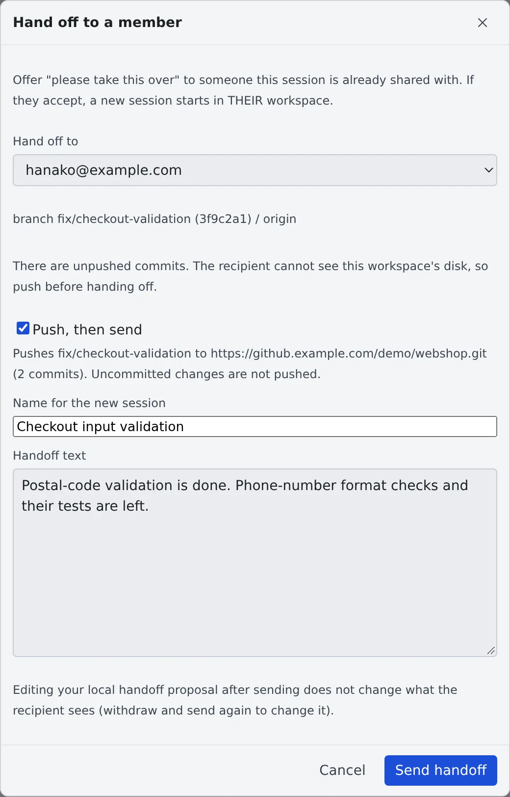

# Hand a session to a member

English | [日本語](hand-over.ja.md)

You can ask a member of the same tenant to carry on a session. When they accept, a new session starts in their workspace
and continues from the branch you pushed.

## How it works

| What you do | What your teammate and the agent do |
|---|---|
| Share the session with them, then send a handoff text with "**Hand off to a member…**" | The handoff reaches their inbox, their notifications and the shared conversation |
| If there are commits not pushed yet, choose "**Push, then send**" | When they press "**Take it over**", a new session starts in their workspace and receives the handoff text as its first instruction |
| Check the outcome on the card's status line | If they never answer, the offer expires after 7 days |

> [!NOTE]
> The session's ⋯ menu has three similar items.
>
> | Item | What happens |
> |---|---|
> | **Share…** | Shows the conversation to someone, read-only. No new session starts ([Share a conversation](share.md)) |
> | **Hand off to another agent…** | Starts a new session with the context in **your own** workspace ([Hand off to another session or agent](../sessions/handoff.md)) |
> | **Hand off to a member…** | This page. The new session starts in **their** workspace |

## Before you send

- **The session is shared with them.** You can only send to members this session is already shared with. A "View only"
  share is enough. If it is shared with nobody, the dialog shows "**Share this session**" first
- **Your workspace is running.** The item appears only on a session with a conversation whose working folder still exists
- **You are on a branch.** A detached HEAD cannot be handed off: check out a branch first

## Send a handoff

1. Open the "**Hand off to a member**" dialog from either place
   - "**Hand off to a member…**" in the session's ⋯ menu (the menu is pictured in [Stop and resume a session](../sessions/stop-resume.md)). The handoff text starts empty and you write it
   - "**Hand off to a member**" on a handoff proposal card in the conversation. The card's proposal is filled in. A card comes from "**Hand off to another agent…**", or from the agent when it proposes one itself
2. Pick the person in "**Hand off to**", and fill in "**Name for the new session**" and "**Handoff text**"
3. Press "**Send handoff**"

What reaches them is the name, the handoff text, and the repository, branch and commit read from your working copy.
Files on your disk do not travel.

- A session can have one offer waiting at a time
- Editing the card after sending does not change what they received

### When there are commits not pushed yet

They cannot see your disk, so an offer with unpushed commits, or on a branch that was never pushed, is not sent as it is.
The dialog says why.

| State | How to send |
|---|---|
| Commits not pushed yet, or a branch never pushed | Tick "**Push, then send**" and send. Only the commits shown are pushed, to the branch of the same name on `origin`, then the state is checked again before sending. No force push, tags or submodules |
| Uncommitted changes | Uncommitted changes are not pushed. You can send only after ticking "**Send anyway; I understand uncommitted changes are not handed over**" |
| Detached HEAD | Cannot be sent. Check out a branch and try again |

If git refuses the push, nothing is sent and git's message appears in the dialog.

## Take over a handoff you received

A handoff shows up for the recipient in three places.

- At the top of the inbox's "**Received**" tab ("**Handoffs from members**"). It counts on the inbox badge until you take it or decline it ([inbox](inbox.md))
- Notifications
- A banner above the shared conversation ("**Review and take it over**")

To take it:

1. Press "**Take it over**" and choose a working copy. If your workspace has none yet, clone the source repository first
2. The usual launch dialog opens with everything filled in. Check it and launch

The session runs in the recipient's workspace and its cost is theirs. To refuse, press "**Decline**".

## After you send

The sender's card shows where the offer stands.

| Shown | Meaning |
|---|---|
| "Handed off to … — waiting" | Waiting for their answer |
| "… is starting a session from this handoff" | They pressed launch. Meanwhile it cannot be withdrawn and does not expire |
| "… took this over" | A session started in their workspace |
| "… declined" | They declined |
| "Handoff withdrawn" | You withdrew it |
| "Handoff expired" | No answer for 7 days. The sender is notified |

### Withdraw or resend

There is no button just for withdrawing. While the offer waits, press "**Start new session**" on the card: after a confirmation
("**Withdraw and start**") the offer is withdrawn and the launch dialog opens. This keeps the same work from starting on both sides.

To change the text, withdraw this way and send again.

## When it goes wrong

### "Hand off to a member…" is not in the menu

The workspace is stopped, or the session's working folder is gone. Start the workspace and open the menu again.
Shell and SSM terminal sessions cannot be handed off.

### The person is not in "Hand off to"

The session is not shared with them yet. Share it from "**Share this session**".

### Taking it says no session was started

The offer is claimed when the recipient presses launch, not when the dialog opens.
If the sender withdrew it first, or it is already launching from another screen, nothing starts and the reason is shown.
Opening the notification of an offer that can no longer be taken only says so.

### You pressed launch and cannot tell whether a session started

Once the launch is committed, the offer stays held for the recipient even without an answer.

1. Press launch again. It checks whether the session started
2. If it is still unknown 10 minutes after the launch was committed, "**Not in my workspace — give it back**" appears. It returns the offer to the sender

Giving it back does not cancel the earlier launch. If that session appears later, the same work runs twice, so tell the sender.
A launch that stopped before being committed releases its hold after 10 minutes.

## Related

- [Share a conversation](share.md): share the session with them before handing it over
- [Ask a teammate through the inbox](inbox.md): where received handoffs are listed
- [Hand off to another session or agent](../sessions/handoff.md): continue in your own workspace
