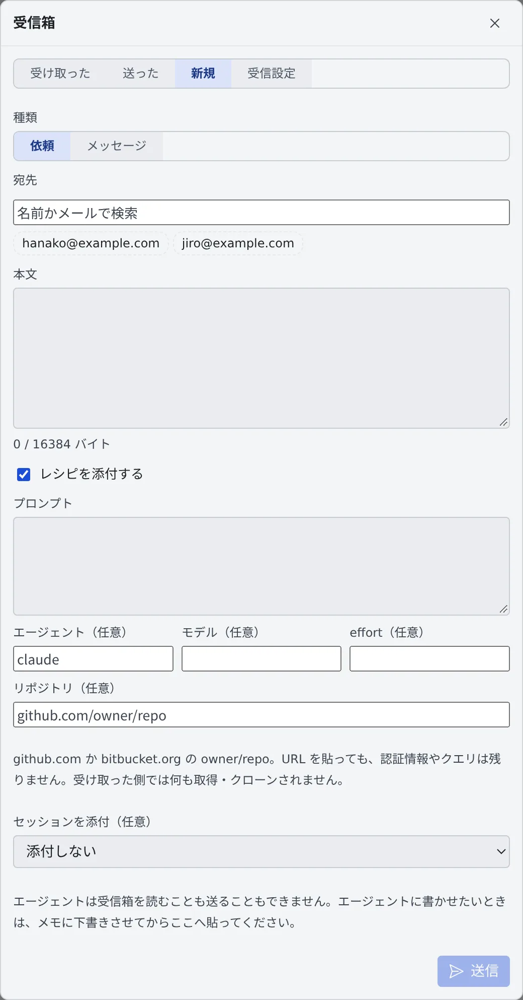
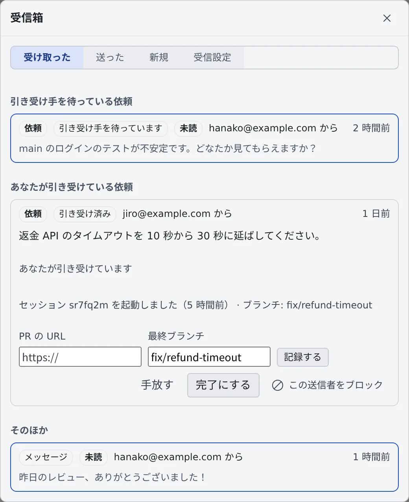

# 受信箱でチームメイトに頼む

[English](inbox.md) | 日本語

受信箱を使うと、同じテナントのメンバーに作業の依頼やメッセージを送れます。依頼を引き受けた人は、
そこから自分のワークスペースでセッションを起動できます。

## 全体像

| あなたがやること | 相手とエージェントがやること |
|---|---|
| 受信箱の「**新規**」で、依頼かメッセージを書いて送る | 宛先の人の受信箱にバッジとトーストで届く |
| 届いた依頼を「**引き受ける**」 | 最初に引き受けた 1 人が担当者になり、ほかの宛先の人にもそれが見える |
| 依頼から「**セッションを起動**」する、レシピを「**メモに取り込む**」 | セッションはあなたのワークスペースで、あなたのアカウントで動く |
| — | エージェントは受信箱を読むことも送ることもできない。取り込むまで、中身はエージェントに渡らない |

受信箱は、画面最上部のバーのベルの隣にあります。専用のバッジがあり、通知センターには入りません。

## 依頼やメッセージを送る

1. 受信箱を開き、「**新規**」を選びます
2. 「**種類**」で「**依頼**」か「**メッセージ**」を選びます
3. 「**宛先**」で相手を検索して選び、「**本文**」を書きます
4. 「**送信**」を押します

- 宛先の全員に届くか、誰にも届かないかのどちらかです。宛先に、あなたからは受け取らない設定の人がいると何も送られず、その人の名前が出ます
- エージェントに依頼文を書かせたいときは、メモに下書きさせてから本文に貼ります

### レシピを添付する

「**レシピを添付する**」にチェックを入れると、セッションの始め方を一緒に送れます。

| 欄 | 入れるもの |
|---|---|
| プロンプト | セッションに渡す最初の指示 |
| エージェント・モデル・effort（任意） | 勧めるエージェント・モデル・effort |
| リポジトリ（任意） | github.com か bitbucket.org の `owner/repo`。URL を貼っても、認証情報やクエリは残りません |

受け取った側では、リポジトリはプロンプトとは別に表示されます。何かを取得したりクローンしたりはしません。

### セッションを添付する

「**セッションを添付（任意）**」で、自分のセッションか、自分に共有されているセッションを選べます。

- 自分のセッションを添付するときは、宛先の全員に読み取り専用で共有できます。共有されるのは会話全体で、この後に増える分も含みます
- 共有とメッセージは、両方できるか、どちらもできないかのどちらかです
- 添付したセッションを見られない宛先には、中身の分からない枠だけが出ます。あとで共有を外したときも、カードはこの枠に変わります
- 依頼を取り下げても、共有は外れません

## 届いたものを読む

「**受け取った**」タブには、届いたものが次の順に並びます。

| 見出し | 並ぶもの |
|---|---|
| 引き受け手を待っている依頼 | まだ誰も引き受けていない依頼 |
| メンバーからの引き継ぎ | [セッションをメンバーに渡す](hand-over.ja.md) で届いた申し出。引き継ぐか辞退するまで残ります |
| あなたが引き受けている依頼 | 自分が担当者の依頼 |
| そのほか | メッセージと、終わった依頼 |

## 依頼を引き受ける

依頼の宛先の人は、それぞれ「**引き受ける**」か「**辞退する**」を選びます。引き受けるのは 1 人で、最初に押した人が担当者になります。

担当者は次のことができます。

| 操作 | できること |
|---|---|
| 手放す | 依頼を「引き受け手を待っています」に戻します |
| セッションを起動 | 作業コピーを選んで、自分のワークスペースで起動します。起動前に内容を確かめられます |
| PR を記録する | 「**PR の URL**」と「**最終ブランチ**」を書いて「**記録する**」を押します |
| 完了にする | 依頼を終えます |

- 依頼から起動したセッションには、左ペインで受信箱の印（「受信箱の依頼から起動（送信者: …）」）が付きます
- 起動の途中で接続が切れて、セッションができたか分からないときは、もう 1 つ起動しないでください。
  自分のセッション一覧を確かめ、やり直すときは依頼を手放してから引き受け直します

### 依頼の状態

| 状態 | 意味 |
|---|---|
| 引き受け手を待っています | まだ誰も引き受けていません |
| 引き受け済み | 担当者が決まりました |
| 完了 | 担当者が完了にしました |
| 全員が辞退 | 宛先の全員が辞退したか、テナントに引き受けられる人がいなくなりました |
| 取り下げ | 送った人が取り下げました。始まった作業は止まりません |

送った人は、依頼が「引き受け手を待っています」か「引き受け済み」のあいだ「**取り下げる**」を押せます。
14 日を過ぎても終わらない依頼には「**14 日以上未完了**」の印が付きます。

## レシピをメモに取り込む

レシピの付いた項目では「**メモに取り込む**」を押すと、レシピを自分のメモキューへ、自分のメモとしてコピーできます。

- 依頼のレシピを取り込めるのは、引き受けた人だけです。メッセージのレシピは、宛先の誰でも取り込めます
- もう一度押しても、同じメモのままです
- 取り込んだメモは、ほかのメモとまとめずに単独で送られます（[メモをためて渡す](../chat/memos.ja.md)）

## 受け取り方を決める

「**受信設定**」タブで、次のことを決めます。

| 設定 | 内容 |
|---|---|
| 受け取る相手 | 「**テナントの全員**」か「**選んだメンバーだけ**」 |
| 通知を止める | バッジとトーストだけを止めます。届いたものは受信箱に入り、辞退にはなりません |
| ブロック中 | 「**この送信者をブロック**」でブロックした人の一覧です。「**解除**」で戻します |

メンバーからの引き継ぎは、この受信設定の対象外です。セッションを共有しているメンバーからだけ届き、
通知を止めていても受信箱のバッジに数えられます。

## 上限と保存期間

| 決まり | 値 |
|---|---|
| 1 件の宛先 | 20 人まで |
| 本文 | 16 KiB まで（レシピのプロンプトも同じ） |
| 1 人が送れる数 | 1 時間に 30 件まで |
| 同じ送信者から同じ相手への未処理 | 10 件まで |
| 1 件に添付できるセッション | 5 件まで |
| メッセージが消えるまで | 送信から 90 日 |
| 依頼が消えるまで | 終わってから 90 日 |

本文は、配備にテナントの鍵があれば暗号化して保存されます。運用者は復号できます。鍵がないときは、「**受信設定**」にそう出ます。
管理者には、誰が誰にどの種類を送ったか、その後の各段階（引き受け・辞退・手放し・完了・取り下げ・PR の記録・取り込み・起動）、
ブロックとその解除が監査記録に残ります。本文は残りません。

## 困ったとき

### 「受け取らない設定の人がいます」と出て送れない

宛先の誰かが、受け取る相手を「選んだメンバーだけ」にしているか、あなたをブロックしています。名前の出た人を宛先から外して送ってください。

### 「未処理が上限に達している人がいます」と出て送れない

その人に、あなたからの未処理が 10 件たまっています。片付くのを待つか、取り下げてから送ってください。

### 「作業コピーがありません」と出て起動できない

自分のワークスペースに、依頼のリポジトリがまだありません。先にクローンしてください（[リポジトリをクローンする](../code/clone.ja.md)）。

## 関連

- [セッションをメンバーに渡す](hand-over.ja.md)：作業中のセッションの続きを頼む
- [会話を共有する](share.ja.md)：添付したセッションの共有を管理する
- [メモをためて渡す](../chat/memos.ja.md)：取り込んだレシピを送る
