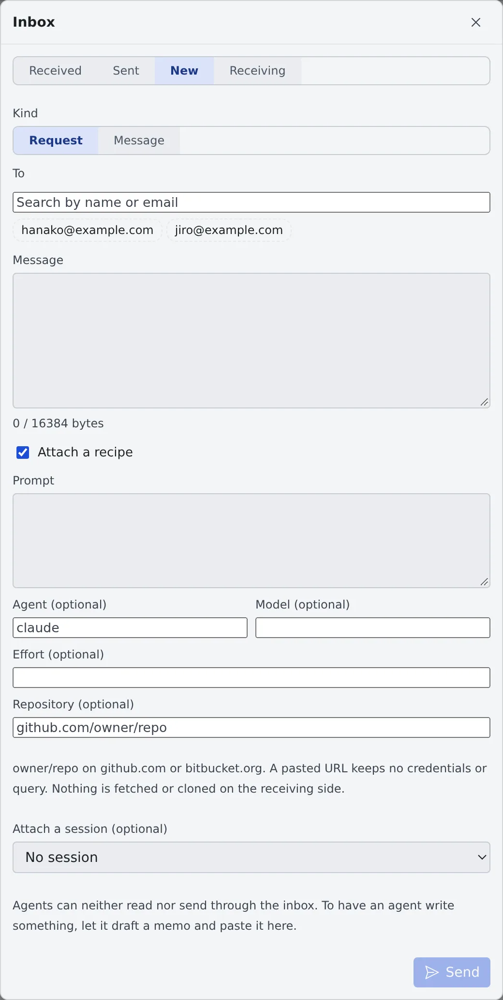
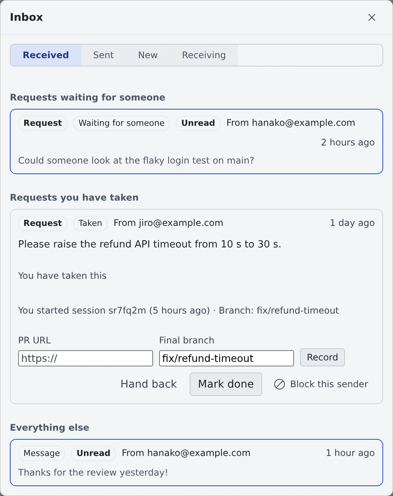

# Ask a teammate through the inbox

English | [日本語](inbox.ja.md)

The inbox lets you send work requests and messages to members of the same tenant. Whoever takes a request can start a
session from it in their own workspace.

## How it works

| What you do | What your teammate and the agent do |
|---|---|
| Write a request or a message under "**New**" in the inbox and send it | It reaches the recipients' inboxes with a badge and a toast |
| "**Take it**" on a request you received | The first person to take it becomes the assignee, and the other recipients see who that is |
| "**Start a session**" from a request, or "**Take into my memos**" for a recipe | The session runs in your workspace, under your account |
| — | Agents can neither read nor send inbox items. Nothing reaches an agent until you take it in |

The inbox sits next to the bell in the bar at the top of the screen. It has its own badge and is not part of the notification centre.

## Send a request or a message

1. Open the inbox and choose "**New**"
2. Under "**Kind**", choose "**Request**" or "**Message**"
3. Search for people under "**To**", pick them, and write the "**Message**"
4. Press "**Send**"

- Either every recipient gets it or none does. If one of them does not accept items from you, nothing is sent and their name is shown
- To have an agent write the request, have it draft a memo, then paste that into the message

### Attach a recipe

Tick "**Attach a recipe**" to send how to start the session along with it.

| Field | What goes in |
|---|---|
| Prompt | The first instruction for the session |
| Agent, model and effort (optional) | The agent, model and effort you recommend |
| Repository (optional) | `owner/repo` on github.com or bitbucket.org. A pasted URL keeps no credentials or query |

The recipient sees the repository apart from the prompt. Nothing is fetched or cloned on their side.

### Attach a session

"**Attach a session (optional)**" lets you pick one of your sessions, or one shared with you.

- When you attach your own session, you can share it read-only with every recipient. The whole conversation is shared, including what is added later
- The share and the message both happen, or neither does
- A recipient who cannot see an attached session gets only a placeholder that says nothing about it. If you unshare it later, the card turns into that placeholder too
- Withdrawing a request does not remove the share

## Read what you received

The "**Received**" tab lists items in this order.

| Heading | What is listed |
|---|---|
| Requests waiting for someone | Requests nobody has taken yet |
| Handoffs from members | Offers sent through [Hand a session to a member](hand-over.md). They stay until you take them over or decline |
| Requests you have taken | Requests you are the assignee of |
| Everything else | Messages, and requests that are over |

## Take a request

Each recipient of a request chooses "**Take it**" or "**Decline**". One person takes it: the first to press becomes the assignee.

The assignee can do the following.

| Action | What it does |
|---|---|
| Hand back | Returns the request to "Waiting for someone" |
| Start a session | Pick a working copy and start the session in your own workspace. You can check it before it launches |
| Record a PR | Fill in "**PR URL**" and "**Final branch**" and press "**Record**" |
| Mark done | Closes the request |

- A session started from a request carries the inbox mark in the left pane ("Started from an inbox request (sender: …)")
- If the connection drops mid-launch and you cannot tell whether a session was created, do not start another.
  Check your session list, and to retry, hand the request back and take it again

### Request states

| State | Meaning |
|---|---|
| Waiting for someone | Nobody has taken it yet |
| Taken | Someone is the assignee |
| Done | The assignee marked it done |
| Declined by everyone | Every recipient declined, or nobody in the tenant can take it any more |
| Withdrawn | The sender withdrew it. Work already started does not stop |

The sender can press "**Withdraw**" while a request is "Waiting for someone" or "Taken".
A request still open after 14 days is marked "**Open for 14+ days**".

## Take a recipe into your memos

On an item with a recipe, "**Take into my memos**" copies the recipe into your memo queue as a memo of your own.

- Only the person who took a request can take in its recipe. A message's recipe can be taken in by any recipient
- Pressing it again keeps the same memo
- A memo taken in this way is always sent on its own, never merged with other memos ([Collect memos and hand them over](../chat/memos.md))

## Choose what you receive

The "**Receiving**" tab decides the following.

| Setting | What it does |
|---|---|
| Accept from | "**Everyone in the tenant**" or "**Chosen members only**" |
| Do not disturb | Mutes the badge and toasts only. Items still arrive, and nothing counts as declined |
| Blocked | The people you blocked with "**Block this sender**". "**Unblock**" lets them through again |

Handoffs from members are outside these settings. They come only from members you share sessions with, and they count on the
inbox badge even with Do not disturb on.

## Limits and retention

| Rule | Value |
|---|---|
| Recipients per item | Up to 20 |
| Message | Up to 16 KiB (a recipe's prompt too) |
| Items one person can send | Up to 30 an hour |
| Open items from one sender to one person | Up to 10 |
| Sessions attached to one item | Up to 5 |
| A message is deleted | 90 days after it was sent |
| A request is deleted | 90 days after it ended |

Messages are stored encrypted when the deployment has a tenant key. Operators can decrypt them. Without a key, "**Receiving**" says so.
Administrators get an audit record of who sent which kind to whom, each later step (take, decline, hand back, done, withdraw,
PR recorded, taken in, launched), and blocks and unblocks. The message text is not recorded.

## When it goes wrong

### "Some recipients do not accept items from you" and nothing is sent

A recipient accepts only chosen members, or has blocked you. Remove the named people from the recipients and send again.

### "Some recipients already have too many pending items from you" and nothing is sent

That person already has 10 open items from you. Wait for them to clear, or withdraw some first.

### "You have no working copy" when starting a session

The request's repository is not in your workspace yet. Clone it first ([Clone a repository](../code/clone.md)).

## Related

- [Hand a session to a member](hand-over.md): ask someone to carry on a session in progress
- [Share a conversation](share.md): manage the share of an attached session
- [Collect memos and hand them over](../chat/memos.md): send a recipe you took in
