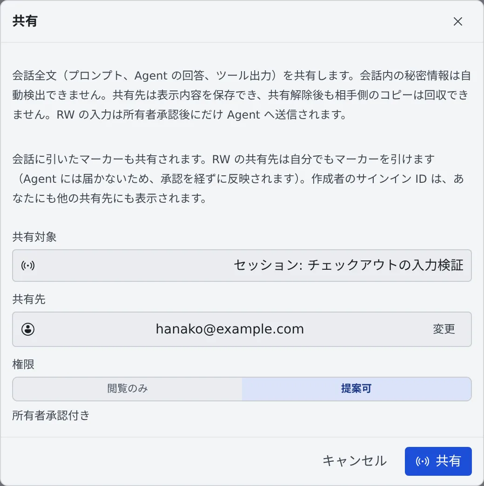

# 会話を共有する

[English](share.md) | 日本語

セッションの会話を、同じテナントのメンバーに読んでもらえます。「この調査の続きを見ておいて」「レビューのついでに経緯も追って」
といった受け渡しに使います。共有で渡るのは会話だけで、相手があなたのワークスペースに入ることはありません。

## 全体像

| あなたがやること | 相手とエージェントがやること |
|---|---|
| ⋯ メニューの「**共有する…**」で、共有先と権限を選ぶ | 相手の左ペインの「**共有セッション**」に、会話が読み取り専用で並ぶ |
| 「**提案可**」で共有した相手の提案を、「**承認して送信**」する | 承認するまで、相手の提案はエージェントに届かない |
| 要らなくなったら「**解除**」する | 相手の一覧から消える。ただし、相手がすでに保存したコピーは回収できない |

共有したセッションの行には「**共有中**」のバッジが付き、何を誰に見せているかがいつでも分かります。

## 共有する

1. 次のどれかから「**共有**」のダイアログを開きます
   - セッション行の ⋯ メニューの「**共有する…**」（メニューの画面は [セッションを止める・再開する](../sessions/stop-resume.ja.md) にあります）
   - リポジトリ行の ⋯ メニューの「**共有する…**」
   - 左ペインの「**共有セッション**」の ⚙（「**共有一覧**」）→「**新規共有…**」
2. 「**共有対象**」を選びます
3. 「**共有先**」をメールアドレスで検索して選びます
4. 「**権限**」を選び、「**共有**」を押します

| 共有対象 | 含まれるもの |
|---|---|
| セッション | そのセッション 1 本だけ |
| プロジェクト | ベースの作業コピーに加えて、その配下の worktree のセッションも含みます。セッションごとに worktree を作る使い方なら、普通はこちらです |
| WT | その worktree 1 つ分 |

| 権限 | 相手ができること |
|---|---|
| 閲覧のみ | 読むだけです |
| 提案可 | 送りたい内容を提案できます。あなたが承認するまで、エージェントには届きません |

> [!WARNING]
> 共有すると、会話の全文（プロンプト、エージェントの回答、ツールの出力）が相手に見えます。会話に混じったシークレットは自動では見つけられません。
> 相手は表示された内容を保存できるので、**共有を解除しても相手の手元のコピーは回収できません**。共有する前に、何が写っているかを確かめてください。

会話に引いたマーカーも共有されます。「提案可」の相手は自分でもマーカーを引けて、承認を待たずに反映されます（エージェントには届きません）。
マーカーを引いた人のサインイン ID は、あなたにもほかの共有先にも表示されます。

## 共有された会話を読む

左ペインの「**共有セッション**」に、所有者ごと・プロジェクトごとに並びます。クリックすると、会話を読み取り専用で開けます。
自分のワークスペースとは関係なく開けるので、リポジトリを持っていなくても読めます。

- 表示位置はセッションのミラーと同じです。初めて開いたときは最新（いちばん下）、途中まで読んで離れたときは次に開くとその位置に戻ります。ブラウザを再読み込みすると最新に戻ります
- 一覧は自動で更新されます。すぐに反映したいときは「**最新に更新**」を押します
- 所有者のワークスペースが止まっているあいだは、履歴を読めません。その旨が出るので、所有者に起動してもらってください
- エージェントが質問を出したまま止まっているときは、その選択肢も見えます。答えられるのは所有者だけです
- 所有者のセッションが引き継ぎ案を出していれば、そのカードも見えます。編集・破棄・起動ができるのは所有者だけです

### 所有者に提案する

権限が「**提案可**」のときだけ、入力欄から「**所有者へ提案**」できます。送る前に「所有者が内容を確認して承認するまで、Agent には送信されません。」と出ます。

- 提案できるのは文面と返信だけです。ファイルの添付はできません
- シェルや SSM のターミナルのセッションには提案できません
- エージェントの質問に答えたいときも、提案として送り、承認を待ちます
- 提案は 24 時間たつと期限切れになります

## 提案を承認する

所有者の側では、「**共有セッション**」の節に「**承認待ち ◯ 件**」が出ます。開くと、対象セッション・操作・本文・提案者が並ぶので、
内容を確かめて「**承認して送信**」か「**却下**」を選びます。

## 共有を解除する

「**共有一覧**」で、解除したい共有の「**解除**」を押します。相手はそのセッションやリポジトリを開けなくなります。

- アーカイブしたセッションは、相手の一覧から外れます。共有そのものは残るので、復元すると再び見えます
- シェルや SSM のターミナルのセッションは、会話がないので共有できません

## 困ったとき

### 「所有者のワークスペースが停止中です」と出て読めない

共有された会話は、所有者のワークスペースから読み出しています。所有者にワークスペースを起動してもらってください。

### 共有先の候補に相手が出ない

共有できるのは、同じテナントのメンバーだけです。相手がテナントに入っているか、管理者に確かめてください。

### 共有したのに相手の一覧に出ない

相手に「**最新に更新**」を押してもらってください。アーカイブしたセッションは出ません。

## 関連

- [セッションをメンバーに渡す](hand-over.ja.md)：共有している相手に、続きの作業を頼む
- [受信箱でチームメイトに頼む](inbox.ja.md)：メッセージにセッションを添付して共有する
- [セッションの状態を読む](../sessions/status.ja.md)：行の印とバッジの読み方
