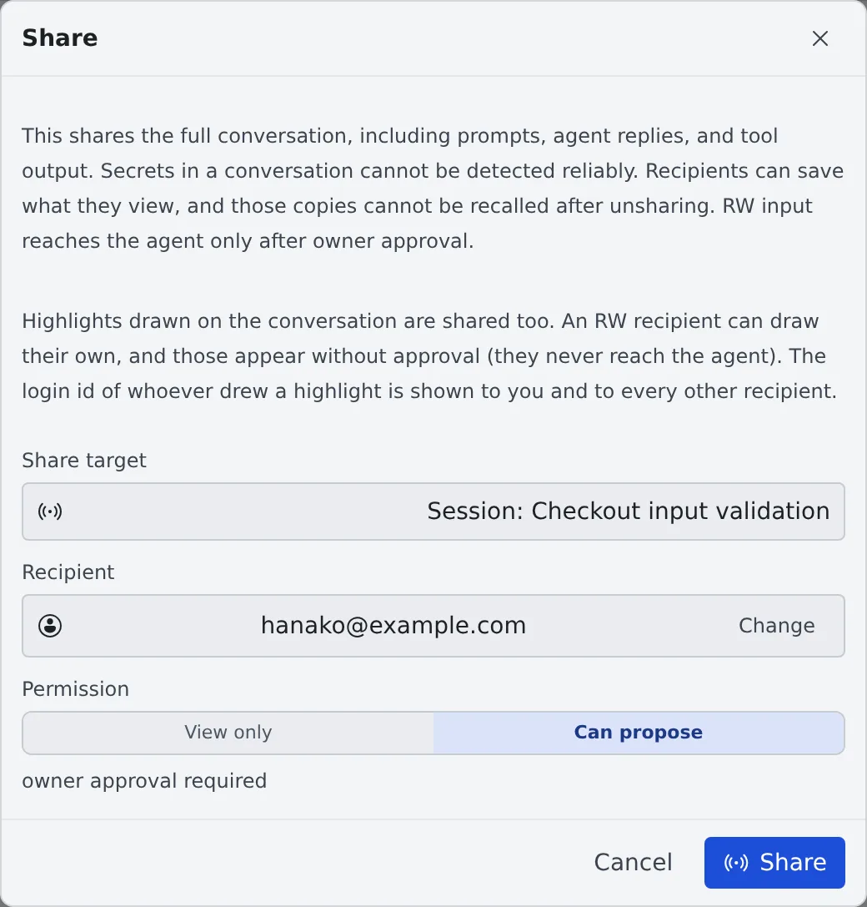

# Share a conversation

English | [日本語](share.ja.md)

You can let members of the same tenant read a session's conversation. Use it to hand something over: "keep an eye on the rest
of this investigation", "follow how we got here while you review". Only the conversation is shared: nobody enters your workspace.

## How it works

| What you do | What your teammate and the agent do |
|---|---|
| Choose a recipient and a permission with "**Share…**" in the ⋯ menu | The conversation appears, read-only, under "**Shared sessions**" in their left pane |
| "**Approve and send**" a proposal from someone you shared with "**Can propose**" | Until you approve, their proposal does not reach the agent |
| "**Unshare**" when it is no longer needed | It leaves their list. A copy they already saved cannot be recalled |

The row of a shared session carries the "**Shared**" badge, so you can always tell what you show and to whom.

## Share

1. Open the "**Share**" dialog from one of these
   - "**Share…**" in a session row's ⋯ menu (the menu is pictured in [Stop and resume a session](../sessions/stop-resume.md))
   - "**Share…**" in a repository row's ⋯ menu
   - ⚙ ("**Shares**") on the left pane's "**Shared sessions**" → "**New share…**"
2. Choose the "**Share target**"
3. Search for the "**Recipient**" by e-mail address and pick them
4. Choose the "**Permission**" and press "**Share**"

| Share target | What it covers |
|---|---|
| Session | That one session |
| Project | The base working copy and the sessions of every worktree under it. If you make a worktree per session, this is the usual choice |
| WT | That one worktree |

| Permission | What the recipient can do |
|---|---|
| View only | Read |
| Can propose | Propose what to send. Nothing reaches the agent until you approve it |

> [!WARNING]
> Sharing shows the full conversation (prompts, agent replies and tool output). Secrets in a conversation cannot be detected automatically.
> The recipient can save what they see, so **unsharing does not recall their copy**. Check what the conversation shows before you share it.

Highlights drawn on the conversation are shared too. A "Can propose" recipient can draw their own, and those appear without approval
(they never reach the agent). The sign-in ID of whoever drew a highlight is shown to you and to every other recipient.

## Read a conversation shared with you

The left pane's "**Shared sessions**" lists them by owner and by project. Click one to open the conversation read-only.
It opens independently of your own workspace, so you can read it without having the repository.

- The scroll position works as in a session's mirror. The first time it opens at the latest message (the bottom); after you read part of it and leave, it reopens where you were. Reloading the browser goes back to the latest
- The list refreshes by itself. To update it right away, press "**Refresh**"
- While the owner's workspace is stopped the history cannot be read. A notice says so: ask the owner to start it
- When the agent is stopped on a question, its choices are visible too. Only the owner can answer
- When the owner's session has proposed a handoff, that card is visible too. Only the owner can edit, discard or launch it

### Propose to the owner

Only with "**Can propose**" can you "**Propose to owner**" from the input box. Before sending it says "Nothing is sent to the agent until the owner reviews and approves it."

- You can propose text and replies only. Files cannot be attached
- Shell and SSM terminal sessions do not take proposals
- To answer the agent's question, send the answer as a proposal and wait for approval
- A proposal expires after 24 hours

## Approve a proposal

On the owner's side, "**N pending approval(s)**" appears in the "**Shared sessions**" section. Open it to see the session, the action,
the text and who proposed it, and choose "**Approve and send**" or "**Reject**".

## Unshare

In "**Shares**", press "**Unshare**" on the share to remove. The recipient can no longer open that session or repository.

- An archived session leaves the recipient's list. The share itself stays, so restoring the session shows it again
- Shell and SSM terminal sessions have no conversation and cannot be shared

## When it goes wrong

### "The owner's workspace is stopped" and the history does not load

A shared conversation is read from the owner's workspace. Ask the owner to start it.

### The person is not among the recipients

You can share only with members of the same tenant. Check with an administrator that they are in the tenant.

### You shared it but it is not in their list

Have them press "**Refresh**". Archived sessions are not listed.

## Related

- [Hand a session to a member](hand-over.md): ask someone you share with to carry on the work
- [Ask a teammate through the inbox](inbox.md): share a session by attaching it to a message
- [Read a session's state](../sessions/status.md): what the row marks and badges mean
