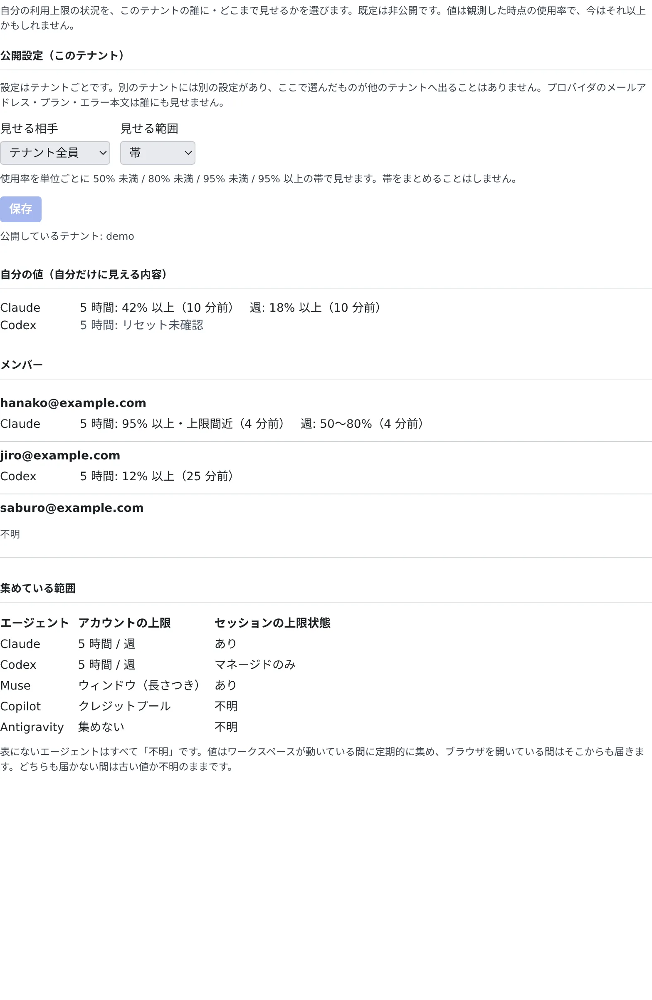

# 使用量の上限の状況を見せ合う

[English](usage-limits.md) | 日本語

エージェントの利用上限にどれだけ近いかを、同じテナントのメンバーに見せられます。誰に余裕があるかが分かるので、
作業を誰に頼むかを決めやすくなります。

## 全体像

| あなたがやること | 起きること |
|---|---|
| **⚙設定 →「利用枠ボード」** で、見せる相手と見せる範囲を選ぶ | 選ぶまでは非公開。選んだ相手にだけ、選んだ範囲が見える |
| 同じタブで、メンバーの状況を読む | 相手があなたに公開している分だけが見える |
| — | ワークスペースが動いている間と、Console のタブを開いている間に、値が届く |

利用枠ボードは、上限をまとめて使うためのものではありません。資格情報を移すことも、自分の作業を別の人のアカウントで動かすことも、
残りの量でメンバーを並べることもしません。契約上こうした分担が許されるかは、組織の判断です。

## 公開する

1. **⚙設定 →「利用枠ボード」** を開きます
2. 「**見せる相手**」と「**見せる範囲**」を選びます
3. 「**保存**」を押します

| 見せる相手 | 見える人 |
|---|---|
| 非公開 | 誰にも見せません（既定） |
| テナント全員 | このテナントのメンバー全員 |
| 選んだメンバー | 一覧で選んだメンバーだけ |

| 見せる範囲 | 見えるもの |
|---|---|
| 状態のみ | セッションが上限・利用額の上限・ブロック・サインイン切れに当たっているかだけ。使用率は見せません |
| 帯 | 使用率を、上限ごとに 50% 未満 / 80% 未満 / 95% 未満 / 95% 以上の帯で見せます |
| 正確な値 | 使用率とリセット時刻をそのまま見せます |

- 設定はテナントごとです。複数のテナントに入っていれば、それぞれに別の設定があります。タブには、今公開しているテナントがすべて出ます
- プロバイダのメールアドレス・プラン・エラーの本文は、誰にも見せません。管理者にも、メンバーの値をまとめて見る画面はありません
- テナント管理者は、テナント全体で利用枠ボードをオフにできます。オフの間は誰の値も集められず、タブにもそう出ます

## メンバーの状況を読む

同じタブの「**メンバー**」に、ほかのメンバーがあなたに公開している状況が並びます。「**自分の値（自分だけに見える内容）**」には、
自分の値が出ます。

| 表示 | 読み方 |
|---|---|
| 「42% 以上（10 分前）」 | プロバイダが最後に報告した値です。使用量はウィンドウの中では増える一方なので、下限として読みます |
| 「古い値」 | 最後の報告から 60 分を過ぎています |
| 「リセット未確認」 | その後ウィンドウがリセットされています。前の値にはもう意味がないので、0% や「使える」とは表示しません |
| 「不明」 | 何も届いていない、そのエージェントが対象外、またはその人があなたに公開していない |

あなたに何も公開していない人は、まだ値が届いていない人と見分けがつきません。どちらも「**不明**」と出ます。

どのエージェントの何を集めるかは、タブの「**集めている範囲**」と [上限と既定値](../../ref/limits.ja.md#利用枠ボード集めるものと読み方) にあります。
表にないエージェントは、すべて「不明」です。

## 困ったとき

### 値が古いまま変わらない

値は、ワークスペースが動いている間と、Console のタブを開いている間に届きます。どちらでもない間は古くなります。

### 前に見えていた値が消えた

別のプロバイダアカウントでサインインし直すと、前のアカウントの値は表示されなくなります。

### 「このテナントではテナント管理者が利用枠ボードをオフにしています」と出る

テナント管理者が利用枠ボードを止めています。使いたいときは、テナント管理者に相談してください。

## 関連

- [上限と既定値](../../ref/limits.ja.md#利用枠ボード集めるものと読み方)：集めるものの一覧と、値の決まり
- [料金と使用量を確かめる](../agents/usage.ja.md)：自分の利用枠の残りを見る
- [受信箱でチームメイトに頼む](inbox.ja.md)：余裕のあるメンバーに作業を頼む
