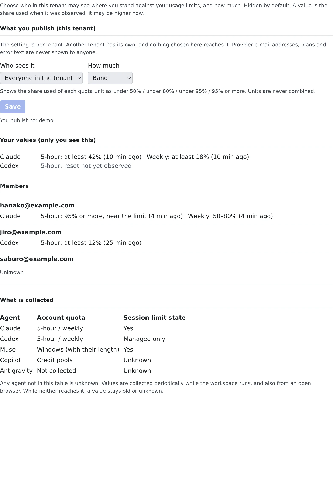

# Show each other where you stand on usage limits

English | [日本語](usage-limits.ja.md)

You can show members of the same tenant how close you are to your agents' usage limits. Seeing who has room left
makes it easier to decide whom to ask for a piece of work.

## How it works

| What you do | What happens |
|---|---|
| Choose who sees it and how much in **⚙ Settings → "Limit board"** | Hidden until you choose. Only the people you chose see the level you chose |
| Read your teammates' standing on the same tab | You see only what each person publishes to you |
| — | Values arrive while the workspace runs and while a Console tab is open |

The limit board is not for pooling limits. It moves no credentials, runs none of your work on someone else's account,
and does not rank members by what they have left. Whether a contract allows sharing like that is the organisation's call.

## Publish

1. Open **⚙ Settings → "Limit board"**
2. Choose "**Who sees it**" and "**How much**"
3. Press "**Save**"

| Who sees it | Who can see it |
|---|---|
| Hidden | Nobody (the default) |
| Everyone in the tenant | Every member of this tenant |
| Chosen members | Only the members you pick from the list |

| How much | What is shown |
|---|---|
| State only | Only whether a session has hit a limit, a spend limit, a block or a sign-in problem. No usage |
| Band | The share used of each limit, as under 50% / under 80% / under 95% / 95% or more |
| Exact | The used percentage and the reset time as they are |

- The setting is per tenant. If you belong to several tenants, each has its own. The tab lists every tenant you publish to
- Provider e-mail addresses, plans and error text are never shown to anyone. Administrators have no screen that shows members' values either
- A tenant administrator can turn the limit board off for the whole tenant. While it is off nobody's values are collected, and the tab says so

## Read your teammates' standing

"**Members**" on the same tab lists what other members publish to you. "**Your values (only you see this)**" shows your own.

| Shown | How to read it |
|---|---|
| "at least 42% (10 min ago)" | The value the provider last reported. Usage only grows within a window, so read it as a lower bound |
| "stale" | More than 60 minutes since the last report |
| "reset not yet observed" | The window has reset since. The old value means nothing now, so it is never shown as 0% or "available" |
| "Unknown" | Nothing has arrived, the agent is not covered, or the person does not publish to you |

Someone who publishes nothing to you cannot be told apart from someone whose values have not arrived yet: both read "**Unknown**".

Which agents are collected, and what, is in the tab's "**What is collected**" and in [Limits and defaults](../../ref/limits.md#the-limit-board-what-it-collects-and-how-it-reads).
Any agent not in that table reads "Unknown".

## When it goes wrong

### The values stay old

Values arrive while the workspace runs and while a Console tab is open. When neither is the case, they go stale.

### A value you saw before is gone

After signing in again with another provider account, the previous account's values are no longer shown.

### "A tenant administrator has turned the limit board off for this tenant"

The tenant administrator has switched the limit board off. Ask them if you want to use it.

## Related

- [Limits and defaults](../../ref/limits.md#the-limit-board-what-it-collects-and-how-it-reads): what is collected, and the rules for the values
- [Check prices and usage](../agents/usage.md): see how much of your own limits is left
- [Ask a teammate through the inbox](inbox.md): ask a member with room to spare
