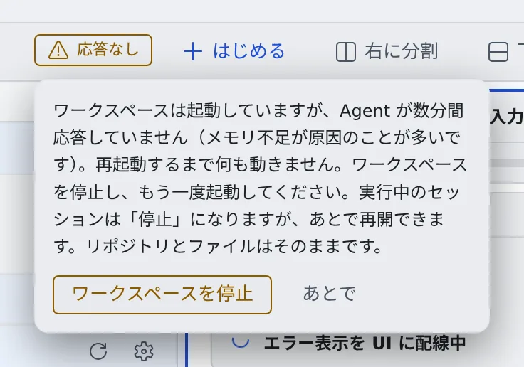

# ワークスペースが起動しない・止まった

[English](workspace.md) | 日本語

電源ボタンの横のバッジや通知センターに出たメッセージから、原因と直し方を探せます。
どの場合も、リポジトリとファイルは消えません。

## 電源ボタンの横に「要再起動」と出る

ワークスペースが動いている間に、バックエンドが更新されました。異常ではないので、急いで何かする必要はありません。

- バッジを押して「**今すぐ再起動**」を選ぶと、ワークスペースが新しいバージョンで起動し直し、バッジが消えます
- 実行中のセッションは停止しますが、あとで再開できます

## 電源ボタンの横に「応答なし」と出る

ワークスペースは起動していますが、中の Agent が数分間応答していません。たいていはメモリを使い切って固まっています。
再起動するまで何も動きません。

1. バッジを開いて「**ワークスペースを停止**」を押します
2. もう一度起動します

- 実行中のセッションは停止になりますが、あとで再開できます
- 自然に応答が戻れば、バッジは消えます
- テナント管理者にも通知が届き、管理者はメンバーの詳細から強制停止できます
- 運用者が自動停止を有効にしている配備では、応答がないまま決まった時間が過ぎると自動で停止し、「**応答しなくなったためワークスペースを停止しました**」と通知が届きます。続けるにはもう一度起動します

メモリを使い切らないようにするには、[マシンと使用状況を見る](../workspace/machine.ja.md) でメモリの使い方を確かめ、同時に動かすビルドを減らします。

## 「起動中…」のまま、勝手に「停止」になった

決まった時間（既定では 30 分）までに終わらなかった起動は、自動で止められます。
通知センター（ベル）に「**ワークスペースの起動を自動で止めました**」が、起動がどこまで進んだかを添えて届きます。
AWS の配備では、ワークスペースを載せられるマシンがなかった理由が書かれていることがよくあります。

- 「**ワークスペースを起動**」をもう一度押して、やり直します
- 同じように止まるなら、テナント管理者に伝えます。管理者のメンバー一覧にも、次に起動するまで同じ理由が出ています

## いつのまにかワークスペースが止まっている

しばらく操作がないと、ワークスペースは自動で停止します。もう一度起動すれば、セッションの一覧もクローンも接続もそのまま戻ります。
長い作業の途中で止めたくないときは、[終わったら止める・動かしたままにする](../sessions/auto-stop.ja.md#動かしたままにする) を見てください。

## 「ホームディスクの空きが少なくなっています」と出る

空きが 2 GiB を切るか、使用率が 90 % を超えると出ます。いっぱいになると、インストールやエージェントが動かなくなります。
空きの作り方は [マシンと使用状況を見る](../workspace/machine.ja.md#ホームディスクの空きを作る) にあります。自分で空けきれないときは、テナント管理者に ホームディスクの拡張を頼みます。

## 「このエージェントの CLI をインストールできませんでした」と出る

セッションを起動すると「**ワークスペースの起動時に、このエージェントの CLI をインストールできませんでした。…**」と断られます。
今回の起動で CLI のインストールに失敗しています。理由はメッセージの続きに出ます。

| メッセージの続き | やること |
|---|---|
| ホームディスクが満杯です | 空きを作ってから、ワークスペースを再起動する |
| ネットワークエラーです | ワークスペースを再起動して、もう一度試す |
| ダウンロードがチェックサムと一致しませんでした | ワークスペースを再起動して、もう一度試す |
| 設定 › ツールチェーンとワークスペースのログを確認してください | [ツールチェーンを選ぶ](../workspace/toolchains.ja.md#ツールのバージョンを確かめる) の手順で理由を読む |

## ワークスペースの調子がずっとおかしい

再起動しても直らないときは、ワークスペースを最新のイメージで作り直せます。
作り直すと消えるものがあるので、先に [ワークスペースを作り直す](../workspace/recreate.ja.md) を読んでください。

## 関連

- [マシンと使用状況を見る](../workspace/machine.ja.md)
- [ツールチェーンを選ぶ](../workspace/toolchains.ja.md)
- [ワークスペースを作り直す](../workspace/recreate.ja.md)
- [よくある質問](faq.ja.md)
