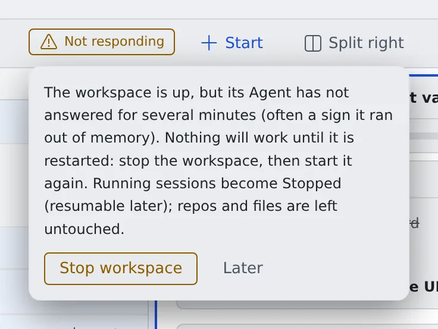

# Fix a workspace that will not start or has stopped

English | [日本語](workspace.ja.md)

Find the cause and the fix from the badge beside the power button or the message in the notification center.
In every case below, your repositories and files stay where they are.

## "Restart needed" appears beside the power button

The backend was updated while your workspace was running. Nothing is broken and nothing has to happen right now.

- Press the badge and choose **"Restart now"**: the workspace starts again on the new version and the badge goes away
- Running sessions stop, and you can resume them afterwards

## "Not responding" appears beside the power button

The workspace is up, but the Agent inside it has not answered for several minutes. Usually it ran out of memory and is stuck.
Nothing works until it is restarted.

1. Open the badge and press **"Stop workspace"**
2. Start it again

- Running sessions become stopped, and you can resume them afterwards
- If it starts answering again by itself, the badge goes away
- Your tenant administrators are notified too, and can force-stop the workspace from the member detail
- Where the operator has turned on the automatic stop, a workspace that stays unresponsive for the set time is stopped for you, with the notification **"Your workspace was stopped because it stopped responding"**. Start it again to continue

To keep it from running out of memory, check the memory in [See your machine and its usage](../workspace/machine.md) and run fewer builds at once.

## The start turned into "stopped" by itself

A start that does not finish within the set time (30 minutes by default) is stopped automatically.
The notification center (the bell) shows **"Workspace start stopped automatically"** with how far the start got.
On AWS deployments it often says why no machine could take the workspace.

- Press **"Start workspace"** again to retry
- If it stops the same way, tell your tenant administrator. Their member list shows the same reason until you start again

## The workspace has stopped without you noticing

After a while with no activity, the workspace stops by itself. Start it again and your session list, clones and connections come back as they were.
To keep it from stopping in the middle of a long job, see [Stop when done, or keep a session awake](../sessions/auto-stop.md#keep-a-session-awake).

## "Your home disk is nearly full"

It appears when less than 2 GiB is free or more than 90 % is used. When the disk fills, installs and agents stop working.
How to free space is in [See your machine and its usage](../workspace/machine.md#free-up-the-home-disk). If you cannot free enough yourself, ask your tenant administrator to grow the home.

## "This agent's CLI could not be installed"

Starting a session is refused with **"This agent's CLI could not be installed when the workspace started …"**.
The install of that CLI failed at this start. The rest of the message says why.

| The message goes on | What to do |
|---|---|
| … because the home disk is full | Free some space, then restart the workspace |
| … because of a network error | Restart the workspace and try again |
| … because the download did not match its checksum | Restart the workspace and try again |
| … See Settings › Toolchains and the workspace log | Read the reason as described in [Choose your toolchains](../workspace/toolchains.md#check-the-tool-versions) |

## The workspace keeps misbehaving

When a restart does not help, you can rebuild the workspace from the latest image.
A rebuild removes some things, so read [Recreate the workspace](../workspace/recreate.md) first.

## Related

- [See your machine and its usage](../workspace/machine.md)
- [Choose your toolchains](../workspace/toolchains.md)
- [Recreate the workspace](../workspace/recreate.md)
- [Frequently asked questions](faq.md)
