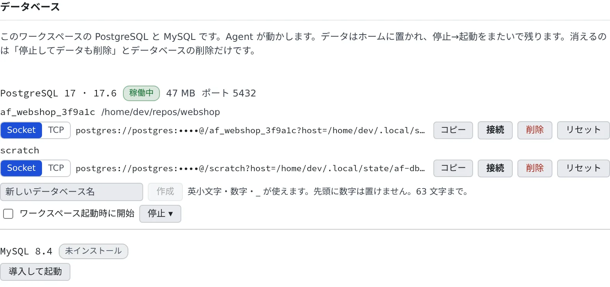

# データベースを使うテストを動かす

[English](databases.md) | 日本語

ワークスペースの中で PostgreSQL と MySQL を動かせます。Docker も外のサービスも要らないので、データベースを使うテストを
その場で動かせます。

## 全体像

| あなたがやること | エージェントがやること |
|---|---|
| テストを頼む | `af-db` で接続 URL を取り、テストに渡して動かす |
| 「データベース」タブで状態を見る・起動する・作る | 必要ならサーバーを起動して、作業コピー用のデータベースを作る |
| メモリの重いビルドの前に止める | 頼まれれば `af-db down` で止める |

[`af-db`](../../ref/cli/af-db.ja.md) は、ワークスペースのデータベースを動かすコマンドです。エージェントは最初から使い方を知っているので、
「DB を使うテストも通して」と頼むだけで使ってくれます。

> [!NOTE]
> **Cursor だけは、このコマンドのことを知りません。** Cursor に頼むときは
> 「`af-db` で PostgreSQL を用意して」のように書き添えてください。

## PostgreSQL でテストを動かす

```sh
# DATABASE_URL を今のシェルに入れる
eval "$(af-db env)"
go test -count=1 ./...

# プロジェクト独自の変数名で渡す
MY_DB_URL="$(af-db url)" go test -count=1 ./...
```

- はじめての実行では、ダウンロード・初期化・起動をするので数分かかることがあります
- **作業コピーごとに 1 つ** のデータベースができます。同じ作業コピーで動く 2 つのセッションは、同じデータベースを使います
- 既定の URL は unix ソケットで接続します。JDBC のように TCP が要るドライバーには `af-db url --tcp` を使います
- ポートは PostgreSQL が 5432、MySQL が 3306 です。フレームワークの既定と同じなので、接続文字列を書き換えなくて済みます

終わったら、サーバーを止めます。

```sh
af-db status   # 状態とポートを見る
af-db down     # 止める
```

30 分接続がないと、サーバーは自動で止まります。

## MySQL を使う

MySQL 8.4 も、同じように使えます。

```sh
af-db up mysql
eval "$(af-db env mysql)"
```

- `eval "$(af-db env mysql)"` を実行したシェルにだけ、`AF_DB_URL_MYSQL` と `DATABASE_URL` が入ります
- `go-sql-driver/mysql` の形が要るときは `af-db url mysql --format=go-dsn` を使います
- 常駐するメモリは約 226 MB です（PostgreSQL は約 47 MB）
- はじめて入れるときのダウンロードは、x86_64 で約 63 MB、arm64 で約 909 MB です（入ったあとは arm64 で約 147 MB）

## Console から管理する

**⚙設定 →「データベース」** で、端末を開かずに状態を見たり操作したりできます。ワークスペースが起動しているときだけ使えます。



| 操作 | できること |
|---|---|
| 導入して起動 / 起動 | 入っていなければ入れてから、エンジンを起動します |
| 停止 ▾ | 「**停止**」か「**停止してデータも削除**」を選びます |
| ワークスペース起動時に開始 | ワークスペースを起動するたびに、そのエンジンを起動します。既定はオフです |
| Socket / TCP | コピーする URL の形を切り替えます |
| コピー | その行のデータベースの URL をコピーします |
| 接続 | シェルのセッションを開き、そのデータベースに `psql` / `mysql` で接続します |
| 作成 | 名前を付けたデータベースを作ります（`af-db create --db=<名前>`） |
| 削除 | データベースを 1 つ、中身ごと削除します。接続が残っていても切断されます |
| リセット | データベースを 1 つ空にします（削除して作り直す） |

- 作業コピー用の 1 つでは足りないとき（使い捨てのスキーマ、1 つのプロジェクトで 2 つ目、セッション間で共有するもの）は「**作成**」を使います
- 名前に使えるのは英小文字・数字・`_` で、先頭に数字は置けません。63 文字までです
- 「**ワークスペース起動時に開始**」は、一度起動したことのあるエンジンにだけ出ます。データベースは使っていなくてもメモリを使うので、既定はオフです

## データが残るとき、消えるとき

データはホーム（`~/.local/state/af-db`）にあり、ワークスペースを停止→起動しても残ります。作り直しでも残ります。

| 操作 | 消えるもの |
|---|---|
| 「停止してデータも削除」（`af-db down --purge`） | **そのエンジンのデータベースすべて**。ほかの作業コピーのものや、名前を付けて作ったものも含みます |
| 「削除」（`af-db drop --db=<名前>`） | そのデータベース 1 つ |
| 「リセット」（`af-db reset`） | そのデータベース 1 つの中身 |
| ホームを掃除する | すべて（[ワークスペースを作り直す](recreate.ja.md)） |

1 つだけ作り直したいときは、「停止してデータも削除」ではなく、その行の「**リセット**」を使ってください。

### 速さを変える

| オプション | 動き |
|---|---|
| （なし） | コミットのたびにはディスクへ書き切りません。ワークスペースが落ちると直前の数トランザクションを失うことがありますが、ふつうの停止では失いません |
| `af-db up --durable` | コミットのたびにディスクへ書き切ります（`fsync`） |
| `af-db up --ephemeral` | データを作業ディスクに置きます。速い代わりに、**ワークスペースを停止すると消えます**。作業ディスクがない配備ではホームに置きます |

## コマンド

サブコマンド、オプション、URL の形、終了コードのすべては [af-db のリファレンス](../../ref/cli/af-db.ja.md) にあります。

`engine` は `postgres`（既定）か `mysql` です。メジャーバージョンは `--major` で選べます（既定は PostgreSQL 17、MySQL 8.4）。

`psql` と `mysql` は `PATH` にあり、引数なしで繋がります。エンジンを起動したあとに開いたセッションには `PGHOST` などが入るので、
`psql` はその作業コピーのデータベースを開き、MySQL は `mysql <名前>` で開けます。

## 困ったとき

### ビルドがメモリ不足で強制終了される

データベースは、使っていなくてもワークスペースのメモリを使います。重いビルドの前に `af-db down` で止めてください
（MySQL は `af-db down mysql`）。

### `af-db up mysql` が終了コード 6 で終わる

ワークスペースのメモリの上限が 1 GiB より少ないと、MySQL は起動しません。PostgreSQL が動いていれば、先に `af-db down postgres` で止めてください。

### `psql` が繋がらない

サーバーを起動する前に開いたシェルには、接続先の変数が入っていません。`af-db connect` を使うか、新しいシェルを開いてください。

### 終了コード

それぞれの終了コードの意味は、[af-db のリファレンス](../../ref/cli/af-db.ja.md#終了コード) にあります。

## 関連

- [AWS のコードを手元のエミュレーターで試す](aws-emulator.ja.md)
- [マシンと使用状況を見る](machine.ja.md)
- [ツールチェーンを選ぶ](toolchains.ja.md)
