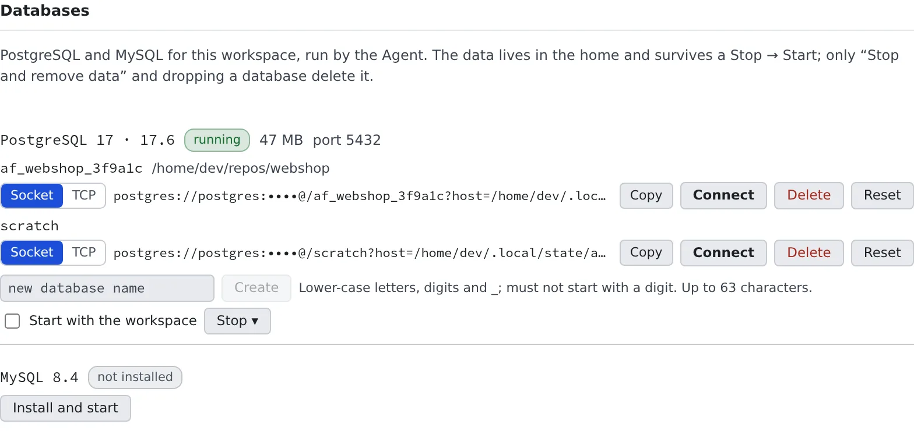

# Run database-backed tests

English | [日本語](databases.ja.md)

PostgreSQL and MySQL run inside your workspace. You need neither Docker nor an outside service, so tests that use a
database run right there.

## How it works

| What you do | What the agent does |
|---|---|
| Ask for the tests | Gets a connection URL with `af-db`, hands it to the tests and runs them |
| Look at, start or create databases on the **Databases** tab | Starts the server if needed and creates the working copy's database |
| Stop them before a memory-heavy build | Stops them with `af-db down` when asked |

`af-db` is the command that runs the workspace's databases. Agents already know how to use it, so asking "make the
database tests pass too" is enough.

> [!NOTE]
> **Cursor is the one agent that does not know this command.** When you ask Cursor, add something like
> "set up PostgreSQL with `af-db`".

## Run tests against PostgreSQL

```sh
# Put DATABASE_URL into the current shell
eval "$(af-db env)"
go test -count=1 ./...

# Or hand it over under your project's own variable name
MY_DB_URL="$(af-db url)" go test -count=1 ./...
```

- The first run downloads, initialises and starts the server, so it can take a few minutes
- **Each working copy gets one** database. Two sessions on the same working copy share it
- The default URL connects over a unix socket. For a driver that needs TCP, such as JDBC, use `af-db url --tcp`
- The ports are 5432 for PostgreSQL and 3306 for MySQL, the frameworks' own defaults, so connection strings need no change

Stop the server when you are done.

```sh
af-db status   # state and port
af-db down     # stop
```

After 30 minutes without a connection, the server stops by itself.

## Use MySQL

MySQL 8.4 works the same way.

```sh
af-db up mysql
eval "$(af-db env mysql)"
```

- Only the shell that ran `eval "$(af-db env mysql)"` gets `AF_DB_URL_MYSQL` and `DATABASE_URL`
- For the `go-sql-driver/mysql` form, use `af-db url mysql --format=go-dsn`
- It keeps about 226 MB of memory resident (PostgreSQL about 47 MB)
- The first install downloads about 63 MB on x86_64 and about 909 MB on arm64 (about 147 MB once installed on arm64)

## Manage them from the Console

**⚙ Settings → Databases** shows their state and runs the actions without a terminal. It works only while the workspace
is running.



| Action | What it does |
|---|---|
| Install and start / Start | Starts the engine, installing it first if needed |
| Stop ▾ | Pick **Stop** or **Stop and remove data** |
| Start with the workspace | Starts that engine every time the workspace starts. Off by default |
| Socket / TCP | Switches the form of the URL you copy |
| Copy | Copies that row's database URL |
| Connect | Opens a shell session connected to that database with `psql` / `mysql` |
| Create | Creates a database with a name you choose (`af-db create --db=<name>`) |
| Delete | Deletes one database with everything in it. Connections still open are cut |
| Reset | Empties one database (drops and recreates it) |

- When the working copy's one database is not enough (a throwaway schema, a second one for the same project, one shared between sessions), use **Create**
- A name takes lower-case letters, digits and `_`, must not start with a digit, and is at most 63 characters
- **Start with the workspace** appears only for an engine that has been started at least once. A database uses memory even when idle, so it is off by default

## When data stays and when it goes

The data lives in your home (`~/.local/state/af-db`) and survives a stop and start of the workspace. It survives a
recreate too.

| Action | What goes |
|---|---|
| **Stop and remove data** (`af-db down --purge`) | **Every database on that engine**, including other working copies' and the ones created by name |
| **Delete** (`af-db drop --db=<name>`) | That one database |
| **Reset** (`af-db reset`) | The contents of that one database |
| Clean home | All of it ([Recreate the workspace](recreate.md)) |

To start one database over, use that row's **Reset**, not **Stop and remove data**.

### Trade durability for speed

| Option | Behaviour |
|---|---|
| (none) | Commits are not flushed to disk one by one. A workspace crash can lose the last few transactions; an ordinary stop loses none |
| `af-db up --durable` | Every commit is flushed to disk (`fsync`) |
| `af-db up --ephemeral` | The data goes on the working disk. Faster, but **gone when the workspace stops**. On a deployment without a working disk it stays in your home |

## Commands

| Command | What it does |
|---|---|
| `af-db up [engine]` | Install and start |
| `af-db url [engine] [--db=NAME] [--tcp]` | Print the connection URL (installing and starting if needed) |
| `af-db env [engine]` | Print `export` lines for `DATABASE_URL` and friends |
| `af-db connect [engine] [--db=NAME]` | Open `psql` / `mysql` (starting the server first if it is stopped) |
| `af-db create` / `drop` / `reset` | Create, delete or empty a database |
| `af-db down [engine] [--purge]` | Stop (`--purge` removes the data too) |
| `af-db status [engine]` | Show the state |

`engine` is `postgres` (the default) or `mysql`. `--major` picks the major version (PostgreSQL 17 and MySQL 8.4 by
default).

`psql` and `mysql` are on `PATH` and connect with no arguments. A session opened after the engine started has `PGHOST`
and friends set, so `psql` opens that working copy's database, and MySQL opens with `mysql <name>`.

## When it goes wrong

### A build is killed for lack of memory

A database uses the workspace's memory even when idle. Stop it with `af-db down` before a heavy build
(`af-db down mysql` for MySQL).

### `af-db up mysql` exits with status 6

MySQL does not start when the workspace's memory limit is below 1 GiB. If PostgreSQL is running, stop it first with
`af-db down postgres`.

### `psql` does not connect

A shell opened before the server started does not have the connection variables. Use `af-db connect`, or open a new shell.

### Exit statuses

| Status | Meaning |
|---|---|
| 0 | Success |
| 2 | Usage error |
| 3 | The install failed |
| 4 | The server failed to start |
| 5 | The server is not running |
| 6 | Not enough memory |

## Related

- [Try AWS code against a local emulator](aws-emulator.md)
- [See your machine and its usage](machine.md)
- [Choose your toolchains](toolchains.md)
