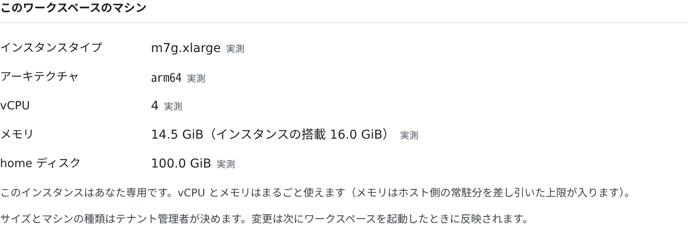

# マシンと使用状況を見る

[English](machine.md) | 日本語

ワークスペースが動いているマシンの種類と大きさ、メモリとディスクの使い方を確かめられます。大きさを決めるのはテナント管理者なので、
足りないときは管理者に頼みます。ディスクの空きは自分で作れます。

## 全体像

| あなたがやること | 起きること |
|---|---|
| 「マシン」タブを開く | インスタンスの種類・vCPU・メモリ・home ディスクと、その使用状況が出る |
| 大きくしてほしいと管理者に頼む | 管理者が変えると、次にワークスペースを起動したときから新しい大きさになる |
| 「測る」「空にする」「削除」を押す | home ディスクの空きができる |

## 今のマシンを見る

**⚙設定 →「マシン」** を開きます。ワークスペースバーの **リソース** の「**マシンと使用状況**」からも開けます。

| 項目 | 意味 |
|---|---|
| インスタンスタイプ | クラウド上の配備で、割り当てられたインスタンスの種類 |
| アーキテクチャ | `amd64` か `arm64` |
| vCPU | 使えるコアの数 |
| メモリ | **このワークスペースが使える上限**。インスタンスの搭載量と違うときは `14.5 GiB（インスタンスの搭載 16.0 GiB）` のように並べて出ます |
| home ディスク | home ボリュームの大きさ |

- 値には「**実測**」（ワークスペースの中で読んだ値）か「**設定上**」（次に起動したときの値）が添えられます。停止中はすべて「設定上」です
- ビルドが強制終了されるかどうかを決めるのは、メモリの行の上限です。インスタンスの一部はホスト側の常駐プロセスのために残されます
- アーキテクチャによって、入る JDK・Node.js・エージェントの CLI が変わります。そのアーキテクチャで動かないツールは入りません（[ツールチェーンを選ぶ](toolchains.ja.md)）
- アーキテクチャが変わると、次の起動でそれらを入れ直し、自分で入れた pip・uv・npm のもののうち見つかったものも、ふつうは同じ版で入れ直します。`~/repos` の下のビルド生成物は自分で作り直します。見つかるもの、見つからないものは [af-arch-repair](../../ref/cli/af-arch-repair.ja.md) にあります

### 1 人 1 台か、共有か

| 表示 | 意味 |
|---|---|
| 「このインスタンスはあなた専用です」 | vCPU とメモリをまるごと使えます。home ディスクの値もあなたのものです |
| 「ホストは他の利用者と共有です」 | vCPU とメモリはこのワークスペースに割り当てられた分です。ディスクの行は「**ディスク全体**」と出て、ほかの人の分も含みます |

## 大きさを変えてもらう

サイズとマシンの種類は、テナント管理者が決めます。足りないときは管理者に頼んでください。

- 変更は、**次にワークスペースを起動したとき** から反映されます
- 変更されたあと、まだ起動し直していないときは「**設定が変更されています。次に起動すると m7g.2xlarge になります。**」のように出ます
- 反映するには、ワークスペースバーから停止して起動します

## 使用状況を見る

「**使用状況**」に、メモリと vCPU の推移と、home ディスクの使用量が出ます。

- グラフは 4 秒ごとに 1 点、最大 1 時間分です。取得できなかった時間は線が切れています
- 上限は、上の表の値です（メモリはこのワークスペースの上限、vCPU はコアの数）
- その間にメモリ不足で強制終了されたプロセスがあると、「**この間にメモリ不足でプロセスが強制終了されました**」と出ます
- 1 人 1 台のインスタンスでは、home ディスクの空きが約 2 GiB を切るか、使用率が 90% を超えると通知が 1 回出ます。
  次に出るのは、空きが十分に戻ってから（空き約 3 GiB 超かつ使用率 85% 未満）また埋まったときです

### メモリ逼迫

ワークスペースのタスクがメモリ待ちで止まっていた時間の割合（`some` と `full`）と、Agent が応答するまでの時間です。

- 計測するだけで、これを理由に警告・拒否・停止はしません
- マシンが報告できないときは「**このマシンでは測定できません**」と出ます
- 運用者が計測を止めているワークスペースでは、この行は出ません

## home ディスクの空きを作る

### home の内訳

「**測る**」を押すと、home 全体をたどってカテゴリ別の量を出します。大きい home では数分かかります。

| カテゴリ | 中身 | 空けかた |
|---|---|---|
| 作業コピー: ソース | 作業コピーのファイル（git のデータを含む） | マージ済みの worktree を掃除の画面で消す |
| 作業コピー: ビルド成果物 | 追跡されていない `node_modules`・`.next`・`target`・`.gradle`・`build`・`dist` | 下の「動いていない作業コピーのビルド成果物」（`node_modules`・`.next`・`target`・`.gradle` のみ） |
| ツールのキャッシュ | `~/.cache`・`~/.npm`・`~/.gradle`・`~/.m2` など | 下の「ツールのキャッシュ」 |
| ランタイム・JDK・ツール | `~/.local`・`~/.nvm` など | [ツールチェーンを選ぶ](toolchains.ja.md) でアンインストール |
| `~/.af-work` | セッションの作業用フォルダ | 下の「使われなくなったファイル」 |
| ごみ箱 | 掃除のごみ箱 | 掃除の画面の「ごみ箱」タブ |

数え方は `du -sx ~` と同じです。ハードリンクは 1 回だけ数え、symlink はたどらず、`/scratch` などほかのディスクは含みません。
その下に、ビルド成果物の多い作業コピーと、`~/.af-work` のフォルダが並びます。

### 動いていない作業コピーのビルド成果物

掃除の画面を開きます（上の内訳の作業コピーの行にある「**ビルド成果物を削除…**」からも開けます）。いちばん下の「**動いていない作業コピーのビルド成果物**」では、作業コピー自体は残したまま `node_modules`・`.next`・`target`・`.gradle` を消せます。`build` と `dist` には触りません。

1. 「**調べる**」を押します。ディスクを見るだけです。作業コピーごとに、フォルダとサイズ付きで「**再生成可**」と判定されるか、理由つきで対象外の一覧に入ります。
2. 行の「**プレビュー**」を押します。もう一度確かめて、消すものを一覧で見せます。何も消しません。
3. 「**ビルド成果物を削除…**」を押して確認します。**元に戻せず、ごみ箱にも入りません。** フォルダの中身は、自分で置いたファイルも含めてすべて消えます。

対象になるのは、30 日以上誰も触っておらず、未コミット・未追跡の変更がなく、セッションもプロセスも使っていない作業コピーだけです。そうでなければ、行に理由（セッションが動いている・未コミットの変更・最近触られた・削除ロック・ビルド成果物が使用中）が出ます。symlink はたどらず、リンクだけを外します。自動では何も実行されません。

### Agent Fleet が使っているディスク

Agent Fleet が `~/.cache/agent-fleet` に溜めるもの（生成した画像・サムネイル・貼り付けや添付したファイルなど）の内訳です。

- 生成した画像は 30 日、サムネイルは 14 日で自動で消えます
- 「**掃除を開く**」で、削除済みセッションの分とごみ箱を片付けられます（[終わったセッションを片付ける](../sessions/cleanup.ja.md#ごみ箱から戻す)）

### ツールのキャッシュ

go・npm（npx を含む）・uv・pip・Maven・Gradle がホームに溜めるキャッシュです。上限なく増え、自動では消えません。

1. 「**測る**」を押して量を数えます（全ファイルを読むので、押したときだけ数えます）
2. 「**空にする**」を押し、確認のあとで削除します

- 次にそれを使うビルドやインストールが、1 回だけ遅くなります
- 実行中のビルドやインストールが使っているものは「**使用中**」と出て、終わるまで空にできません
- Gradle は 2 行、`gradle-caches`（`~/.gradle/caches/<バージョン>`）と `gradle-wrapper`（`~/.gradle/wrapper/dists`）で出ます。
  `~/repos`（worktree を含む）の `gradle-wrapper.properties` がどれも指定していないバージョンだけが対象です。
  共有のキャッシュ（`modules-2` など）・`gradle.properties`・`~/.gradle/jdks` には触れません
- `~/repos` を完全には読めないとき（読めないフォルダ、バージョンを読み取れない wrapper ファイル、大きすぎるツリー）は、Gradle の行が「**対象外**」と出て、何も消しません
- 「指定されていない」の範囲は `~/repos` だけです。ほかの場所のプロジェクト、wrapper を使わない素の `gradle`、別の `GRADLE_USER_HOME` や `-g` は見ていないので、それらが使うバージョンも消えることがあります（次のビルドが取り直しますが、オフラインでは失敗します）
- 消した Gradle バージョンは、それを必要とする次のビルドが取り直します（`services.gradle.org` に届く必要があります）
- `~/.m2/repository` や `~/.npm/_npx` がシンボリックリンクのときは出ません。ターミナルから消してください

### 使われなくなったファイル

二度と読まれないものです。消しても次のビルドは遅くなりません。

| 種類 | 中身 |
|---|---|
| Chromium の使い捨てプロファイル | 強制終了したヘッドレス Chromium が残したもの |
| 終わったセッションの作業用フォルダ | セッションも作業コピーもなくなった `~/.af-work` のフォルダ |
| 古い Node.js | 同じメジャーの新しいパッチに置き換わったもの |
| 古い Kiro | 入っている版とピンの版のほかのもの |
| アーカイブしたセッションの作業用フォルダ | アーカイブしてまだ 7 日たっていないセッションの `~/.af-work` |

- Agent が起動するたびと、その後は 1 日 1 回、自動で消します。何週間も再起動しないワークスペースのための項目です
- 「**測る**」で今消せるものを数え、「**削除**」で種類ごとにすぐ消します。確認は出ません（アーカイブしたセッションの行を除く）
- 使用中のものと、1 時間以内に変更されたものは残ります

> [!WARNING]
> **`~/.af-work` は使い捨ての置き場です。** 残したいファイルは `~/repos` の下や、ホーム直下の自分のフォルダに置いてください。

- 起動時に自動で消すのは、Agent が作ったセッション用のフォルダだけです。自分で作ったフォルダはここに数えられ、「**削除**」を押したときだけ消えます
- アーカイブしたセッションのフォルダは、アーカイブの 7 日後に消えます。削除ロック中のセッションのフォルダは残ります
- 7 日を待たずに消すときは、「**アーカイブしたセッションの作業用フォルダ**」の「**削除**」を使います。
  確認のあとで今すぐ消え、元に戻せません。セッションは復元できますが、`$AF_WORK_DIR` は空から始まります

#### `~/.af-work` の古いフォルダ

使われなくなったファイルの行の下にある「**~/.af-work の古いフォルダ**」は、自分で作ったフォルダを、古いものだけ 1 つずつ消す項目です。

1. 日数を入れ（最初は 30）、「**フォルダを探す**」を押します。どのセッションも使っておらず、その日数以上変更のないフォルダが、サイズと最終変更の時期つきで並びます。フォルダの古さは、中のいちばん新しい変更で決まります
2. 残したいフォルダのチェックを外し、「**選んだものを削除**」を押します
3. 確認にフォルダの一覧が出ます。そのまま消え、元に戻せません

- 並ぶのは Agent が作ったものではないフォルダだけです（Agent が作ったものは上の決まりで消えます）。セッションのフォルダ（アーカイブしたセッションのものは上の専用の行で扱います）、使用中のもの、指定した日数以内に変更されたものは、一覧にも出ず、消えもしません
- 確認を押したときに、Agent がフォルダごとにもう一度調べます。そのあいだに変更された、またはセッションが使い始めたフォルダはスキップされ、メッセージに個数が出ます
- シンボリックリンクはたどりません。フォルダの中のリンクはリンクとして消え、指す先は残ります

#### 端末から: `af-clean`

ワークスペースの端末で `af-clean` を実行すると、容量不足の通知の **再生成できるものを掃除…** と同じもの（動いていない作業コピーのビルド成果物と、どこも使っていないツールのキャッシュ）を一覧します。`--apply` を付けるまで何も削除せず、付けたときは新しく作った一覧の項目だけを消します（前のドライランの結果は使い回しません）。使われなくなったファイル、`~/.af-work`、ごみ箱、アーカイブにはここからは触れません。オプションと出力は [af-clean](../../ref/cli/af-clean.ja.md) にあります。

## 困ったとき

### ビルドが終了コード 137 で終わる

メモリの上限を超えて、強制終了されています。メモリの行の上限を確かめ、同時に動かすビルドを減らしてください。
データベースを動かしているなら、止めると空きます（[データベースを使うテストを動かす](databases.ja.md)）。
それでも足りないときは、管理者に大きさを変えてもらいます。

### 「home ディスクの空きが少なくなっています」と出る

いっぱいになると、インストールやエージェントが動かなくなります。上の手順で空きを作るか、管理者に home の拡張を頼んでください。

### 共有ホストで、ディスクを空けても数字があまり動かない

共有ホストでは、ディスクの行はほかの人と共有のファイルシステム全体の値です。あなたの home を空けても、そちらはあまり動きません。

## 関連

- [ツールチェーンを選ぶ](toolchains.ja.md)
- [稼働時間とクラウド費用を見る](cost.ja.md)
- [ワークスペースを作り直す](recreate.ja.md)
