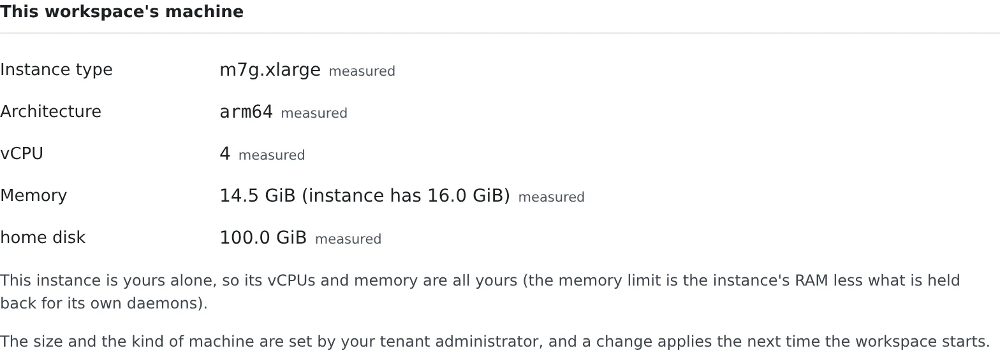

# See your machine and its usage

English | [日本語](machine.ja.md)

See what kind of machine your workspace runs on, how big it is, and how its memory and disk are used. A tenant
administrator decides the size, so when it is not enough you ask them. Disk space you can free yourself.

## How it works

| What you do | What happens |
|---|---|
| Open the **Machine** tab | The instance type, vCPUs, memory and home disk appear, with their usage |
| Ask an administrator for a bigger machine | Once they change it, the new size applies from the next start of the workspace |
| Press **Measure**, **Empty** or **Delete** | Space on the home disk is freed |

## See your machine

Open **⚙ Settings → Machine**. **Machine and usage** under **Resources** in the workspace bar opens it too.

| Row | Meaning |
|---|---|
| Instance type | On a cloud deployment, the kind of instance you were given |
| Architecture | `amd64` or `arm64` |
| vCPU | How many cores you can use |
| Memory | **The limit this workspace can use**. When it differs from the instance's RAM, both appear, as in `14.5 GiB (instance has 16.0 GiB)` |
| home disk | The size of the home volume |

- Each value is marked **measured** (read inside the workspace) or **configured** (what the next start will use). While stopped, everything is configured
- Whether a build gets killed depends on the limit in the Memory row. Part of the instance is held back for the host's own processes
- The architecture decides which JDK, Node.js and agent CLIs are installed. A tool that cannot run on it is not installed ([Choose your toolchains](toolchains.md))

### Your own machine, or a shared one

| What it says | Meaning |
|---|---|
| "This instance is yours alone" | The vCPUs and memory are all yours, and so is the home disk figure |
| "The host is shared with other members" | The vCPUs and memory are what this workspace was given. The disk row reads **Whole disk** and includes other people's files |

## Get the size changed

A tenant administrator decides the size and the kind of machine. When it is not enough, ask them.

- A change applies **from the next start of the workspace**
- Until you restart after a change, the tab says something like **The settings have changed. The next start will use m7g.2xlarge.**
- To apply it, stop and start the workspace from the workspace bar

## See the usage

**Usage** shows memory and vCPU over time, and how much of the home disk is used.

- The charts take one point every 4 seconds, up to an hour. A gap in a line is time the figures could not be read
- The ceilings are the values in the table above (memory against this workspace's limit, vCPU against the core count)
- If a process was killed for lack of memory in that window, **A process was killed for memory during this window** appears
- On a machine of your own, you get one notification when the home disk falls below about 2 GiB free or goes past 90% used.
  The next one comes only after enough space came back (more than about 3 GiB free and under 85% used) and it filled up again

### Memory pressure

The share of time the workspace's tasks were stalled waiting for memory (`some` and `full`), and how long the Agent took
to answer.

- It is a measurement only: nothing warns, refuses or stops because of it
- When the machine cannot report it, **Cannot be measured on this machine** appears
- On a workspace where the operator turned the measurement off, the row does not appear

## Free up the home disk

### Where home went

**Measure** walks the whole home and shows how much is in each category. On a large home it takes a few minutes.

| Category | What is in it | How to free it |
|---|---|---|
| Working copies: source | The working copies' files (git data included) | Delete merged worktrees from the cleanup screen |
| Working copies: build output | Untracked `node_modules`, `.next`, `target`, `.gradle`, `build`, `dist` | **Build output in dormant working copies** below (only `node_modules`, `.next`, `target`, `.gradle`) |
| Tool caches | `~/.cache`, `~/.npm`, `~/.gradle`, `~/.m2` and so on | **Tool caches** below |
| Runtimes, JDKs and tools | `~/.local`, `~/.nvm` and so on | Uninstall in [Choose your toolchains](toolchains.md) |
| `~/.af-work` | Sessions' work folders | **Leftover files** below |
| Trash | The cleanup trash | The **Trash** tab of the cleanup screen |

It counts the way `du -sx ~` does: hard links once, symlinks not followed, other disks such as `/scratch` not included.
Below it come the working copies with the most build output, and the folders in `~/.af-work`.

### Build output in dormant working copies

Open the cleanup screen (the **Drop build output…** button on a working-copy row in the breakdown above opens it). The last section, **Build output in dormant working copies**, drops `node_modules`, `.next`, `target` and `.gradle` from a working copy while keeping the working copy itself. `build` and `dist` are never touched.

1. Press **Check**. It only looks at the disk. Each working copy comes back graded **Regenerable** (with the folders and their sizes) or is listed under the ones left alone, with the reason.
2. Press **Preview** on a row. It checks again and lists exactly what would go, deleting nothing.
3. Press **Delete build output…** and confirm. **This cannot be undone and does not go to the trash**, and everything inside those folders goes, including files you put there yourself.

A working copy is offered only when nobody has touched it for 30 days, it has no uncommitted or untracked change, and no session or process is using it. Otherwise the row says which of these stopped it (a running session, uncommitted changes, recent activity, a deletion lock, build output in use). A symlink is unlinked, never followed. Nothing here runs by itself.

### Disk used by Agent Fleet

What Agent Fleet keeps in `~/.cache/agent-fleet` (generated images, thumbnails, pasted and attached files and so on).

- Generated images are removed after 30 days and thumbnails after 14 days
- **Open cleanup** lets you clear what deleted sessions left and empty the trash ([Clear away finished sessions](../sessions/cleanup.md#restore-from-the-trash))

### Tool caches

The caches go, npm (npx included), uv, pip and Maven keep in your home. They grow without limit and are never removed
on their own.

1. Press **Measure** to count them (it reads every file, so it runs only when you press it)
2. Press **Empty** and confirm to delete one

- The next build or install that uses it is slower, once
- A cache a running build or install is using shows **In use** and cannot be emptied until that finishes
- `~/.m2/repository` or `~/.npm/_npx` do not appear when they are symbolic links. Delete them from a terminal

### Leftover files

Files nothing will read again. Deleting them does not slow the next build.

| Kind | What it is |
|---|---|
| Chromium throwaway profiles | Left behind by headless Chromium that was killed |
| Work folders of ended sessions | `~/.af-work` folders whose session and working copy are both gone |
| Old Node.js versions | Replaced by a newer patch of the same major |
| Old Kiro versions | Neither the installed version nor the pinned one |
| Work folders of archived sessions | `~/.af-work` of sessions archived less than 7 days ago |

- They are removed every time the Agent starts and once a day after that. This section is for workspaces that run for weeks without a restart
- **Measure** counts what can be removed now, and **Delete** removes one kind at once. There is no confirmation (except for the archived sessions' row)
- Anything in use, and anything changed within the last hour, is kept

> [!WARNING]
> **`~/.af-work` is a throwaway place.** Keep files you want under `~/repos` or in a folder of your own in your home.

- At start, only the session folders the Agent created are removed. Folders you made yourself are counted here and go only when you press **Delete**
- An archived session's folder is removed 7 days after archiving. A folder of a session with a delete lock stays
- To remove them before the 7 days, use **Delete** on **Work folders of archived sessions**.
  They go at once after a confirmation and cannot be brought back. The sessions can still be restored, but their `$AF_WORK_DIR` starts empty

## When it goes wrong

### A build exits with status 137

It went over the memory limit and was killed. Check the limit in the Memory row and run fewer builds at once.
If databases are running, stopping them frees memory ([Run database-backed tests](databases.md)).
If that is still not enough, ask an administrator for a bigger machine.

### "Your home disk is nearly full"

When it fills, installs and agents stop working. Free space as above, or ask an administrator to grow the home.

### On a shared host, freeing space barely moves the figure

On a shared host, the disk row is the whole filesystem you share with others. Freeing your home barely moves it.

## Related

- [Choose your toolchains](toolchains.md)
- [See running time and cloud cost](cost.md)
- [Recreate the workspace](recreate.md)
