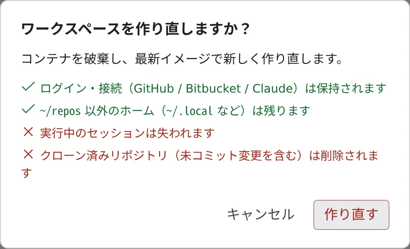

# ワークスペースを作り直す

[English](recreate.md) | 日本語

環境が壊れたとき、ワークスペースを最新のイメージで作り直せます。消えるのは `~/repos` だけで、ログインや
ホームディレクトリのほかのファイルは残ります。

## 全体像

| あなたがやること | 起きること |
|---|---|
| ワークスペースを停止して起動する | 何も消さずに、最新のイメージで起動し直す |
| 「作り直す」を押す | `~/repos` を消して、最新のイメージで作り直す |
| 「掃除」を押す | ログインと接続のほかはホームディレクトリをすべて消して、最新のイメージで作り直す |

どれも、ホームディレクトリの外（`/usr`・`/opt`・`/tmp` など）はイメージの状態に戻ります。ツールを自分で入れるときは `~/.local` に入れてください。

## 何が残り、何が消えるか

| | 停止 → 起動 | 作り直す | ホームを掃除する |
|---|---|---|---|
| `~/repos`（作業コピーと、未コミットの変更） | 残る | **消える** | **消える** |
| ホームディレクトリのそのほか（`~/.local`・キャッシュ・設定ファイル・`~/.af-work`・`af-db` のデータ） | 残る | 残る | **消える** |
| ログインと接続（`~/.config`・`~/.ssh`・`~/.gitconfig`・`~/.git-credentials`・`~/.claude`・`~/.claude.json`・`~/.codex`） | 残る | 残る | 残る |
| Claude の設定と状態（`$CLAUDE_CONFIG_DIR`。保存したメモリも含む） | 残る | 残る | 残る |
| ホームディレクトリの外（`/usr`・`/opt`・`/tmp` など） | イメージに戻る | イメージに戻る | イメージに戻る |
| `/scratch`（作業ディスクがある配備だけ。[af-scratch](../../ref/cli/af-scratch.ja.md)） | **消える** | **消える** | **消える** |
| 実行中のセッション | 停止する（あとで再開できる） | **失われる** | **失われる** |

> [!WARNING]
> **作り直しと掃除では、未コミットの変更も消えます。** 先にコミットして push してください。

## 新しいイメージを取り込む

新しいイメージを使うだけなら、作り直す必要はありません。ワークスペースバーから停止して起動すると、最新のイメージで動きます。

- 新しいイメージが出ると、ワークスペースバーに **要再起動** と出ます。押すと「**今すぐ再起動**」で停止→起動できます
- **⚙設定 →「ツールチェーン」** の「**使われていないとき、新しいイメージへ自動で再起動する**」をオンにすると、
  しばらく何も動いていないときに Control Plane が代わりに再起動します。既定はオフです

自動の再起動は、ターンやバックグラウンド作業を実行中のセッションや「**自動停止しない**」のセッションがあるとき、
ターミナルへの入力やブラウザペインの操作があるとき、直近にリクエストがあったときには行いません。返答待ちのセッションや、
入力せずに開いたままのターミナルは、再起動を止めません。何も動いていないと見なすまでの時間は、配備が別に決めていなければ
15 分です。詳しくは [ツールチェーンを選ぶ](toolchains.ja.md#新しいイメージへ自動で再起動する) にあります。

- 再起動すると通知が 1 回届きます。セッションはあとで再開できます
- 自動の再起動は、同じイメージに対して 1 回だけ試します。起動に失敗したときは停止したままになり、バッジも残ります

## 作り直す

1. **⚙設定 →「危険な操作」** を開きます
2. 「**ワークスペースを作り直す**」の「**作り直す**」を押します
3. 確認の画面で、残るものと消えるものを確かめて「**作り直す**」を押します

作り直したあとは、リポジトリをもう一度 clone してください。

## ホームを掃除する

作り直しは `~/repos` しか消さないので、ホームディレクトリの中に原因があるときは直りません。`~/.local` に入れたツールが壊れた、
キャッシュや設定ファイルがおかしい、というときは、同じタブの「**ホームを掃除する**」の「**掃除**」を使います。

まず「作り直す」で直るか試し、それでも直らないときだけ掃除してください。掃除のあとも、ログインと接続はそのまま使えます。

## 困ったとき

### 「危険な操作」のタブがない

この配備では、作り直しとホームの掃除を使えません。ホームディレクトリが Control Plane から届かない場所にあるためです。
停止と起動はワークスペースバーからできます。

### 作り直しがなかなか終わらない

配備によっては数分かかります。その間、ワークスペースは起動中になり、
「**作り直し・ホームの掃除で消す分を home から削除しています…**」と表示されます。

### 「作り直し・ホームの掃除が完了しなかったため、ワークスペースは停止したままです」と出る

ファイルの削除か、そのあとの起動に失敗しました。ワークスペースは停止しています。表示された理由を確かめてから、
もう一度起動するか、作り直してください。

## 関連

- [ツールチェーンを選ぶ](toolchains.ja.md)
- [マシンと使用状況を見る](machine.ja.md)：ホームのディスクの空きを作る
