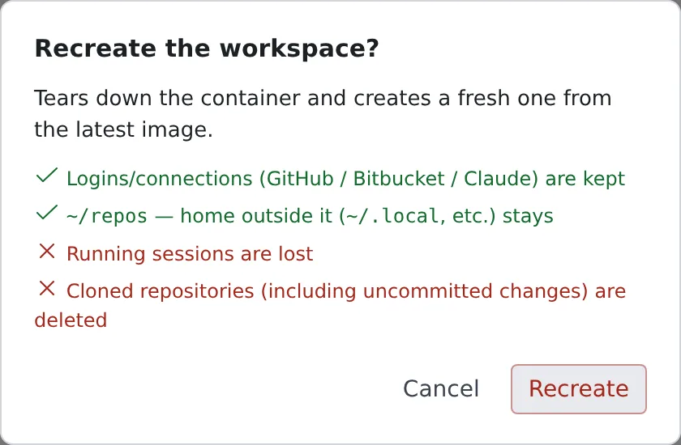

# Recreate the workspace

English | [日本語](recreate.ja.md)

When the environment is broken, you can recreate the workspace from the latest image. Only `~/repos` is deleted; your
logins and the rest of your home stay.

## How it works

| What you do | What happens |
|---|---|
| Stop the workspace and start it again | It starts again from the latest image, and nothing is deleted |
| Press **Recreate** | `~/repos` is deleted and the workspace is recreated from the latest image |
| Press **Clean** | Everything in your home except logins and connections is deleted, and the workspace is recreated from the latest image |

In every case, everything outside your home (`/usr`, `/opt`, `/tmp` and so on) goes back to what the image has. Install
your own tools into `~/.local`.

## What stays and what goes

| | Stop → Start | Recreate | Clean home |
|---|---|---|---|
| `~/repos` (working copies, including uncommitted changes) | stays | **deleted** | **deleted** |
| The rest of your home (`~/.local`, caches, dotfiles, `~/.af-work`, `af-db` data) | stays | stays | **deleted** |
| Logins and connections (`~/.config`, `~/.ssh`, `~/.gitconfig`, `~/.git-credentials`, `~/.claude`, `~/.claude.json`, `~/.codex`) | stays | stays | stays |
| Claude's settings and state (`$CLAUDE_CONFIG_DIR`, saved memory included) | stays | stays | stays |
| Outside your home (`/usr`, `/opt`, `/tmp` and so on) | back to the image | back to the image | back to the image |
| `/scratch` (only on deployments with a working disk) | **deleted** | **deleted** | **deleted** |
| Running sessions | stopped (you can resume them later) | **lost** | **lost** |

> [!WARNING]
> **Recreate and Clean home delete uncommitted changes too.** Commit and push first.

## Pick up a new image

To use a new image you do not need to recreate anything. Stop the workspace from the workspace bar and start it again:
it then runs on the latest image.

- When a new image is out, the workspace bar shows **Restart needed**. Press it, then **Restart now**, to stop and start
- With **Restart automatically onto a new image when idle** turned on under **⚙ Settings → Toolchains**, the Control
  Plane restarts the workspace for you once nothing has been happening for a while. It is off by default

The automatic restart does not happen while a session is working or waiting for an answer, while a terminal, preview or
browser pane is open, or when a request came in recently. Unless an administrator set another value, "nothing has been
happening" means 15 minutes.

- You get one notification when it restarts. You can resume your sessions afterwards
- It tries the same image once. If the start fails, the workspace stays stopped and the badge stays

## Recreate

1. Open **⚙ Settings → Danger zone**
2. Under **Recreate the workspace**, press **Recreate**
3. The confirmation lists what stays and what goes; check it and press **Recreate**

After the recreate, clone your repositories again.

## Clean home

Recreate deletes only `~/repos`, so it does not help when the cause sits elsewhere in your home: a tool you installed
in `~/.local` is broken, or a cache or dotfile has gone wrong. For that, use **Clean** under **Clean home** on the same tab.

Try **Recreate** first, and clean home only when that does not fix it. Your logins and connections keep working after
a clean.

## When it goes wrong

### There is no Danger zone tab

This deployment cannot recreate the workspace or clean its home, because the home is somewhere the Control Plane
cannot reach. Stop and Start still work from the workspace bar.

### The recreate takes a long time

On some deployments it takes a few minutes. Meanwhile the workspace shows as starting, with
**Removing what Recreate / Clean home deletes from your home…**.

### "Recreate / Clean home did not finish, so the workspace was left stopped"

Deleting the files, or the start after it, failed, and the workspace is stopped. Read the reason shown, then start the
workspace again or recreate it again.

## Related

- [Choose your toolchains](toolchains.md)
- [See your machine and its usage](machine.md): free up space on the home disk
