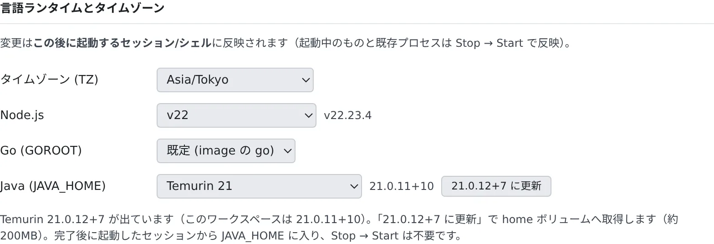

# ツールチェーンを選ぶ

[English](toolchains.md) | 日本語

ワークスペースで使う Node.js・Java・Go のバージョンと、タイムゾーンを選べます。入っていないバージョンも、
その場でインストールできます。

## 全体像

| あなたがやること | 起きること |
|---|---|
| バージョンやタイムゾーンを選ぶ | この後に起動するセッションとシェルで使われる |
| 「インストール」や「… に更新」を押す | home ボリュームに取得し、終わったあとに起動したセッションから使われる |
| 使わないバージョンをアンインストールする | home ボリュームの容量が空く |
| 「**サインイン時の自動起動**」をオフにする | Console を開いても、停止中のワークスペースが自動では起動しなくなる |
| 「**イメージの自動更新**」をオンにする | 更新のあと、誰も使っていないときに新しいイメージで再起動する |

エージェントも、セッションを起動したときのバージョンを使います。

## バージョンを選ぶ

**⚙設定 →「ツールチェーン」** の「**言語ランタイムとタイムゾーン**」で選びます。ワークスペースが起動しているときだけ変更できます。

| 項目 | 選べるもの |
|---|---|
| タイムゾーン (TZ) | シェルとエージェントの時計。既定は `Asia/Tokyo` です |
| Node.js | メジャーバージョン。「**既定 (image の node)**」はイメージに入っているものです |
| Go (GOROOT) | 入っている Go のバージョン |
| Java (JAVA_HOME) | メジャーバージョンごとに Eclipse Temurin と Amazon Corretto（「Temurin 21」「Corretto 21」） |

- 変更は、**この後に起動するセッションとシェル** に反映されます。起動中のものは、ワークスペースを停止→起動すると反映されます
- Node.js と Java の行には、実際に使われる版（`v22.23.4`、`21.0.11+10` など）が出ます
- Console に出る日時や、エージェントが書く通知の時刻は、タイムゾーンではなく **⚙設定 →「表示」** のタイムゾーンに従います

## 入っていないバージョンを入れる

Node.js と Java は、まだ入っていないバージョンも「Temurin 17（未インストール）」のように一覧に出ます。

1. そのバージョンを選びます
2. 「**17.0.21+9 をインストール**」のように、入る版を示したボタンを押します
3. 終わったら、新しくセッションを起動します

- Java は約 200 MB です
- home ボリュームに入るので、ワークスペースを停止→起動しても残ります
- 停止→起動は要りません。終わったあとに起動したセッションから使われます（Java は `JAVA_HOME` に入ります）

使っているバージョンに新しいパッチが出ると、「**21.0.12+7 に更新**」のようなボタンが出ます。同じように home ボリュームに取得します。

Agent Fleet が入れた古い Node.js のパッチは、次にワークスペースを起動したときに削除されます。
自分で nvm から入れた版と、nvm の alias や `.nvmrc` で厳密に固定した版は残ります。

## 使わないバージョンを消す

「**インストール済みのバージョン**」に、ディスクにある JDK と Node.js がサイズつきで並びます。
「**アンインストール**」を押すと、確認のあとで home ボリュームから削除します。

- Node.js は、そのメジャーのパッチをすべて削除します。nvm で入れたものも含みます
- 削除する前に起動していたセッションやシェルは、再起動するまでないパスを指したままになります
- 次のものは削除できません：ワークスペースのイメージが持っている版、選択中の版（イメージにも同じ版があるときを除く）、インストール中の版

## ツールのバージョンを確かめる

「**ツールのバージョン**」に、ワークスペースに入っているツールと、その版が並びます。

| 列 | 意味 |
|---|---|
| 実効 | `PATH` で実際に使われるもの。`~/.local/bin` のものがイメージのものより優先されます |
| イメージ | イメージに入っている版 |

セルにカーソルを合わせると、パスとコマンドの出力が出ます。

- 「**インストール失敗: …**」：ワークスペースの起動時にインストールできなかったツールです。次の起動でもう一度試します
- 「**アップグレードをスキップ: home ディスク満杯、現在のバージョンを使用中**」：空きが足りず、起動時の更新を飛ばしました。入っている版のまま動きます

## エージェントの CLI を最新にする

「**エージェント CLI の更新**」の「**起動時にエージェント CLI と rtk を最新へ更新する**」をオンにすると、
ワークスペースを起動するたびに、エージェントの CLI を最新に更新します。

- 対象は claude・opencode・codex・GitHub Copilot・Antigravity（agy）・Cursor・rtk です
- 既定はオフで、イメージで決まった版に固定されています
- 停止中でも切り替えられます。反映されるのは次の起動からです。オフに戻して再起動すると、イメージの版に戻ります
- 定期実行で起動したときのように、人が見ていない起動では更新しません。home ディスクの空きが少ないときも更新しません
- この項目は、管理者が許可しているときだけ出ます

Kiro と Muse Code はこの設定の対象外です。版はイメージで決まります（Muse Code は [Muse Code](../agents/muse.ja.md#更新する) を参照）。

## サインインしたらワークスペースを起動する

組織でサインイン時の自動起動がオンになっていると、このタブに「**サインイン時の自動起動**」の行が出ます。
「**サインインしたとき、ワークスペースを自動で起動する**」がオンなら、ワークスペースが停止しているときに
Console を開くと、自動で起動します。

- 既定はオンです。自分で起動したいときはオフにします。オフにしても、ほかのメンバーには影響しません
- ワークスペースが停止していても変えられます
- テナントでオフのときはこの行が出ず、自分の選択にかかわらずサインインしても起動しません。
  選択は残っていて、テナントがまたオンにするとその選択が効きます
- 自動での起動そのものを止めている配備でも、起動しません

起動するのは次のときです。

- 見えているタブで、あなたがそこにいるとき。サインイン・アドレスの入力・ブックマークで Console に来たことは
  それだけで数えるので、すぐに起動します。再読み込みのあとや、前から開いていたタブでは、キー入力・クリック・
  タッチ・スクロールをすると起動します。この入力は 1 分間有効です
- 同じブラウザのタブ全体で 30 分に 1 回まで。タブを開いている間に止まったワークスペースは、もう一度は起動しません

起動している間、ホームに「**ワークスペースを起動しています…（ホームはそのまま使えます）**」と出ます。
組織のワークスペース上限に達しているときは起動せず、ホームにそのことが出ます。ほかのワークスペースが止まってから、
自分で起動してください。

管理者がオンにする方法は [サインインしたらワークスペースを起動する](../../admin/resources/start-at-signin.ja.md) にあります。

## 新しいイメージへ自動で再起動する

Agent Fleet が更新されても、動いているワークスペースは古いイメージのままで、ワークスペースバーに「**要再起動**」が出ます
（[一日の終わりにワークスペースを止める](../start/end-of-day.ja.md#新しいバージョンがありますと要再起動)）。
「**イメージの自動更新**」の「**使われていないとき、新しいイメージへ自動で再起動する**」をオンにすると、
誰も使っていないときに、この再起動を自動で行います。

| | 起きること |
|---|---|
| オフ（既定） | 自分で再起動するまで、今のイメージのままです |
| オン | イメージが古く、しばらく何も動いていないときに、停止して起動し直します |

- 「何も動いていない」とは、次のすべてが同時に成り立つ状態です
  - ターンやバックグラウンド作業を実行中のセッションがなく、「**自動停止しない**」を選んだセッションもありません（[終わったら止める・起こしたままにする](../sessions/auto-stop.ja.md)）。
    リポジトリの取り込みや画像の生成ジョブも動いていません
  - 誰も使っていません。最近（配備が変えていなければ 30 分）、ターミナルへの入力もブラウザペインの操作もありません
  - Console やプレビューからワークスペースへのリクエストが、静止時間のあいだ届いていません
- 返答を待っているセッションや、入力せずに開いたままのターミナルは、再起動を止めません
- 静止時間はテナントごとに決まります。空欄なら配備の既定に従い、配備が変えていなければ 15 分です。`0` なら行いません
- アイドル自動停止のほうが先に来るときは、ワークスペースは停止します。次に起動すれば、新しいイメージになります
- 再起動だけで、再作成はしません。ファイルもリポジトリも残ります。セッションはあとで再開できます
- 「**ワークスペースを自動で更新しました**」という通知が 1 回届きます
- 同じイメージにつき、自動で試すのは 1 回だけです。起動に失敗したときは停止したままになり、
  「**自動更新に失敗し、ワークスペースは停止しています**」が届きます。自分で起動すると、新しいイメージで起動します
- ワークスペースが停止していても変えられます。どのメンバーでも使えます

テナント側の設定は [放置されたワークスペースを止める](../../admin/resources/idle-stop.ja.md#新しいイメージへ自動で再起動する) にあります。

## Agent Fleet を更新する

1 台のマシンに Agent Fleet を入れて動かしている配備では、このタブの上に「**Agent Fleet の更新**」が出ます。
新しい版が用意されると「**再起動して適用**」を押せます。Control Plane とワークスペースが再起動するので、
実行中のセッションは中断されます。

## 困ったとき

### 「ワークスペースが停止中です。起動すると変更できます。」と出る

バージョンはワークスペースの中で切り替えます。ワークスペースバーから起動してください。

### 選んだバージョンにならない

すでに起動していたセッションやシェルは、前のバージョンのままです。新しくセッションを起動するか、ワークスペースを停止→起動してください。

### エージェントの CLI をインストールできなかったと言われる

[ワークスペースが起動しない・止まった](../troubleshooting/workspace.ja.md#このエージェントの-cli-をインストールできませんでしたと出る) を参照してください。

### エージェントの CLI のバージョンが何週間も変わらない

ワークスペースの CLI は、通常はイメージで決まった版か、[起動時の更新](#エージェントの-cli-を最新にする) をオンにしているときはその時点の最新版です。
まず次を確かめてください。

- 「**エージェント CLI の更新**」の「**起動時にエージェント CLI と rtk を最新へ更新する**」がオンか。オンでも、人が見ていない起動や home ディスクの空きが少ないときは更新しません
- 「**ツールのバージョン**」に「**インストール失敗: …**」や「**アップグレードをスキップ: …**」が出ていないか（[ツールのバージョンを確かめる](#ツールのバージョンを確かめる)）
- 使っているのが、更新の前から起動していたセッションではないか（[選んだバージョンにならない](#選んだバージョンにならない)）

「**ツールのバージョン**」の表の下の「**上流のリリース監視: 最終成功 …**」の行は、各 CLI の新しいリリースを見張る監視（2 時間ごと）が動いているかを示します。
監視が新しい版を見つけることと、その版がイメージに入ることは別です。

| 行の状態 | 意味 |
|---|---|
| 最終成功が新しく、警告がない | 監視は動いています。上の項目を確かめても版が動かない理由が分からないときは、配備管理者に尋ねてください |
| 「監視が … の取得に失敗しています」「監視が 48 時間以上成功していません」と出る | 監視がうまく動いておらず、新しい版を見逃しているかもしれません。配備管理者に監視の確認を頼んでください |
| 行が出ていない | 監視の状態が分かりません（この配備から GitHub に届かない場合など）。それ自体は異常ではありません |

## 関連

- [マシンと使用状況を見る](machine.ja.md)：アーキテクチャで入るツールが変わる
- [データベースを使うテストを動かす](databases.ja.md)
- [ワークスペースを作り直す](recreate.ja.md)
