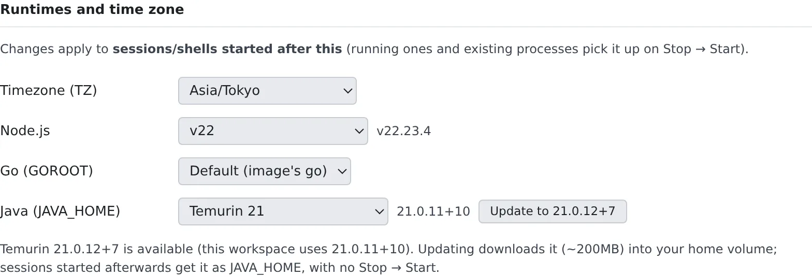

# Choose your toolchains

English | [日本語](toolchains.ja.md)

Choose the Node.js, Java and Go versions your workspace uses, and its time zone. A version that is not installed yet
can be installed on the spot.

## How it works

| What you do | What happens |
|---|---|
| Pick a version or a time zone | Sessions and shells started after this use it |
| Press **Install** or **Update to …** | It is downloaded into the home volume, and sessions started after that use it |
| Uninstall a version you no longer use | Space on the home volume is freed |
| Turn **Start at sign-in** off | Your stopped workspace no longer starts by itself when you open the Console |
| Turn **Automatic image refresh** on | After an update, the workspace restarts onto the new image once nobody is using it |

Agents, too, use the versions that were selected when their session started.

## Pick a version

Pick them under **⚙ Settings → Toolchains → Runtimes and time zone**. They can be changed only while the workspace is
running.

| Setting | What you can pick |
|---|---|
| Timezone (TZ) | The clock of shells and agents. The default is `Asia/Tokyo` |
| Node.js | A major version. **Default (image's node)** is the one in the image |
| Go (GOROOT) | One of the installed Go versions |
| Java (JAVA_HOME) | Eclipse Temurin and Amazon Corretto for each major ("Temurin 21", "Corretto 21") |

- A change applies to **sessions and shells started after it**. Ones already running pick it up when you stop and start the workspace
- The Node.js and Java rows show the exact version in use (`v22.23.4`, `21.0.11+10` and so on)
- Dates in the Console and the times in agents' notifications follow the time zone under **⚙ Settings → Display**, not this one

## Install a version you do not have

Node.js and Java also list versions that are not installed yet, as "Temurin 17 (not installed)" and so on.

1. Pick the version
2. Press the button that names the version it will install, such as **Install 17.0.21+9**
3. When it is done, start a new session

- Java is about 200 MB
- It goes into the home volume, so it survives a stop and start of the workspace
- No stop and start is needed: sessions started after it finishes use it (Java through `JAVA_HOME`)

When a newer patch of the version you use is out, a button such as **Update to 21.0.12+7** appears. It downloads into
the home volume the same way.

Old Node.js patches that Agent Fleet installed are removed the next time the workspace starts. Versions you installed
with nvm yourself, and versions pinned exactly by an nvm alias or `.nvmrc`, are kept.

## Remove versions you no longer use

**Installed versions** lists the JDKs and Node.js versions on disk, with their sizes. **Uninstall** removes one from the
home volume after a confirmation.

- For Node.js, every patch of that major is removed, including ones installed with nvm
- Sessions and shells started before the removal point at a path that no longer exists until they are restarted
- These cannot be removed: a version the workspace image has, the selected version (unless the image has the same one), a version being installed

## Check the tool versions

**Tool versions** lists the tools in the workspace and their versions.

| Column | Meaning |
|---|---|
| Effective | The one `PATH` actually finds. `~/.local/bin` wins over the image |
| Image | The version in the image |

Hover over a cell to see the path and the command's output.

- **install failed: …**: a tool that could not be installed when the workspace started. The next start tries again
- **upgrade skipped: home disk full, old version in use**: there was not enough space, so the start-time update was skipped. The installed version keeps working

## Keep the agent CLIs on the latest version

With **Update the agent CLIs and rtk to the latest on start** under **Agent CLI updates** turned on, the agent CLIs
are updated to their latest version every time the workspace starts.

- It covers claude, opencode, codex, GitHub Copilot, Antigravity (agy), Cursor and rtk
- It is off by default, which keeps the versions the image pins
- It can be changed while the workspace is stopped and applies from the next start. Turn it off and restart to go back to the image's versions
- A start nobody is watching, such as one for a scheduled run, does not update. Neither does a start with little free space on the home disk
- The setting appears only when an administrator allows it

Kiro and Muse Code are not covered: their versions come with the image (for Muse Code, see [Muse Code](../agents/muse.md#update)).

## Start your workspace when you sign in

Where your organization has switched on start at sign-in, a **Start at sign-in** row appears on this tab. With
**Start my workspace automatically when I sign in** on, opening the Console while your workspace is stopped starts it
for you.

- It is on by default. Turn it off to start the workspace yourself; it is off for you only
- It can be changed while the workspace is stopped
- The row does not appear when the tenant has the feature off, and then nothing starts at sign-in whatever you chose.
  Your choice is kept, and applies again if the tenant switches it back on
- On a deployment where automatic starts are turned off altogether, nothing starts either

When it starts:

- In a visible tab, when you are there. Arriving at the Console by signing in, typing its address or opening a
  bookmark counts by itself, so the workspace starts right away. After a reload, or in a tab that was already open,
  it starts once you press a key, click, touch or scroll; that input counts for one minute
- Once per 30 minutes across the tabs of one browser. A workspace that stopped while the tab was open is not started again

While it starts, Home shows **Starting your workspace… (you can keep using Home)**. When your organization's
workspace limit is reached, nothing starts and Home says so; start it yourself once another workspace stops.

How your administrator turns it on is in [Start the workspace at sign-in](../../admin/resources/start-at-signin.md).

## Restart onto a new image automatically

When Agent Fleet is updated, a running workspace keeps its old image and the workspace bar shows **Restart needed**
([Stop the workspace at the end of the day](../start/end-of-day.md#a-new-version-is-available-and-restart-needed)).
With **Restart automatically onto a new image when idle** under **Automatic image refresh** turned on, the workspace
does that restart by itself once nobody is using it.

| | What happens |
|---|---|
| Off (the default) | The workspace keeps its image until you restart it |
| On | When the image is outdated and the workspace has been quiet for a while, it is stopped and started again |

- Quiet means all of these at once:
  - No session is running a turn or background work, and none is pinned with **Keep awake** ([Stop when done, or keep a session awake](../sessions/auto-stop.md)). No repository import or
    image job is running
  - Nobody is using it: no typing in a terminal and no use of the browser pane recently (30 minutes unless the
    deployment changed it)
  - No request (the Console, a preview) has reached the workspace for the quiet time
- A session waiting on your answer does not hold it off, and neither does a terminal left open without typing
- The quiet time is set per tenant. Empty takes the deployment default, which is 15 minutes unless the deployment
  changed it; `0` turns the refresh off
- When idle auto-stop is due first, the workspace is stopped instead. The next start takes the new image anyway
- It is a restart, never a recreate: your files and repositories stay. Sessions can be resumed afterwards
- You get one notification, "**Your workspace was updated automatically**"
- Each new image is tried automatically only once. If the start fails, the workspace stays stopped and you get
  "**Automatic update failed; your workspace is stopped**". Start it yourself; it comes up on the new image
- It can be changed while the workspace is stopped, and is available to every member

The tenant side is in [Stop workspaces left idle](../../admin/resources/idle-stop.md#restart-onto-a-new-image-automatically).

## Update Agent Fleet

On a deployment where Agent Fleet is installed on one machine, **Agent Fleet updates** appears at the top of this tab.
When a new version is ready, **Restart to apply** becomes available. It restarts the Control Plane and the workspaces,
so running sessions are interrupted.

## When it goes wrong

### "The workspace is stopped. Start it to make changes."

Versions are switched inside the workspace. Start it from the workspace bar.

### The version you picked is not the one in use

Sessions and shells that were already running keep the old version. Start a new session, or stop and start the workspace.

### You are told an agent CLI could not be installed

See [Fix a workspace that will not start or has stopped](../troubleshooting/workspace.md#this-agents-cli-could-not-be-installed).

### An agent CLI has been the same version for weeks

A workspace's CLI is usually the version the image fixes, or, when [the update at start](#keep-the-agent-clis-on-the-latest-version) is on, the latest version at that start.
Check these first.

- Whether **Update the agent CLIs and rtk to the latest on start** under **Agent CLI updates** is on. Even when it is, a start nobody is watching, or a home disk low on space, skips the update
- Whether "**Tool versions**" shows **install failed: …** or **upgrade skipped: …** ([Check the tool versions](#check-the-tool-versions))
- Whether you are in a session that was already running before the update ([The version you picked is not the one in use](#the-version-you-picked-is-not-the-one-in-use))

The line under the "**Tool versions**" table, "**Upstream release watch: last clean run …**", tells you whether the watch for new releases of each CLI (every 2 hours) is working.
The watch finding a new version and that version reaching the image are separate steps.

| What the line shows | What it means |
|---|---|
| A recent clean run and no warning | The watch is working. If the checks above do not explain why the version stands still, ask your deployment administrator |
| "The watcher cannot read …" or "The watcher has not had a clean run for over 48 hours" | The watch is not working properly, and a new version may have been missed. Ask your deployment administrator to check the watch |
| No line at all | The watch's state is unknown (for example, this deployment cannot reach GitHub). That is not itself a fault |

## Related

- [See your machine and its usage](machine.md): the architecture decides which tools are installed
- [Run database-backed tests](databases.md)
- [Recreate the workspace](recreate.md)
- [What's in the workspace](../../ref/workspace-image.md): the tools in the image, their versions and licences
